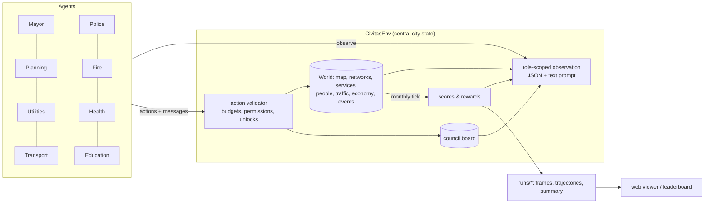

# Civitas Bench

A SimCity-style city simulation built for **multi-agent AI benchmarking**.
Each city department is played by a separate agent (an Arcee LLM, a scripted
baseline, a remote program, or an RL policy). All of them read from one central
city state, act only through validated actions, talk on a shared council board,
and are scored on the city as a whole *and* on their own department.

The map starts as a flat plain with a river flowing north to south. The highway
on the west edge connects the city to the rest of the region.

```
roles:    Mayor · Planning & Housing · Utilities (power, water, sewage) · Transport
          Police · Fire & Emergency · Health & Sanitation · Education
episode:  120 months (10 years), each agent acts once a month
cost:     scripted run ≈ 4–5 s · every role on an LLM ≈ 960 model calls
modes:    one city, or a region of 2-6 linked cities that trade and specialise
```

---

## 1. Setup (macOS)

You need Python 3.10 or newer. The Python that ships with macOS is usually 3.9, so
the simplest path is [uv](https://docs.astral.sh/uv/):

```bash
cd ~/Desktop/civitas-bench
uv venv --python 3.12
source .venv/bin/activate
uv pip install -e ".[dev]"
pytest -q                       # ~150 tests, ~25 s (pytest -q -m "not slow" skips the 5-episode benchmark test)
```

(With plain pip: `python3.12 -m venv .venv && source .venv/bin/activate && pip install -e ".[dev]"`.)

## 2. Open the control center

```bash
civitas serve            # then open http://127.0.0.1:8765
```

Everything happens in the browser from here. You can:

- **Watch** the city in the OpenTTD-style pixel view (the default) or in 3D (toggle with `X`
  or the `PX`/`3D` button). The pixel view is a 2:1 isometric pixel-art map: drag to
  scroll, zoom in steps with the wheel, rotate in quarter turns with `Q`/`E`. Buildings go
  up behind scaffolding, cars, buses, trains, boats and planes move around, cars queue at
  traffic lights on junctions, planes land, taxi to the terminal and take off (in region runs
  they fly to the other cities' airports), container ships berth under the harbour crane, and night lights the windows. Around the city a distant view
  fades into haze: fields, the river and highways running on, villages where roads leave the
  map and, in region runs, the neighbouring cities with the rivers flowing between them and
  their highway and rail links routed from connector to connector (`T` zooms out over all of it). Both views
  show the river (a little murkier where it is polluted), bridges,
  houses, row houses and villas that become apartments and towers, offices, shop-houses,
  factories, farms, sawmills, mines and oil fields, power plants (nuclear too), pumps, sewage works,
  police and fire stations, clinics, 2×2 hospitals and universities, schools, landfills,
  crematoria, higher-tier buildings drawn bigger or with annexes,
  bus and metro lines, casinos, airports, levees, landmarks, floods, historic plaques,
  snow in winter and orange trees in autumn. Smoke drifts with the wind.
- **Replay or follow live.** Use the timeline to play, step or scrub. Marks on the
  timeline show council messages (purple), failed actions (amber), money trouble (red),
  disasters and offers (blue) and milestones (gold). A run in progress is followed
  automatically.
- **See why things happen.** The Agents tab shows each month's decisions with ✓/✗
  results. Click an action to fly the camera to where it happened. For LLM agents you
  can expand the model's full reasoning, its raw reply and the exact prompt it saw. A fleet
  turn also has a **Tool calls** panel: every call in order with its arguments, outcome (ok,
  failed, refused or repeat), cost and result, one line each (click one to expand it), under
  a header counting calls, actions, failures and how the turn ended. The
  Events tab starts with what residents complain about this month.
- **Inspect** any tile by clicking it: stats, services, wealth or industry type, its
  building level over time, and which agent zoned or built it.
- **Switch map layers** (press `V`, or `1`–`9`): pollution, land value, happiness, noise,
  power, water, sewage, river pollution, traffic, bus coverage, police/fire/clinic/school
  cover, crime, fire risk, health, garbage, soil pollution, historic buildings, business
  profit, affordability, natural resources, flood risk and districts.
- **Launch runs** with **＋ New run**: pick a config, seed, length and each role's agent
  (scripted, LLM with any model, fleet, noop or random); each role starts at the config's own
  agent and only the roles you change are overridden. Stop runs from the Runs tab, which also
  holds the leaderboard.
- **Browse the Charts tab**: population, scores, money, happiness and approval, demand,
  jobs, pollution, commute and traffic, trade, service coverage, crime and health,
  education.
- **Region runs** get a city switch in the top bar and a **Region** tab: a map of the
  cities with their links and the goods, commuters and tourists flowing between them,
  plus each city's score and specialisations.

Press `?` in the app for all keyboard shortcuts. `civitas run ... --serve` also opens the
interface while a run from the terminal is playing. The old 2D viewer is still available
at `/classic.html`.

## 3. Plug in Arcee models (trinity-large-thinking)

Put your key in a `.env` file in the project folder. It's gitignored and `civitas` loads
it automatically. `export ARCEE_API_KEY=...` works too.

```bash
echo 'ARCEE_API_KEY=rcai-...' > .env
civitas check-llm                            # one test call to trinity-large-thinking
civitas run -c configs/smoke.toml --serve    # 2 years, 3 LLM roles acting every 3 months (~24 calls)
civitas run -c configs/arcee.toml --serve    # 10 years, mayor/planning/utilities on the LLM, the rest scripted
civitas run -c configs/arcee_full.toml       # 10 years, all 8 roles on the LLM (~960 calls)
civitas run -c configs/fleet_smoke.toml      # 1 year, all 8 roles as a tool-calling fleet (see Agent fleets)
civitas run -c configs/fleet_region_smoke.toml   # 1 year, two cities: the fleet in north, scripted south
```

The Arcee API is OpenAI-compatible (`https://api.arcee.ai/api/v1`). Notes on the
thinking model:

- **Token budget.** The Arcee configs give each call `max_tokens = 12000` so there's room
  for the reasoning *and* the JSON answer. If a reply is cut off, the agent retries once,
  hands the model the end of its own reasoning and asks for the JSON only; as a last resort
  it recovers the action objects from the end of the reasoning. Prompts are about 3–4.5k
  tokens per role (a system prompt with the rules and action docs, then the observation).
- **Where the answer comes from.** The agent reads plain JSON from the reply rather than
  using tool calling. If the final answer has no JSON, the agent checks the reasoning text.
- **What gets logged.** The reasoning is saved in `trajectories.jsonl` along with the
  answer, which is useful for studying or training on how the model plans.
- **Speed.** Calls are slow, so a full game with several LLM roles can take hours. Start
  with `smoke.toml`, or set `game.act_every` to 2–3.
- **Stalls.** A call attempt is retried after `timeout` s (300) without data or `deadline` s (1,800) in all, both timed on the wall clock: after a laptop sleep the attempt ends on waking and its `[llm] ... retrying` log line says `system slept ~N s`.

Any role can be switched from the CLI, and any value overridden:

```bash
civitas run -c configs/arcee.toml --agent mayor=scripted --agent police=llm:arcee/trinity-mini --set game.act_every=3
```

Other OpenAI-compatible endpoints (OpenRouter, vLLM, Ollama and so on) work the same way.
Add a `[providers.name]` block with `base_url` and `api_key_env`, then use `llm:name/model`.

## 4. Benchmark

```bash
# the same line-up across 5 seeds (maps and disaster schedules differ by seed)
civitas bench -c configs/arcee.toml --seeds 0-4 --workers 3

# role-isolated eval: only Planning is an LLM, the other roles are fixed baselines,
# so any score difference comes from the Planning agent
civitas bench -c configs/eval_planning.toml --seeds 0-4
civitas bench -c configs/eval_planning.toml --seeds 0-4 --agent planning=llm:arcee/trinity-mini   # compare models

# the fleet reference: the scripted baselines played through the fleet tools on the fleet's settings (free)
civitas bench -c configs/fleet_scripted.toml --seeds 0-4 --workers 5

civitas leaderboard            # every finished run, grouped by agent line-up
```

Baseline reference (all scripted, seeds 0–4): **city 77.5 ± 1.5**, mayor 88.1, planning
68.4, utilities 89.4, transport 75.9, police 74.9, fire 85.7, health 86.6, education 83.2,
population ≈ 14.5k, no bankruptcies, ~4–5 s per game (seeds 5–9: city 75.9 ± 0.8). `noop` and
`random` line-ups score 0. Building tiers changed these numbers. Just before tiers were
added, the same baseline scored city 78.1 ± 1.8 with population ≈ 14.7k.
Acting every 3 months, as the fleet configs do, the same agents reach city 68.8 ± 2.0 and
population ≈ 7.3k; `configs/fleet_scripted.toml` plays them through the fleet tools and
scores exactly that (see [Agent fleets](#agent-fleets), "Scripted fleet").
The scripted agents leave obvious room: they never use districts, mixed use, historic
listings or soil clean-up, rarely use policies or funding levels, build services by simple
coverage rules and hoard money late in the game. In a region the scripted mayors make the
neighbour deals their observation names (see [Region mode](#region-mode-cities-that-trade-and-specialise)).

Useful switches in `[game]` (or `--set game.X=...`):

| setting | effect |
|---|---|
| `events = "auto"` / `"none"` | seeded floods, heatwave, recession and a factory offer (same on every line-up for a seed) |
| `milestones = true` | buildings unlock at 1k / 5k / 10k residents |
| `simultaneous = true` | every role sees the same start-of-month state (harder: no reacting to earlier roles) |
| `roles = [...]` | which roles play, in turn order |
| `seasons = true` | winter heating and snow, summer cooling and fires, seasonal tourism |
| `region = true`, `cities = [...]` | 2–6 cities, each with its own team (see below) |
| `team_weight` | reward = w·Δcity + (1−w)·Δrole − penalty·invalid actions |
| `balance` | override any constant, e.g. `"CATALOG.coal.cost" = 3000`, `"SERVICES.clinic.radius" = 9` or `"TIERS.pump.2.water" = 800` |

---

## How it works



**The central state.** `CivitasEnv` is the hub. It owns the `World` (the single source
of truth), the council board, each role's memory (the results of its last turn and its
notes to self) and the scores. Agents never touch the world directly. Each month every
role observes and acts in turn order (later roles see what earlier roles just did), then
`end_month()` simulates the month and recomputes the scores. Each role's reward is the
change in score.

Every observation is available as structured JSON (for RL policies and remote agents)
and as a rendered text prompt (for LLMs). Everyone sees the same city summary, the top
complaints, the finances, events, forecasts and council messages; each role also gets a
detailed section on its own system (its buildings with load vs capacity, problem hotspots
with coordinates, suggested sites) and, except the mayor, the ASCII map. Other systems
only appear as summaries, so agents have to talk to each other.

**Five ways to connect an agent.** All use the same actions:

| kind | what it is |
|---|---|
| `llm` | Any OpenAI-compatible model (Arcee by default). It gets a system prompt with the rules and action docs, plus the observation text, and replies with JSON. |
| `fleet` | A tool-calling model: a short briefing, then look-up and action tools in a loop, with a city plan and memory between turns. See [Agent fleets](#agent-fleets). |
| `scripted` | Rule-based baselines. They read only the observation, so they are fair references and a source of demonstration data. |
| `remote` | Any external process, in any language, over HTTP: `GET /api/live/turn?role=planning`, then `POST /api/live/act`. See `examples/remote_agent.py` and `configs/remote.toml`. |
| RL | `env.reset()` / `env.step({role: Decision})` (PettingZoo-style), with `env.tensor_observation()` returning a 14×H×W grid and a feature vector. See `examples/rl_loop.py`. |

### The simulation

- **Zones and levels.** Residential (R), commercial (C), industrial (I) and office (O)
  zones develop by themselves when there is demand. Each level needs more of the city:
  L1 road access + power, L2 water, L3 sewage + garbage pickup + land value 40%, L4 a
  school in reach (homes) or skilled workers (jobs) + land value 58%, L5 land value 75% +
  low crime + a park nearby. Low-density zones stop at L2; high density goes to L5 (up to
  240 residents or 140 office jobs per tile). Industry stops at L3 unless it is high-tech.
- **People.** Residents are tracked as an age × education vector (children, teens, adults,
  seniors × none, elementary, high school, university). Migrants fill new housing, people
  age and die, and students only graduate when they have a school seat. Jobs need education:
  offices and high-tech want graduates, over-educated workers take lower jobs.
- **Wealth and households.** Homes are low, middle or high income depending on land value
  when they are built. Wages minus rent is what households spend in shops; rich households
  pay more tax, care more about pollution, crime and noise, and leave first when unhappy.
- **Industry types.** Industry zoned on natural resources becomes farms (fertile soil),
  sawmills (forest), mines (ore) or oil fields; resources run out. Educated cities attract
  high-tech industry.
- **Demand** depends on jobs vs. workers, taxes, happiness, commute times, household
  spending and export demand. Big cities need a train station or harbour, and enough parks,
  or residential and commercial demand is capped.
- **Utilities.** Every connected road network is its own grid for power, water and sewage.
  Facilities serve the network they touch, nearest buildings first. Pumps and sewage
  facilities sit on the riverbank, and clustered pumps, outlets, towers and turbines lose
  output (see [Building tiers](#building-tiers)). Plants lose output after five years unless overhauled;
  wind output follows a wind map. Shortfalls are covered by costly imports from the region
  (the mayor can stop them) and surplus power is sold.
- **The river** flows north to south. Sewage outlets and riverside industry pollute it
  downstream: pumps below an outlet deliver dirty water. Treatment plants remove 80% (advanced
  treatment 95%).
- **City services** (police, fire, clinics and hospitals, schools, garbage trucks,
  shelters) cover buildings they can reach along the road network within their radius, up
  to their capacity, scaled by the department's funding level. Crime grows with
  unemployment, density, low education and low land value; uncovered fires spread;
  uncollected garbage piles up; pollution, dirty water and garbage make people sick (sick
  workers stay home); deaths need cemetery space or a crematorium; landfills fill up
  (recycling centres don't).
- **Traffic.** Workers commute from home to the busiest job areas along shortest road
  paths (a gravity model); trucks carry goods to the highway, train stations and the
  harbour. Load over capacity means congestion: longer commutes, noise, exhaust, and slower
  police, fire and ambulances. Avenues and highways carry more; bus lines take trips off
  the road.
- **Trade and businesses.** Industry makes goods and raw materials; shops need goods.
  Surpluses are exported and shortfalls imported, limited by freight capacity. Every shop,
  factory and office has a profit margin (customers, taxes, shortages, traffic, crime);
  six months of losses and it closes.
- **Happiness** is a weighted sum of 14 needs (power, water, sewage, garbage, safety,
  health, education, commute, leisure, noise, pollution, tax, affordability, jobs). The
  needs that cost the most happiness become the **complaints feed**. **Approval** follows
  happiness and taxes; 12 months below 30% and the mayor loses the recall election.
- **Mixed use** (M zones) puts shops below flats; **historic listings** freeze a
  building's level and add land value and tourists; **soil pollution** builds up under dirty
  industry, landfills and coal plants, fades very slowly, and hurts health, land value and
  farms (the health department can clean it); **wind** changes every month around a
  westerly and pushes air pollution downwind; **seasons** raise power demand in winter
  (and slow the roads with snow), water and fire risk in summer, and move tourism.
- **Metro**: stations serve 5 tiles around them; lines between stations carry trips
  three times faster than driving, immune to jams. Hospitals, universities, stadiums
  and casinos cover 2×2 tiles, airports 3×3 (x, y is the top-left tile).
- **Casinos and airports**: a casino gives low-skill jobs and gamblers who pay a gambling
  tax, but raises crime around it; an airport adds freight, tourists and air links.
- **Events** come from the seed: a river flood (forecast 3 months ahead; levees protect,
  shelters save lives), a heatwave, a recession and a factory offer the mayor must accept
  or decline (jobs and a bonus vs. heavy pollution).
- **Milestones** at 1k / 5k / 10k / 20k residents pay a reward and unlock buildings (high
  density, offices, avenues, high schools... then hospitals, universities, train stations,
  hydro dams, stadiums, the harbour... then monuments). Landmarks raise land value and
  bring tourists.
- **Money.** Taxes (per sector, with district modifiers), fares, trade fees, tourism and
  power sales come in; upkeep of roads, plants and service buildings (times funding
  levels), policies, imports and loan interest go out. Departments can only spend what the
  mayor gives them. Twelve months in a row with a negative treasury means bankruptcy.

All balance numbers live in `civitas/sim/catalog.py`. You can override them per config
with `[game.balance]`.

### Building tiers

Most service and utility buildings belong to a ladder, like the ones in Cities: Skylines
(`catalog.TIER_LINES`). Higher tiers unlock at the Town (1k), City (5k) and Metropolis (10k)
milestones. They are bigger buildings with much more output per dollar of upkeep, so a
growing city replaces a cluster of small buildings with a few large ones. Each cell below
shows the milestone, the main output, the build cost and the upkeep per month.

| line | tier 1 | tier 2 | tier 3 |
|---|---|---|---|
| pump (riverbank) | water pump: 250 water, $1,500, $25 | pumping station (1k): 650, $4,000, $45 | water works (10k, 2×2): 2,000, $12,000, $100, filters dirty river water |
| tower | water tower: 120 water, $2,200, $30 | inland water plant (5k): 600, $7,000, $70 | |
| outlet (riverbank) | outlet: 250 sewage, raw, $1,200, $15 | treatment plant (1k): 700, removes 80%, $5,000, $50 | advanced treatment (10k, 2×2): 2,000, removes 95%, $14,000, $110 |
| coal | coal plant: 250 power, pollution 25, $4,000, $80 | advanced coal (5k): 500, pollution 12, $9,000, $120 | |
| gas | gas plant: 200 power, pollution 10, $6,500, $60 | combined cycle (5k): 450, pollution 6, $12,000, $90 | |
| wind | wind turbine: 40 power, $2,500, $12 | advanced turbine (1k): 100, $5,000, $20 | |
| solar | solar farm: 70 power, $5,000, $15 | solar plant (10k, 2×2): 400, $16,000, $50 | |
| landfill | landfill: collects 450/mo, fills at 30,000, $2,000, $30 | recycling centre (1k): 900, never fills, $6,000, $50 | waste complex (10k, 2×2): 3,000, never fills, +60 power, $20,000, $150 |
| cemetery | cemetery: 30/mo, 2,500 plots, $1,500, $12 | crematorium (1k): 120/mo, no plots, $5,000, $35 | |
| clinic | clinic: capacity 2,500, radius 10, $2,000, $40 | hospital (5k, 2×2): 9,000, r14, $8,000, $120 | medical centre (10k, 2×2): 22,000, r20, $20,000, $220 |
| police station | station: 4,000, r14, 25 cells, $2,500, $55 | police HQ (5k): 14,000, r22, 100 cells, $9,000, $130 | |
| jail (1k) | jail: 250 inmates, $4,000, $45 | prison (10k, 2×2): 1,200, $14,000, $120 | |
| fire station | station: capacity 260, 5 call-outs, r14, $2,500, $55 | fire HQ (5k): 900, 15 call-outs, r20, $9,000, $130 | |
| elementary | school: 450 seats, $2,500, $45 | large elementary (1k): 1,200, $6,000, $80 | |
| high school (1k) | school: 700 seats, r22, $5,000, $75 | large high school (5k): 2,000, r26, $11,000, $130 | |

The **nuclear plant** (10k, map character `u`) is a new single-tier building. It is a 2×2
plant on the riverbank that makes 2,000 clean power for $40,000 and $400/mo, and it draws
100 water for cooling from its road network. The crematorium has its own character, `z`.
Every other tier keeps its line's character, and frames carry the tier in the per-tile
`levels` string. Hydro dams, incinerators, universities, libraries and shelters have a
single tier.

- **Build a tier directly.** Every facility build action (power, water, sewage and service
  buildings) takes `"tier": n` (counted within the line, 1 = base), or a tier name as `kind`:
  `{"type":"build_water","kind":"pumping_station","x":29,"y":24}`,
  `{"type":"build_police_station","kind":"police_hq","x":14,"y":25}`,
  `{"type":"build_cemetery","tier":2,...}`. Nuclear is `build_power_plant` with
  `kind: "nuclear"`. `kind: "treatment"` and `build_hospital` still work; they build tier 2
  of their lines.
- **Upgrade in place.** `{"type":"upgrade_facility","x":..,"y":..,"module":"tier"}` moves a
  building up one tier. It costs the price difference × 1.2 and keeps the building's age
  and modules. A 2×2 tier grows into free tiles around the building (the top-left tile may
  move), and the action fails with a clear message if none are free. Outlets become
  treatment plants and clinics become hospitals. An expansion adds 50% of the current
  tier's output.
- **Crowding.** Production buildings of the same group lose 15% output for each neighbour
  within the group's radius, down to a floor of 40%. A neighbour of any tier counts. The
  groups are pumps (4 tiles), outlets (4), water towers (5) and wind turbines (2, on top of
  the wind map). Coal, gas, solar and nuclear plants don't crowd. One water works beats
  eight pumps on one stretch of river.
- **Downtown.** Level 4–5 buildings get only 60% of the police, fire and health cover that
  tier-1 buildings give. A tier-2+ building in range gives them full cover.
- **What agents see.** The utilities section shows the crowding for each group, the
  observation offers the best upgrades with their real gains, service sections report
  downtown tiles without tier-2 cover, and suggested sites include riverbank spots with
  room for a 2×2 building. The windy, pump and sewage site lists put uncrowded spots first and mark
  crowded ones (`near 1 turbine`). `World._metrics()` records `tiers` (count per line and tier)
  and `downtown_uncovered`.
- **Overrides.** Use `"TIERS.<line>.<tier>.<field>"`, e.g.
  `"TIERS.pump.2.water" = 800` in `[game.balance]`, a nested `[game.balance.TIERS.pump.2]`
  table, or `--set game.balance.TIERS.pump.2.water=800`. Tier 1 is the same dict as the
  `CATALOG` / `SERVICES` entry, so `"CATALOG.pump.water"` still works. Tiers 2+ are
  copies, so a tier-1 override doesn't reach them. The crowding and downtown rules use
  `CROWD_STEP`, `CROWD_FLOOR`, `T1_DOWNTOWN` and `DOWNTOWN_LEVEL`.

### Roles and actions

| role | actions |
|---|---|
| mayor | `set_tax` (R/C/I %), `allocate_budget`, `set_funding` (department 50–150%), `enact_policy` / `repeal_policy` (city-wide or per district), `set_district_tax`, `accept_offer` / `decline_offer`, `set_service_imports`, `take_loan`, `repay_loan` |
| planning | `build_road`, `zone` (R/C/I/O/M, low or high density), `dezone`, `build_park`, `build_landmark` (plaza/stadium/monument), `build_casino`, `paint_district`, `specialize_district`, `preserve_historic` / `delist_historic`, `bulldoze`, `demolish` |
| utilities | `build_power_plant` (coal / gas / solar / wind / hydro / nuclear), `build_water` (pump / tower), `build_sewage` (outlet / treatment), `upgrade_facility` (tier / filter / expansion / overhaul), `demolish` |
| transport | `upgrade_road` (avenue / highway), `create_bus_line`, `remove_bus_line`, `set_fare`, `build_metro_station`, `create_metro_line`, `remove_metro_line`, `build_train_station`, `build_harbour`, `build_airport`, `build_connector` (region mode), `upgrade_facility`, `demolish` |
| police | `build_police_station`, `build_jail`, `upgrade_facility`, `demolish` |
| fire | `build_fire_station`, `build_levee`, `build_shelter`, `upgrade_facility`, `demolish` |
| health | `build_clinic`, `build_hospital`, `build_landfill`, `build_incinerator`, `build_cemetery` (tier 2: crematorium), `clean_soil`, `upgrade_facility`, `demolish` |
| education | `build_school` (elementary / high / university), `build_library`, `upgrade_facility`, `demolish` |

Policies: recycling, neighborhood watch, smoke detectors, education boost, industry
filters, high-rise ban, free transit. Every role can post `messages` to the council board
(to `all` or a role) and keep `notes` for its next turn. Invalid actions are rejected with
a helpful message and counted in the invalid-action rate. Every facility build action (power,
water, sewage and service buildings) also takes a `tier` (see [Building tiers](#building-tiers)).

### Scores (0–100)

| score | built from |
|---|---|
| **city** | ½ population (√ of pop / 30k) + ½ quality: happiness, finances, power/water/sewage coverage, environment, employment, safety, health, education. Quality counts only once the city has people; bankruptcy halves the total, a lost recall election cuts it by a quarter. |
| **mayor** | revenue, solvency, net worth, happiness, approval, and how much of the money given to departments actually got spent |
| **planning** | growth, share of zoned land that developed, demand balance, land value, road efficiency, employment |
| **utilities** | power, water and sewage coverage, spare capacity in the 10–60% range, cost efficiency, clean-energy share (solar, wind, nuclear), pollution near homes, water quality, river quality |
| **transport** | commute time, share of congested road, bus share of trips, cost per resident |
| **police** | crime at homes, coverage, jail space, cost per resident |
| **fire** | buildings lost to fire, coverage, cost per resident |
| **health** | health of residents, garbage at homes, clinic coverage, landfill room, deathcare, cost |
| **education** | enrolment, skilled jobs filled, share of adults with high school+, cost |

Every score is a function of the monthly history, so the same code produces the final
benchmark number, the live "your score" shown to agents, and dense RL rewards.

### Region mode: cities that trade and specialise

`configs/region.toml` (two cities) and `configs/region_trio.toml` (three) run a region:
`[game] region = true` and `cities = [...]` from north, south, east, west, southeast,
southwest. Every city has its own full team; roles are named `north.planning`,
`south.mayor` and so on. Agents configured for a base role (`[agents.planning]`) play it
in every city, `[agents."south.planning"]` sets one city.

- **The river** runs through the north-south column: upstream sewage and runoff arrive
  in the next city's water.
- **Links.** Transport departments build `build_connector` (highway or rail) on the map
  edge facing a neighbouring city, with a feeder road inland; the link opens when both
  cities have built their side. Any two cities with a harbour are linked by boat, any two
  with an airport by air. Each link type has a goods and a people capacity.
- **Commerce.** Every month, over those links, surplus goods and raw materials go to
  cities that are short (the seller collects part of the value; the buyer avoids costly
  imports and shortages), unemployed workers commute to open jobs, and residents visit
  their partners' casinos, landmarks and historic districts.
- **Specialisation** follows from each city's land and people and is reported to every
  agent: mining & farming (natural resources, pollutes the soil), high tech (needs
  graduates and raw materials), gambling (casinos: little education needed, crime, tourist
  money), tourism, trade (freight), education. Complementary cities gain the most from links.
- **Diplomacy.** All teams share one council board (address `"south"`, `"north.mayor"` or
  `"all"`) and mayors can agree power/water deals (`offer_deal`, `accept_deal`, `cancel_deal`).
- **Power and water deals.** A deal moves a fixed amount of capacity from the seller's
  supply to the buyer's every month, for a price per unit, until its term ends or either
  mayor cancels it; no link is needed. A city short of power or water imports at most 25%
  of its demand at $1.50 / $0.80 a unit a month (+1% per 1,000 residents), and while it
  imports no empty lot connects, so it stops growing. Spare power earns $0.25 a unit
  (sold to the outside region) and spare water nothing. A deal priced between the two
  pays both sides. Once the buyer has room again it only moves money from one city to the
  other. Each mayor's observation (`RegionEnv.deal_opportunities`) names a deal
  opportunity when one city is at 90% or more of its own supply (imports left out) while
  another has spare beyond 90%. It gives the amount that brings the buyer back to 90%
  (at most the seller's spare, `offer_deal`'s 2,000 units and what the buyer can afford),
  a price halfway between the seller's floor and the buyer's
  import price, a term of two mayor turns and the exact `offer_deal` call. Need and spare
  count the deals the supply doesn't show yet (accepted this month, the city's own open
  offers, offers to it worth taking), so two sellers aren't both sent to cover one need.
  An offer to the city says whether it is worth taking (`RegionEnv.deal_check`): cheaper
  than its imports, not already covered by its other deals, the seller still has some
  capacity to sell, and affordable (the deal's cost beyond the imports it replaces, over its term,
  within the treasury above the fleet's reserve plus last month's surplus). An active deal
  says when it ends and whether to cancel it. An offer not accepted within two mayor turns
  (`2 x act_every` months) expires (status `expired`), and `accept_deal` refuses an offer
  whose seller has no capacity left (its own supply no longer above its demand) or whose
  need the buyer's deals accepted this month already cover. The scripted mayors follow these lines: they accept fair offers
  (the second of two for one need only if need is left), cancel the others and offer each
  opportunity.

Each city is scored on its own; the region score is their average.

| scripted, 120 months | city | population | deals run / offered |
|---|---:|---:|---:|
| `region.toml` seeds 0–2, before deals | 75.96 ± 1.56 | 27,175 | 0 / 0 |
| `region.toml` seeds 0–2, with deals | 77.19 ± 1.28 | 29,159 | 20 / 24 |
| `region.toml` seeds 0–7, before deals | 76.26 ± 1.15 | 27,507 | 0 / 0 |
| `region.toml` seeds 0–7, with deals | 76.76 ± 1.05 | 28,434 | 18 / 22 |
| `region_trio.toml` seeds 0–2, before deals | 76.13 ± 0.78 | 40,755 | 0 / 0 |
| `region_trio.toml` seeds 0–2, with deals | 77.10 ± 1.00 | 42,004 | 51 / 67 |
| `region.toml` seeds 0–2, deal checks | 77.35 ± 1.14 | 29,429 | 21 / 24 |
| `region.toml` seeds 0–7, deal checks | 76.84 ± 1.10 | 28,660 | 18 / 22 |
| `region_trio.toml` seeds 0–2, deal checks | 76.40 ± 0.15 | 41,525 | 41 / 48 |
| `region_trio.toml` seeds 0–7, with deals / deal checks | 77.02 ± 0.71 / 76.71 ± 0.64 | 42,346 / 42,383 | – / 36 / 42 |

The deals are small money: $650–2,200 paid per two-city game, with most deals running
1–2 months before the buyer's own plant gives it room. The gain is within seed noise
(7 of 8 seeds up, seed 7 down 2.3). The deal checks (pending deals counted, offers
expiring, affordability, a seller with nothing left refused) leave the two-city numbers up
slightly; three cities make fewer deals (counting pending offers stops two sellers both
covering one need, which had given buyers extra capacity), the same population on seeds
0–7 and a score 0.3 lower, within noise. Refusing a seller with less capacity than the
amount (not only none) cost 0.8 on `region.toml` seeds 0–2, so a partly short seller still
sells and ends the deal itself once its demand reaches its own supply. Single-city play is unchanged. Fleet agents play region
roles too (see [Agent fleets](#agent-fleets), "Regions").

### Agent fleets

`kind = "fleet"` plays a role with a tool-calling agent (`civitas/fleet/`) instead of the
one-shot JSON `llm` agent. A fleet is built to measure how well a team of agents manages
tasks and money, and to let people coach it.

- **One manager, seven departments.** The mayor manages. It writes the city plan (goals, a
  budget target and a one-line priority per department, notes) and moves the money. The
  seven departments carry the plan out, and each one sees only its own slice. Turn order
  doesn't change, so the mayor acts first each month.
- **A turn is a tool loop.** The agent starts from a short briefing and then calls tools.
  The mayor's briefing covers the city, the finances (below) and the departments, most
  urgent first. Each department's line gives its funds, its target (`funds $0 < target
  $2,500` when it still needs funding; `target $7,000 (unusable now)` when it has nothing to
  buy, so a top-up would sit idle: no `<` and not in `update_plan`'s `below_target`, which
  lists it, with any priority given it in that call, under `nothing_to_fund`; not planning,
  nor a department blocked for lack of land) and what it spent over the last 3 months. Then comes
  one note on its money: what its needs line buys (below), what is blocked, its idle money,
  or what its money does without a needs line: `funds cover its builds` (every priced
  purpose), `funds cover its next build`, `supply has room` (utilities sites are ready but
  no supply is short, nor will be 90% used within 3 months at its growth over the last 3),
  `only a library ready ($1,500)` (only supplementary sites), or
  `nothing ready to buy`. Last is its latest report, cut at 170 characters. Two lines close
  the block: the money there is to spend and what to fund with it.
  - **Finances.** The treasury's change since the trend month is split into what the city
    earned and what the mayor moved: `- treasury $7,922 (-$12.3k since month 3: operations
    +$977, top-ups -$13.3k), debt $0`. Loans and `other` (a milestone reward, an offer's
    bonus) show only when nonzero. Last month's costs follow: `- last month: income $597,
    expenses $469: buildings $312 (utilities $82, roads $75, 3 more $155), city services
    $157, interest $0`. City services are the rest of the expenses (town hall, policies),
    and imports (services bought from outside, a region's trade deficit and deal payments)
    show as `imports $173` before the interest when there are any, so the parts add up.
    With debt, a third line gives the interest in dollars and what can still be borrowed
    (`repay_loan`'s description and the playbook say what a repayment saves). In smoke
    v13–v19 the change mixed in the mayor's own transfers, so 30 of 81 turns showed a
    "loss" while operations ran a surplus. Interest never showed in dollars either, and
    there were 0 `repay_loan` calls in 96 turns.
  - **Needs line.** It names the department's next build, and says whether it is the
    first. That is the cheapest ready first building the city lacks (not a supplementary
    or per-tile site; a first jail only once inmates pass 80% of the cells), else the
    cheapest ready building. In the review of this change, a $30 avenue stretch hid
    transport's first $1,500 bus line on 9 mayor turns of seed 0 (months 42–69, no bus
    line, `funds cover its next build`), and another elementary school hid education's
    first high school and university:
    - `needs $2,500 for its first police station (5 sites, $55/month)` while the city has
      none;
    - `needs $2,500 for another police station (coverage 74%, $55/month)` once it has one.
      Clinics, landfills, schools and high schools show their coverage too, and bus lines
      the transit share.
    - The last figure is the building's monthly upkeep at the department's funding level
      (the tier's or off-tier spec's, read when shown, so balance overrides reach it; a bus
      line with the 2 stops it needs at least). Every building adds it for good. In the 120-month run, service upkeep was a median 34% of
      income, and at month 48 the city had 22 service buildings against the scripted
      fleet's 7.
    - A hospital counts as a clinic. For utilities, any building that makes the same
      supply counts, and a supply is short only while the city lacks it or uses at least
      90% of it. In smoke v14–v15 seed 1 the line named a water tower with water spare,
      and towers were built until water was 4.7–4.9× demand.
    - Utilities' line names one building per short supply, bought together, most urgent
      first (a lot develops at all only with power, to level 2 with water, to 3 with
      sewage): `needs $6,200 for its first coal plant and water tower ($110/month)`. For
      each supply it is the cheapest ready building whose output covers max(1.5 × demand,
      demand + 60 power or 50 water or sewage) less the city's own output (imports left
      out), else the one with the most output. The 60 and 50 are a young city's first
      quarter (smoke v9–v19: a median 62 power and 50 water from month 0 to 3), so a wind
      turbine's 40 (× its site's wind) falls short of a fresh map's 66 power and a coal
      plant's 250 doesn't. Only one-tile first buildings count while one is ready: a 2×2
      water works, advanced treatment or nuclear plant is named only when none is (past
      10,000 residents water wants 700 or more, which only the $12,000 water works
      covers, and a review state at month 90 named it over six ready $1,500 pumps). With
      one free riverbank lot the outlet, which can go nowhere else, gets it and water a
      tower. A short supply whose building has no site yet is named after the price:
      `needs $6,200 for its first coal plant and water tower ($110/month); sewage outlet
      waits for a road to the river`. One supply alone reads as before, with the share
      used: `another water tower (water 117% used, $30/month)`. In smoke v20 seed 1 the
      line named only the cheapest ($2,200 tower), the mayor gave exactly that, and power
      stayed at 0–18% until month 10.
    - On a tie each building at that price is named (`another clinic (coverage 21%,
      $40/month) or another landfill (coverage 83%, $30/month)`). A first one is named alone
      (`its first landfill (4 sites, $30/month)` once a clinic is built).
    - A per-tile site counts its best stretch whole, upkeep included: `needs $90 for 3
      avenue tiles (5 sites, $4/month)`.
    - Planning's is its best `road_extension` site (a dead end's extension or a branch
      road), priced as `build_road` charges it plus any bulldozing, plus zoning the land
      it opens at low density (`zone`'s $5 a tile): `needs $505 for a road into open land
      and zoning it (opens 71 tiles)`. A road is no building, so it is neither a first nor
      another, shows no upkeep, and never shows on the leave-free or blocked lines. In
      the live 120-month run on seed 0, at month 9, the mayor read planning as `idle
      $1,243`. It took that back and $1,000 more. Planning's $150 extension then failed
      twice on "the planning budget only has $0" while its line showed no need. In smoke
      v18 seed 0, at month 9, the line priced the road alone (`needs $50 for a road into
      open land (opens 15 tiles)`); the mayor moved exactly $50, which left nothing to zone
      the land the road opened.
  - **Most urgent first.** Each department's money has a kind, and the block lists the
    departments in this order, turn order within a kind:
    1. first/supply: a first building, utilities' supply (its needs line names a building
       only while the supply is short), or a levee;
    2. growth: planning's road and zoning;
    3. another: a second building;
    4. blocked, then nothing to fund, then idle money.

    The order is shown, not imposed. It replaces the old `- first buildings still unfunded`
    line and the plan's priorities, which `get_plan` still has. In smoke v16 seed 0 the
    treasury ran short. The mayor funded second police and fire stations and a second
    clinic first, and education never got its school (33.2; v17: 33.3 and 33.4). In smoke
    v16–v19 the mayor funded in block order in 32 of 54 turns. Education, last in turn
    order, was topped up last in 11 of them, and at v19 seed 0 month 9 planning's $315 road
    came tenth.
  - **Idle money.** A department keeps max(2 × its 3-month spending, its dearest ready
    first building, $1,000); for utilities only buildings the needs line could name
    count, those it names together with any short supply's building blocked for lack of
    land (a fresh map's coal plant, tower and outlet: $7,400), and for planning its road
    and zoning. What set it is named: `2 x its $658
    spending`, `for its first university`, `for another fire station`, or `the $1,000
    minimum`. Funds that are $1,000 or more above that,
    excluding this month's top-ups, show as `idle $3,400 (keeps $2,000)`. The to-spend
    line counts them as money to take back (a negative `allocate_budget`) before any loan
    or new top-up. A take-back that would leave a department below what it keeps is
    refused (see Guards).
  - **Blocked buildings.** A first building with no lot for lack of land or roads counts
    toward the keep, because the department still needs that money. That covers:
    - no free roadside land;
    - no free roadside lot near the homes that need it, or no free roadside land at all,
      for a need-ranked station, clinic or school when at least 15% of what it serves is
      under 30% coverage (a well-covered department with no land isn't blocked);
    - no roadside lot away from homes, for a landfill or jail;
    - no free 2x2 roadside block;
    - for a pump or sewage outlet, no road to the river or the bank taken, but only while
      the city lacks one or its demand is at least 90% of supply. The 90% test also
      applies to a water tower (on water) and a power plant or wind turbine (on power).

    When a department has no ready site, its line says `; blocked: a police station`, and
    one line under the block says `- blocked for lack of land: money buys nothing there
    until planning frees lots (ask planning)`.
    In smoke v13 seed 0, planning had zoned every roadside lot, and the mayor took the
    station, clinic and school money back from four departments as idle. A department
    whose funded first buildings all have no lot of their own (every site of theirs is
    claimed first by an earlier department, see planning's leave-free line) reads
    `; blocked: an elementary school` too; its ready site already keeps the money. In smoke
    v18 seed 1, education's only site was also police's, and education never built.
  - **Below target.** A department counts as below its plan target only if it isn't idle
    and would use a top-up: it spent more than half of the most it held over those 3
    months, or it never held its keep. In smoke v9–v12, planning spent about $1,000 a
    quarter and still read "funds $7,834 < target $9,000", so the mayor topped it up.
    The `<` marker still reads the plan target. The to-fund line doesn't.
  - **To spend and to fund.** Two lines close the block, and `update_plan`'s `next` is the
    same two lines:
    - `- to spend: $2,698 above the $3,711 reserve (3 x $1,237 expenses) + $1,508 idle to
      take back = $4,206; operations +$233/month; first/supply and growth may use $4,917
      (treasury + idle above $3,000)`. The reserve is $3,000 or 3 months of expenses (6
      after a deficit month), with its reason when above the minimum. The deficit test works
      on rounded dollars; v16 seed 1 doubled the reserve on a $0.70 deficit. There are no
      operations before the first month.
    - First buildings, supply and planning's road may take the treasury down to $3,000:
      they may use the treasury and idle money above $3,000, in a hold or not, and the line
      names that amount when it is more than the money to spend and the to-fund line lists
      one. Anything else only gets the money above the reserve. In review, a hold's
      allowance that stopped at the hold's edge cut what a first school could use from
      $1,605 to $1 when the treasury rose $2 past the reserve.
    - In a hold (nothing to spend once idle money counts) the line says how far under the
      reserve the treasury is and when operations close the gap (left out past the game's
      end). `- to spend: none (hold): the treasury is $1,723 under the $3,711 reserve (3 x
      $1,237 expenses); operations +$381/month close that in 5 months; first/supply and
      growth may use $900 (treasury + idle above $3,000)`, or `nothing above $3,000`. In the
      120-month run "hold" showed in 35 of 40 turns with no way out, and $108.7k was still
      allocated in them.
    - `- to fund: first/supply: health $2,000, education $2,500 ($4,500, upkeep
      +$85/month) | growth: planning $315 | another: police $2,500 (upkeep +$55/month):
      $4,917 covers health, education, planning; the other $2,500 would go under the
      reserve`. Each amount is what the department's needs line lacks, whatever its plan
      target. The kinds go in the block's order, and a kind with several departments gets
      their sum and upkeep. The cover clause is greedy: one that doesn't fit is skipped, and
      a cheaper one after it can still fit. First/supply and growth are covered from what
      they may use, another from what is left above the reserve; the rest "would go under
      $3,000" when only first/supply and growth are left. In a hold it covers first/supply
      and growth only (`$400 covers no first/supply or growth; their $540 would go under
      $3,000`). With no needs line asking it reads `- to fund: nothing ready`.
    - In smoke v13–v19, education's month-0 target was $0 in 15 of 15 plans. First
      buildings at a $0 target were funded 16 of 36 times, against 36 of 40 with a target,
      and utilities got $113k of its $135k top-ups beyond what its needs line asked.
  - **Open requests.** Under those two lines, `## Open requests to you` lists the
    departments' requests to the mayor that are still open: a council message to the mayor
    that asks for something, with no top-up to that department and no message back to it
    since, inside its window of 2 × `act_every` months. That is the collaboration score's own
    rule (`bench/collab.py:answer`, used by both). There is one line per department, the
    longest waiting first, at most 4 (then `+N more`), with repeats merged: `- police: m6 x2
    (waiting 3 months), asks $2,500; to fund $1,006 (first/supply), covered: "Requesting
    $2,500 to build the first police station..."`. Each line gives what the department's
    money needs: the top-up and whether the money covers it (`not covered (hold)` when it
    doesn't), or why it needs none (`no top-up needed (nothing ready to buy)`, `(holds $1,508
    idle)`, `(blocked for lack of land)`). It adds `last turn to answer` when the next turn
    falls outside the window, and quotes the latest request. The digest counts those
    messages on one line and quotes one fewer other message per department line, so the
    briefing stays within its bound. The system prompt asks the mayor to answer each request
    the turn it sees it: a top-up, or one line by `send_message` to that department saying
    why not or when. One `send_message` answers several departments: `to` takes several
    roles separated by commas (`"police,fire"`, or a JSON list), and each gets its own
    council message, so digests, the Team tab's threads and this block see one each. A model mayor's first `end_turn` with requests still open is refused
    once (`refused: "open_requests"`, naming them) while at least 2 tool calls are left, and
    the next `end_turn` ends the turn. The scripted fleet gets no reminder. In the 120-month
    trinity runs (v19, v23) the mayor answered 59–81% of the requests sent to it, against
    about 100% for every other department. In v23 seed 0, 102 money requests went
    unanswered. The mayor's digest showed 94 of them, and in every case it funded someone
    else in the window (first/supply in a hold for 66 of them). 80 of them asked for
    another building, and it replied to few. In the region smoke that added the block (both
    cities on trinity, 12 months) the mayor answered 93–94% of the requests, but most
    answers were a no (follow-through 25 / 29): of 46 requests to it, 9 were for a first
    building or supply, 9 for planning's road, 15 for another building the money above the
    reserve didn't cover and 13 came with nothing ready to buy (transport's "below 1,500
    residents" notes among them), and the south mayor spent all 20 steps of month 9 on
    refusals. Departments now ask only for what the mayor can fund (below).

    The plan comes last.

  A department's briefing covers its plan slice, its budget (with one line on asking the
  mayor for money, `fleet/tools.py:mayor_ask`: `- ask the mayor for $2,500 for your first
  police station (send_message, with a reason): ...` when its kind is first/supply or growth,
  for its needs line's top-up, or another building the mayor's money covers now
  (`fund_cover`); otherwise `- no money ask to the mayor now: another police station ($2,500
  short) waits: the mayor is in a hold ... This turn: build only what your funds pay for; say
  what you need in your end_turn report`, or why it needs none: nothing ready to buy, idle
  money, blocked for lack of land (ask planning), supply has room; a no-ask also says, when
  the plan target is above the funds, that the target is the mayor's ceiling, not money to
  ask for, when an ask would be valid (`Ask when a supply will be 90% used within 3 months
  at its growth (now water 60% used, 64% in 3 months)`, or when a site is ready) and what
  to do this turn instead (build the next building its funds cover, `no supply needs
  building yet`, ask planning for a lot), as the hold-back below does; when its funds buy none of its ready sites, a line names the cheapest, all of
  them on a tie, and tells it to ask the mayor for that top-up, or to report instead, and
  end the turn instead of calling build tools; a model department's `send_message` to the
  mayor that asks for money it can't get now is held back once a turn, `refused: "ask"`,
  and the next one is posted; the scripted fleet is never held), its
  key metrics, a "since your last turn" digest (failed actions, events, and the newest
  council messages addressed to it or to `all`, quoted with sender and month), a Ready
  sites block (one line per `find_sites` purpose: the count and best site with the price
  of the cheapest unlocked building the sites are for (a bus line for bus stops; per tile
  for levees, `$300/tile`, and for congested roads, `$30/tile` for an avenue, with
  stretches that are avenues already listed last), and `; $2,500 - you have $1,000` when
  the funds are short; or why there is none, e.g. locked, under 1,500 residents for bus
  stops, no connected road reaches the river, the riverbank beside the roads is taken, no
  free roadside lot near the homes that need it (around a named tile), no free 2x2
  roadside block, or no roadside lot away from homes for a landfill, cemetery or jail; a site on one of
  the last two free riverbank lots is marked to keep for a pump or sewage outlet) and its
  memory. Utilities' lines say which one a scarce lot is kept for, the one its needs
  line builds there: `- wind: 6 sites, best (34,23), wind 1.39 (not (33,23): riverbank
  kept for sewage)`, `- pump: 1 site, best (33,23), pollution 0 (riverbank: kept for
  sewage)`, `- sewage: 1 site, best (33,23) (riverbank: kept for sewage)`. While a supply
  is short or at least 90% used, now or within 3 months at its growth over the last 3
  (`tools.py:demand_ahead`, `AHEAD_MONTHS`; then `water 84% used, 92% in 3 months`; the
  growth leaves out season and event multipliers, metrics' `demand_factor`, so summer
  water or a heatwave isn't read as growth), its
  budget block adds each such supply in the words of
  the mayor's needs line and what its funds pay for, most urgent first, with the
  buildings its needs line names: `- supply needed now: power 25% covered (supply 1.80,
  demand 7, 1.80 imported), sewage 0% covered (supply 0, demand 7): your $4,400 pays for
  a coal plant at (0,23) ($4,000); a sewage outlet at (33,23) ($1,200) needs $800 more`
  (as `short now: power (111 of 103)` it called a supply with room short, under Key
  metrics' "coverage 100%"). When its funds pay for no ready site, the can't-pay line
  under it names that amount (`the supply above needs $800 more ... ask the mayor for
  $800`), and names no purpose whose supply has room. It only names: utilities decides. In
  smoke v20 seed 1, month 3, utilities held $4,400 with the coal plant ready, read "best
  (33,23) ... (riverbank: keep for pump/sewage)" for wind and "same site as wind" for the
  pump and the outlet, spent all 20 steps inspecting sewage sites and built nothing.
  Every purpose outside planning is priced, and so is planning's `road_extension`,
  with the road and the zoning shown apart
  (`opens 71 land tiles; $150 road + $355 zoning - you have $0`, "you have" when its funds
  are short of the two), though never on its budget line. A library (it only adds to
  schools), a shelter (it only matters in disasters), a cemetery (the landfill comes first) and a
  train station, harbour or metro station (bus lines come first) are priced on their
  lines, but the mayor's needs line never names one, and the budget line only when nothing
  else is ready (smoke v9's mayor funded fire $1,500 for "a shelter", and fire never
  reached the $2,500 station). Prices are what the build actions charge, and funds count
  as short exactly when the build action would refuse them. Both have a short Map block
  (size, highway entry, river columns by row band, the extent of the connected roads and
  their straight road lines, e.g. `y=24 x 0-47; x=19 y 19-29`, up to 8 with the longest
  first, any road tiles not connected to the highway, and the built-up area) and end with
  the next milestone. While high density is locked, planning's Ready sites block says so
  and tells it to zone at low density. When no dead end extends into open land, planning's
  `road_extension` line (and `find_sites road_extension`) offers branch roads instead:
  `- road_extension: none - no dead end; branch: dezone (23,25) (empty lot, free), then
  build_road (23,25)-(23,39), opens 75 land tiles; $150 road + $375 zoning`.
  - A branch leaves a road tile of the connected network and runs straight into open land
    (up to 15 tiles, bridges allowed). It starts from a free lot beside the road, or else
    through up to 2 empty zoned lots to dezone. Failing those, it bulldozes the cheapest
    buildings (`bulldoze (17,23) (a level-1 home, $5)`).
  - Branches are ranked by land opened (as the dead-end extensions count it), then by
    fewer tiles to clear, then by distance to the town hall. `find_sites` lists up to 6,
    each with its cost, the road tile it leaves and what to run first.
  - In smoke v17 seed 0 the only road crossed the map with every tile beside it zoned or
    built. Planning read "no straight extension from a dead end" and spent three turns on
    roads into buildings and past the map edge.

  Two more lines there are about the other departments' buildings:
  - **`- leave free (funded): fire station (20,22), clinic (21,25): zone around them`**
    covers each department whose funds already pay for its cheapest ready first
    building (all of them on a tie; utilities' only while that supply is at least 90% used). It gives each building a site, in turn order,
    that no earlier building has claimed. A building with every site claimed first gets a
    note after the list: `; education (elementary school): no lot of its own - leave or
    free one near (38,25)`, at its best site. Past 240 characters whole items are dropped
    (`(+2 more)`), the claimed sites before the notes.
    - Zone strips that cover a claimed site are listed after the others. When one still
      comes first, it's marked `(leave (20,22) for the fire station)`.
    - A failed zone's "zone beside it" suggestions skip these sites.
  - **`- blocked for lack of land: utilities (sewage outlet: a road to the river), police
    (police station: near homes): extend a road into open land, or free a lot, for
    them`** gives each department's cheapest blocked first building, in turn order, and
    what frees it. Past 240 characters the tags are dropped (`away from homes` first),
    then the building names.
    - A landfill or jail is tagged `(landfill: away from homes)`, and a line under it says
      where to leave its lot: `- away from homes (health's landfill): leave a lot free by
      (12,9), the far end of road_extension (12,23)-(12,9), with no homes within 4 tiles`.
      It names the first extension or branch whose far end has under 3 homes within 4
      tiles; without one it says to extend a road into open land at the town edge. In
      smoke v15 seed 1 the landfill read "no roadside lot away from homes" from month 6,
      planning never left one, and garbage coverage stayed 0 all run.

  In smoke v14 seed 0, planning zoned the lots near homes after the mayor had funded fire,
  health and education, and fire held $2,500 for nine months without a site.

  Actions run immediately and return `ok`, a message,
  the cost and the money left, so a failed action can be fixed in the same turn. Bad arguments, unknown tools and
  refused actions come back as `{"ok": false, "error": ...}` for the model to correct. A
  failed `build_road`, `zone` or `dezone` also says how to fix it: a road blocked by empty zoned
  lots names them and the `dezone` rectangles to run first (free; they stay on the road's
  line, at most 2 named), and one blocked by a building says to route around it.
  - While no dead end extends, a road blocked by a building or run off the map also names
    the best branch road (`no dead end to extend: branch instead, e.g. dezone (12,23)
    (empty lot, free), then build_road (12,23)-(12,9) (find_sites road_extension)`).
  - A model's `build_road` that is a listed branch road blocked only by empty zoned lots
    runs the free `dezone` first within the same call, when the road is affordable and the
    turn has room for both actions (the scripted fleet runs its own dezones). In the
    120-month runs (v19), 10 of planning's 29 roads into zoned lots were the briefing's own
    branch road sent without its dezone.
  - A zone the planning budget can't pay says what a tile costs (industry and mixed use
    always at the high-density price), how many tiles the money buys, and the part of the
    rectangle that fits (`zone x1=5,y1=10,x2=7,y2=11 (6 tiles, $30) now; then ask the mayor for $18 for the rest`). In v19, 43 zones
    failed on a few dollars, 41 with money for some tiles, and planning asked the mayor
    instead of zoning less. The first wording ("zone fewer tiles rather than waiting for funds", and "rather than asking" in the playbooks) cut planning's requests on the v23 120-month seed 0 from 37 to 18 and its spending from $13.3k to $7.8k, under full residential demand, so the hint now asks for the rest as well.
  - One zone type per strip. Each zone line in Ready sites shows a strip no earlier zone
    line shows (`next free (0,22)-(16,23), 34 tiles (one zone type per strip)`) instead of
    `same strip as zone_R`. A zone that fails on the role's own zoning this turn names the
    next free strip for its type. In v19, planning re-zoned the rectangle it had just zoned
    with another type 19 times.
  - "Already road" names the road line it runs along ("branch off it into free land") and
    points to `find_sites road_extension`. When the line runs along the role's own
    `build_road` of that turn, it names that call (`you built y=24 x 19-34 at call 2 this
    turn`).
  - A zone on land that isn't free says what the rectangle holds ("all 14 tiles are road",
    "6 zoned C (4 developed), 2 road"), and names the role's own zones of that turn that
    took those tiles (`you zoned them at call 17 this turn`). Where free roadside land lies
    beside it, the hint suggests up to 2 one-tile-wide strips there to zone instead. While
    the city lacks a pump or a sewage outlet, those strips skip free riverbank lots.
  - A failed dezone says what is there.
  - High density before its unlock gets `zone with density "low" now`.
  - A build on a tile that isn't free says what is there (`(29,23) now holds your water
    pump (call 5 this turn)` when the role's own build took it that turn) and names the next
    free site on the role's list for that building, or why the list is empty. In smoke
    v12–v16, 15 of 19 such builds went where the role had just built.

  These hints go to the model only; the history log and the turn's action results keep the
  game's message. From the 4th `inspect` in a turn, while `map_overview` hasn't been called,
  the result points to `map_overview`. After it, from the 3rd further `inspect`, the result
  says its map already shows the layout and to inspect only a tile about to be acted on.
- **Guards.** A `bulldoze` that would cut highway-connected road tiles off the highway
  (the road network relabelled without the removed tiles, as `World.refresh()` does) is
  refused before it runs (`refused: "disconnect"`: not executed, not charged as an invalid
  action, still a tool call), naming how many tiles and where; the agent can build a new link
  first or repeat with `confirm: true`. Transport's `demolish` of a train station, harbour or
  airport that is some roads' only link to the region (metro stations don't link) is refused
  the same way; the refusal suggests asking planning for a road to the highway or building
  another link first. Transport's `upgrade_road` is refused (`refused: "bus_line"`) while
  the city has no bus line, its first one is ready and the upgrade would leave transport
  short of it; the refusal names the line as one `create_bus_line` call. In the 120-month
  LLM runs (v19) transit scored 0.00 and 0.28: seed 0 never built a bus line, and at month
  78 put $690 of $2,000 into avenues, after which the $1,500 line failed. Transport's
  briefing says the first line comes before any avenue, and its Key metrics count bus
  riders against seats. The bus_stops list reads as one line (`6 stops for one line:
  create_bus_line stops [[40,5],...]`, and `find_sites bus_stops` returns `stops`),
  since the model had built lines of 1–2 stops from "6 sites, best (40,5)". It offers
  another line only while every line carries 90% of its seats, or once 40% of the
  residents live away from every stop and the next line has 2+ stops there (a trip rides
  the best line covering both its ends, so a second line on the same stops buys nothing
  but one in new areas adds riders; at most 4 lines). The next line's stops are the big
  job centres plus the home areas no stop reaches. In the v23 120-month runs one 7-stop
  line from month 12–18 took transit to 15–21%, then the city outgrew it (4–6% by month
  48, 124–196 riders of 1,500 seats) and no second line was offered, and congested
  roads are listed from 1.0× capacity, as the scripted transport upgrades them. A failed
  `create_bus_line` names the suggested stops. The mayor's `allocate_budget` identical to one that already succeeded
  this turn (same department and amount; allocations add up) is refused too
  (`refused: "duplicate"`), naming what the department now holds; other amounts pass. An
  identical take-back is a duplicate as well (`you already took $1,140 back from planning
  this turn (it now has $1,240); take-backs add up`); in v19 seed 1 month 6 the mayor
  repeated its take-back pairs. So is a take-back (a negative amount) that would leave a
  department below what it keeps (see Idle money) of what it held before this turn's
  top-ups (`refused: "take_back"`): `that takes planning below the $1,316 it keeps (2 x
  its $658 spending), so it can't pay for a road into open land and zoning it ($640); it
  has no idle money: leave its funds. To take it anyway, repeat this exact call with
  confirm: true.` It names why the department keeps that much, what the money left can't
  pay for (only when it is short of the department's next build; in review, "so it can't
  build next quarter" was false with planning's $640 road still covered by the $950
  left), what this turn already took back from it, and what may go back instead (`its
  idle money is $1,508`, `only the $800 you moved to it this turn`).
  Taking back idle money or this turn's top-ups passes, as does any take-back from a
  department that isn't in the game. In smoke v18 seed 0, at month
  6, the mayor read planning as `idle $1,508` and took back all $2,508; planning had $0
  at months 9 and 12. On seed 1 it took $1,182 of planning's $1,479, nothing of it idle,
  then its last $297.

  A top-up for another building (the department's kind is "another" on the to-fund line),
  or one that buys nothing now (kind "nothing" or "idle"), that would leave the treasury
  at least $1 under the reserve is refused too (`refused: "reserve"`): `this top-up for
  another fire station leaves the treasury at $1,803, $1,413 under the $3,216 reserve (6
  x $536 expenses: last month's deficit was $22); first/supply and growth come first:
  education $2,500 (first/supply), planning $315 (growth) still wait. To fund it anyway,
  repeat this exact call with confirm: true.` With nothing of those waiting it says what
  the reserve is for (`the reserve keeps the city solvent and pays for first buildings,
  supply and planning's road when they come (none waits now)`), a top-up to a department
  with nothing ready reads `this top-up buys nothing now (transport: nothing ready to
  buy) and leaves ...`, and it names idle money elsewhere to take back first when there
  is some. First buildings, supply, planning's road, a department blocked for lack of
  land, and a top-up that leaves the treasury at or above the reserve all pass,
  as does fire's while the briefing's forecast names a flood (levees are first/supply, and
  the playbook's flood rule funds fire at once, although fire's needs line names its
  cheaper next station). A top-up larger than the treasury gets the action's own failure
  and its money note. In smoke v20 seed 0, month 6, the to-fund line read `$4,305 covers
  planning, police; the other $6,500 would go under the reserve`, and the mayor funded
  another fire station and another clinic anyway, leaving the treasury at $303 of a
  $3,216 reserve.

  A `take_loan` is refused (`refused: "loan"`) while the treasury holds $3,000 or more
  (`the treasury holds $3,598, over the $3,000 minimum: a $5,000 loan costs $25/month
  until repaid (debt would be $5,000 of $50k); borrow only for a first building or supply
  need the treasury can't cover`). It is also refused when the turn started at $3,000 or
  more and this turn's own moves took the treasury under: top-ups that aren't for a first
  building or supply, named with their amounts (`take back (free) a top-up that isn't a
  first building or supply (police $2,500, fire $698) instead of a $3,000 loan at
  $15/month`), or a repayment, which the loan would only borrow back (`repaying $4,000 took
  it under $3,000: a $4,000 loan at $20/month borrows back what you just repaid`). When
  every top-up was for a first building or supply, that part stays silent. Whatever the
  treasury at the turn's start, a loan is also refused while no first building, supply or
  planning road waits on the to-fund line: `no first building, supply or planning road is
  waiting (only another: police $2,500, fire $2,500); this $3,000 loan would pay for
  another building at $15/month interest until repaid (debt would be $3,000 of $50k): fund
  another building only from the money above the reserve.` With nothing listed at all it
  says the loan `would sit in the treasury`. While a first building, supply or planning
  road waits (fire's top-up too while a flood is forecast: levee money), or operations
  would take the treasury below $0 before the mayor's next turn (last months' pace ×
  `act_every`), it refuses only a loan $1,000 or more over what those, the bills and the
  reserve need: `only $3,850 of this $5,000 loan is needed ($1,400 for first/supply and
  growth, $2,450 to keep the treasury at the $3,000 reserve): the other $1,150 would pay
  for another building at $6/month interest until repaid (debt would be $5,000 of $50k):
  borrow $3,850 or less.` It stays silent while the treasury is below
  $0, where a loan pays the bills. With one of the first two cases it comes
  after that case's text as one refusal (`Also, no first building, supply or planning road
  is waiting (...): the loan would pay for another building.`), which one override
  passes. A loan the action itself refuses (over the $50,000 cap, not positive) gets the
  action's message. In smoke v13–v19, 10 of 15 loans ($34.8k of $60.0k) came in turns
  that started at $3,000 or more, and 14 of 15 after the mayor's own top-ups had emptied
  the treasury. The 120-month run sat at the debt cap from month 45 and paid $23.9k in
  interest. In smoke v20 seed 0, month 9, a turn that started at $550 took loans of
  $5,000, $3,000 and $2,500, each sent with `confirm: true` on the first call. No guard
  fired, and the money paid for another police, fire and health building. Replayed on a
  state rebuilt from that briefing (its treasury, reserve and needs lines), the police and
  fire top-ups are refused for the reserve, and the second and third loans for the
  treasury and because only other buildings wait. The treasury case stays silent while
  the first buildings, supply and planning road waiting cost more than the treasury and
  idle money above $3,000 cover: in smoke v22 seed 1, month 9, a $4,500 loan with $3,607
  in the treasury and a $5,000 first high school waiting was refused and overridden.

  **Earned confirm.** For the mayor's `allocate_budget` and `take_loan` the guard always
  runs, and `confirm: true` overrides a refusal only on a repeat of the exact call
  (action, department, amount) that was refused this turn. Each refusal earns one
  override. The result then carries `"override"` with the refusal's kind, and the fleet
  report counts it. A call that sent `confirm: true` without earning it is refused with
  `(confirm: true counts only when repeating this exact call after it was refused)`. In
  v19 all 3 take-back refusals were overridden at once, and 3 of 7 duplicate refusals.
  One exception: after a loan this turn, a reserve refusal can't be overridden (a loan pays
  only for first buildings, supply and planning's road). In smoke v22 seed 1, month 9, the
  mayor borrowed $4,500 for a first high school, then confirmed another landfill that left
  $1,107 of a $3,000 reserve. The other guards stay soft. The harness never picks
  an amount or enforces the reserve: the reserve and extra-building refusals cost one
  repeat of the call.

  **Money results.** The mayor's `allocate_budget`, `take_loan` and `repay_loan` results
  say where the money stands, for the model only (the history log and `executed` keep the
  game's message):
  - a top-up says what the department can buy now: `transferred $2,500 to police (now
    $2,500) | police: can pay for another police station (upkeep +$55/month); treasury
    $2,788, $212 under the $3,000 reserve; still to fund: education $2,500
    (first/supply)`. Short of it, the note reads `still $1,000 short of its first
    elementary school: less buys nothing` (`less buys fewer tiles` for levee or avenue
    tiles, and nothing added for planning's road, where less buys part of it). It can
    also read `needs nothing now: supply has room`, `had only a library ready ($1,500)`,
    `had nothing ready to buy` or `blocked for lack of land`.
  - a take-back says what the department holds against its keep: `planning now $1,240,
    what it keeps (nothing idle)`, `$508 over what it keeps`, or `$1,316 below what it
    keeps (2 x its $658 spending): it can't pay for a road into open land and zoning it
    ($640)` (the last part only when what is left is short of its next build).
  - a loan gives the interest and the credit left: `interest now $15/month (+$15); $47k
    more can be borrowed`. At the cap it reads `no more credit: repay_loan from money above
    the reserve cuts the $250/month interest`. A repayment gives `interest now $225/month
    (saves $25/month)`.
  - a top-up or repayment the treasury can't pay names the idle money to take back and
    what is still to fund.

  The `take_loan` and `repay_loan` descriptions give the interest in dollars ($5 a month
  per $1,000, read when the toolbox is built, so a `LOAN_INTEREST` override reaches it;
  nothing about the score, which no other LLM agent is told). In smoke v13–v19, 234 of
  338 allocation messages had under 40 characters
  of content, so the model's step-0 plan was lost and block order became funding order.
  The treasury also ran dry mid-turn in 10 of 56 turns.

  A `zone` that takes the last free riverbank lot beside the connected
  roads while the city still has no pump or water tower, or no sewage outlet / treatment
  plant, succeeds, with a warning naming what utilities still needs the bank for. So does
  a `zone` that leaves a department with funds for its cheapest ready first building no
  unclaimed site for it (`WARNING: that zoned the last site for fire's fire station near homes (fire holds
  $2,500 for it): dezone one, e.g. (20,22)`): only when claiming the sites afresh in turn
  order seats fewer of the funded buildings than before; the buildings named are those
  left out when each keeps its earlier site where it can. With several, each gets its own
  tile from its sites the zone took (`dezone (46,29) for the fire station and (46,35) for the
  clinic`); in smoke v18 seed 1 planning dezoned the one tile named for two buildings. A
  landfill or jail gets a tile that is away from homes once dezoned, else the warning says
  it needs a lot at the town edge (`leave one by (40,19), the far end of road_extension
  (25,19)-(40,19)`). A `zone` that leaves no dead end to extend and
  no free lot beside the roads from which a straight road reaches open land warns as well
  (`WARNING: that zoned the last lot a new road could branch from; leave one free, e.g.
  dezone (12,23)`). After another warning on the same zone (the riverbank one, or the
  game's "no road access yet"), it adds `; it also zoned the last lot a new road could
  branch from` instead of a second warning.

| tools | |
|---|---|
| look-ups (no side effects) | `city_overview` (headline numbers, a 3-month trend, `operations_3_months`, the treasury change split as in the Finances block, and `costs_last_month` by kind), `map_overview` (the whole map as ASCII with rulers and a legend, downsampled on maps too big for one tool result, plus the facts of the briefing's Map block; when the map and the facts together don't fit, as from about month 66 of a long game, the road lines go first, the longest kept while they fit, then the facts give way to a pointer to the Map block), `inspect(x, y, radius)` (tiles within 4: zones and levels, buildings and tiers, roads, river, power / water / pollution), `find_sites(purpose, near_x, near_y)` (ranked sites for the role, e.g. `zone_R`, `road_extension`, `pump`, `clinic`, `bus_stops`, `levee`, `library` (the school list); sites on roads cut off from the highway are dropped, and the pump and sewage lists then top up from free riverbank lots beside the connected roads; the mayor's read-only version takes `<department>.<purpose>`, e.g. `utilities.sewage`, to check which sites a department has), `my_facilities` (the role's buildings with load, capacity, tier and the upgrades on offer; for the mayor, funding levels, policies and imports), `unlocks`, `get_plan`, `get_messages`, `history(kind, months)` |
| turn control | `send_message(to, text)` (`to`: a role, `all`, or several roles separated by commas, one message each), `update_memory(commitments, open_tasks, lessons)`, `update_plan(goals, budgets, priorities, notes)` (mayor only; the result names any idle money to take back first, lists the departments below their budget target that would use a top-up (as in the briefing) with the treasury, gives `to_spend`, `to_fund` (department, kind, amount, upkeep per month, in the briefing's order) and `first_buildings` (first/supply departments at a $0 target, utilities' supply included), and its `next` is the briefing's to-spend and to-fund lines; the reserve rule in `fleet/tools.py:reserve`, $3,000 or 3 months of expenses, 6 after a deficit on rounded dollars, mirrors the fleet configs' mayor playbook), `end_turn(report)` |
| actions | one tool per action of the role (see [Roles and actions](#roles-and-actions)). The JSON schemas come from `actions.action_docs()`, and the actions run through `apply_action`, so validation, costs and milestone locks are the same as for every other agent |

**Three memory layers.** Nothing else carries over between turns.

1. **City plan**, owned by the mayor. In `update_plan`, goals (up to 5) and notes replace the old ones, while budgets and priorities merge per department. Every version is kept.
2. **Department memory**, owned by each agent: `commitments`, `open_tasks` and `lessons`, up to 8 items of 200 characters each. It's shown in full in the agent's briefing.
3. **History log**, written by the game: every action with its result and cost, end-of-turn reports, city events and a monthly metrics snapshot. Agents query it with `history(kind = action | failure | event | report | metrics | all, months up to 12)`. A department sees its own entries and the city's; the mayor sees everything.

The memory lives on the env (`env.fleet`) for the length of the run. The final plan and
lessons go into the fleet report, and every edit is in the tool traces.

**Limits per turn** are set in `[fleet]` or per role:

- `max_steps` tool calls (default 20)
- `max_tokens` per model call (16,000)
- `turn_tokens` completion tokens per turn (80,000)
- the game's `max_actions_per_turn` successful actions

A model that answers without a tool call gets one nudge, and a second one ends the turn.
A reply cut off at `max_tokens` before any tool call gets its own nudge instead (keep the
reasoning short, pick one action and call its tool now), up to 2 a turn; after those it
counts as any other reply without a call. No nudge is sent once the turn has used
`turn_tokens`: the turn ends there as `turn_tokens`.
Tool calls a model leaves as text (`<tool_call>` blocks in its reasoning, which
trinity-large-thinking sometimes does) still run, and the trajectory counts them in
`recovered_calls`.
On a limit or an API error the turn ends, and completed actions stay. Every turn records
why it ended: `end_turn`, `max_steps`, `turn_tokens`, `no_tool_calls` or `api_error`.
Every tool result carries `steps_left` (except `end_turn`'s and the "not run" ones for calls
after `end_turn` or past the limit), plus a `wrap_up` note once 3 or fewer calls are left.
Within a turn, an identical repeat of a look-up (same tool, same arguments after type
coercion) returns the earlier result marked `repeat`, and an identical repeat of an action
that failed is refused without running (`refused: "repeat"`, not charged as an invalid
action), as is one of an invalid call (bad arguments or JSON, or an unknown tool; same
arguments as sent), with the earlier error, until the agent's next successful action. A
successful `update_plan` also refreshes look-ups, and a failed action refreshes `history`
(which lists it). Every kind of repeat still counts as a tool call. A guard refusal (above)
is not remembered as a failure: an identical repeat is checked, and refused, again.

**Coaching with playbooks.** The system prompt starts with a fixed part: how to play (start
from the briefing and look up only what it lacks), the role's mission and the game rules.
Then comes the coach's playbook: the fleet playbook (`[fleet].playbook`, shared by every role) and the role's own (`[agents.<role>].playbook`).
Coaches can steer strategy this way but can't change the rules or the tools.
The "hold" advice and the to-spend line follow a reserve rule that lives in code
(`fleet/tools.py:reserve`): a coach who changes the mayor playbook's reserve rule must
change it there too. The example configs' mayor playbook reads the money lines: fund every
first building a needs line names from month 3, whatever its target, and give utilities
what its needs line asks after month 0. Each turn it takes back idle money first, then
funds what the to-fund line says the money covers, in its order (the cover is greedy, so
it doesn't stop at the first item that doesn't fit). First buildings, supply and
planning's road may use the treasury above $3,000, anything else only the money above the
reserve. It borrows only for a first building or supply need the money can't cover,
repays from the money above the reserve, and does what a refusal says instead of
confirming it.
`civitas prompt -c configs/fleet_trinity.toml --role planning` prints a fleet agent's
system prompt, its first briefing and its tool names.

**Modes.** `mode = "autonomous"` fixes the instructions at month 0 and the fleet plays to the
end on its own; this is the standard eval track. `"supervised"` plays in sessions, and the
coach may revise the playbooks between them. The mode is recorded in the run (the signature
ends in `[autonomous]` or `[supervised]`) and shown in briefings. All fleet agents in a run
share one mode.

- **Pausing.** With `[fleet].session_months = 12` (default 0: no pauses), a supervised run
  stops every 12 months, before that month's turns, prints how to resume and leaves three
  files in `runs/<run_id>/`:
  - `checkpoint.ckpt`, the whole game as a gzipped pickle: the env with its world and RNG,
    the council, the scores history and the fleet's plan, memory and log; every agent's
    state; the runner's stats; and where the logs ended. With a fake model, fleet_smoke's
    fleet paused at month 12 left 49 KB (1.1 MB unzipped), and 81 KB with scripted
    departments growing the city. Chat clients aren't saved (they hold the API key) and are
    rebuilt on resume.
  - **Signed.** Unpickling runs code, so the file starts with an HMAC-SHA256 of the pickle,
    keyed by a secret made on the first pause: `~/.config/civitas/checkpoint.key`, mode
    0600 (`$XDG_CONFIG_HOME` moves it, and so does `CIVITAS_CHECKPOINT_KEY_DIR`, which the
    tests use). Resume checks it before unpickling. A checkpoint with no signature or a
    wrong one is refused, saying why: the file was changed, or it was made on another
    machine or account. So is one with no key to check against, or a key file other users
    can read. A checkpoint only resumes where it was made, so a shared run folder can be
    replayed but not resumed.
  - `playbooks.toml`, the run's current playbooks and `session_months`, ready to edit.
  - `PAUSED`, with the month, the session and the resume command.
- **Resuming.** `civitas resume <run_id>` merges `playbooks.toml` over the run's config, or
  the file given with `-c` instead (an edited copy of the run's config works). Tables merge
  key by key, and so does each `[agents.<role>]`. It then applies `--agent` / `--set`, builds
  the fleet agents again from the merged config, keeping their usage and state, and plays the
  next session with the new system prompts.
  - Playbooks and the other fleet settings may change: model, limits, `session_months`
    (`--set fleet.session_months=0` plays to the end).
  - A change to `[game]`, `[scoring]`, the line-up or the mode is refused, naming what differs.
- **Logs.** Frames and trajectories append; lines an interrupted session logged after the
  checkpoint are dropped first. Each trajectory record carries its `session`. `meta.json`
  gets a `sessions` list: months, status, `fleet_version`, a hash of each playbook, and the
  roles whose system prompt changed with the new prompts (`sessions[i].fleet_prompts`, which
  those roles' later turns point to; `fleet_prompts` keeps session 1's). The summary counts
  the sessions. A run that played more than one `fleet_version` lists them in
  `fleet_versions` and gets a `fleet_version` hashed from the sequence.
- **Determinism.** `session_months` is left out of `fleet_version`, and a run resumed with
  unchanged playbooks plays exactly like one that never paused: same frames, trajectories
  and scores (`tests/test_sessions.py` resumes in a fresh process).
- Autonomous runs and `civitas bench` ignore `session_months`. `civitas serve` lists a
  paused run as `paused`, and `POST /api/resume {"run_id": ...}` resumes it with its
  `playbooks.toml` (the viewer has no button for it yet).

```bash
civitas run -c coached.toml                 # [fleet] mode = "supervised", session_months = 12
$EDITOR runs/<run_id>/playbooks.toml        # after each pause
civitas resume <run_id>                     # or: civitas resume <run_id> -c edited.toml
```

**Config.**

```toml
[game]
act_every = 3                  # the city runs monthly; the fleet plans by the quarter

[fleet]                        # every fleet agent; any key can be overridden per role
mode = "autonomous"
session_months = 0             # "supervised" only: pause every N months (run-wide, see Modes)
provider = "arcee"
model = "trinity-large-thinking"
max_steps = 20
max_tokens = 16000
turn_tokens = 80000
temperature = 0.4
extra_body = {}                # extra request fields (a role's extra_body replaces this one)
playbook = """
- Keep a treasury reserve; utilities first, then services as the city grows ...
"""

[agents.mayor]
kind = "fleet"
playbook = """
- First turn: write the plan, then fund it ...
"""

[agents.health]
kind = "fleet"
model = "trinity-mini"         # a cheaper model for one department
max_steps = 12
```

Fleet and non-fleet roles mix freely, for example a fleet mayor over scripted departments.
`configs/fleet_trinity.toml` is the full fleet: all eight roles on trinity-large-thinking for
120 months, acting every 3 months (320 turns), with a default fleet playbook and one
playbook per department. The fleet playbook tells departments that their briefing already
has their plan slice, budget, new messages, map and ready sites, so they shouldn't re-read
them with `get_plan` / `get_messages` / `history`, and that when it says they can't pay for
any ready site they should send at most one request and end the turn.
`configs/fleet_smoke.toml` is the same fleet for 12 months.
`meta.json` records `fleet_version` and every fleet agent's system prompt once
(`fleet_prompts`); `summary.json` records `fleet_version` too. `fleet_version` is a hash of
`[fleet]` and the fleet agents' settings, so runs with the same coaching can be compared: the
leaderboard groups fleet runs by signature and `fleet_version` (shown in its own column). The
signature reads `role=fleet:<model> ... [mode]`.

**Regions.** Fleets play region games too: `[agents.<role>]` puts the fleet in every city
and `[agents."north.<role>"]` in one, so fleet and scripted cities, and fleet and non-fleet
roles, mix freely. A fleet agent binds to its own city's env (`fleet/region.py`), so each
city has its own plan, department memory, history log and briefings, and the north mayor
plans and funds north's departments only. The system prompt gains a Region section (the
other cities and where they lie, the council's addresses, the river, links and, for the
mayor, deals). The mayor's briefing gains a Region block: per other city its population,
specialisations, surplus and shortfall, unemployed and open jobs, links, what a connector
would cost transport and last month's goods, commuters and tourists between the two, then
the river's pollution and up to 4 deals with what to do about them (an offer to the city
with the month it is open until, whether it is worth taking or why not, e.g. "can't afford
it" or "already covered by deal #2", and the `accept_deal` call; an active deal with its last
month and, when the city should end it, the `cancel_deal` call; an offer that expired since
the last turn). Its City line shows supply bought from outside apart ("power 1,046 own +
35 imported / 1,081"). Below those come its deal
opportunities, at most one per resource, each with why, the exact `offer_deal` call and
what it pays or earns a month; without one, its spare beyond 90% of its own supply. The
system prompt's Deals rule gives the import and resale prices that make a deal pay.
Transport's block has
each neighbour's best connector site priced as `build_connector` charges it, and boat and
air links; utilities' has the river and what the deals do to supply. Every role gets
`region_overview`, the mayor gets `offer_deal`, `accept_deal` and `cancel_deal` (run as
the region runs any mayor's deals, and counted in the action cap), and `send_message`
takes a role of the city (`"mayor"`), a team (`"south"`), another city's agent
(`"south.mayor"`) or `"all"`, or several of them separated by commas. The fleet report has the region scoreboard and one section
per city with fleet agents. `configs/fleet_region_smoke.toml` runs the `fleet_smoke.toml`
fleet in the north city against the scripted baseline in the south.

**Scripted fleet.** `model = "scripted"` makes a fleet agent play the role's scripted
baseline (`agents/scripted.py`) through the fleet tools instead of calling a model
(`fleet/scripted.py`). It costs nothing and runs a 120-month game in about 5 s (10 s acting
monthly). Each turn:

- it gets the briefing (logged as the turn's first message, like a model's);
- it reads what the policy needs with look-ups on top of `role_obs()`: `map_overview` for
  the departments that read the map, `get_messages` for the mayor's council requests;
- it runs the scripted decision as tool calls, arguments sent as JSON text. The mayor first
  writes its working balances into the plan with `update_plan` (goals, a budget and a
  priority per department). Each action is one call (a duplicate allocation, a
  take-back below a department's keep, a top-up for another building under the reserve,
  or a loan refusal that the policy means is repeated with `confirm: true`, which earns
  the override; the scripted mayor tops up only from the treasury above its own reserve,
  bar its flood rule, which the reserve guard lets through, and borrows only at a turn's
  start with the treasury under $3,000, which on seeds 0–4 never happened),
  then come `send_message`, `update_memory` (open
  requests, one lesson per kind of failed action) and `end_turn` with a report.

`configs/fleet_scripted.toml` plays all eight roles with the game settings of
`fleet_trinity.toml` (120 months, `act_every = 3`). `--agent police=fleet:scripted` puts
one scripted fleet role into any line-up, for example an LLM fleet department with scripted
colleagues that talk to it through the same plan, messages and reports.

It plays exactly as the scripted baselines: on seeds 0–4, at both cadences, every turn
has the same actions, results, costs and council messages
(`tests/test_fleet_scripted.py` checks a 24-month game). The tool layer changes nothing
for these policies. The mayor's money picture (the Finances split, the need-ordered
Departments block, the to-spend and to-fund lines, the money results, earned confirm and
the loan guard) and the reserve and extra-building guards added after smoke v20 changed
only what the fleet reads. The scripted baseline (77.5 ± 1.5), the
fleet reference below (68.8 ± 2.0, 7,341 residents) and the region games score exactly as
before. On seeds 0–4, at both cadences, no guard refused a scripted call and nothing was
overridden. Before the flood exception, the reserve guard met the monthly games of seeds 3
and 4 three times, each time on the policy's $3,000 for fire before a flood. On seed
0 the scripted mayor's longest briefing is 4,577 characters (4,474 before; 4,397 before the
review fixes named first buildings ahead of cheaper sites and what first/supply may use).

| seeds 0–4, 120 months | city | population | mayor | planning | utilities | transport | police | fire | health | education |
|---|---:|---:|---:|---:|---:|---:|---:|---:|---:|---:|
| monthly: `baseline.toml`, or `fleet_scripted.toml --set game.act_every=1` | 77.5 ± 1.5 | 14,466 | 88.1 | 68.4 | 89.4 | 75.9 | 74.9 | 85.7 | 86.6 | 83.2 |
| every 3 months: `fleet_scripted.toml`, or `baseline.toml --set game.act_every=3` | 68.8 ± 2.0 | 7,341 | 86.3 | 64.5 | 91.4 | 89.7 | 77.2 | 83.8 | 86.5 | 86.0 |

So compare a fleet with 68.8, not the monthly 77.5. The 8.7 points are the quarterly
cadence, since the scripted policies do about a month's work per turn:

- **Planning** lays about one road and up to three zone strips per type a turn. It built 18
  road segments and 157 zone strips instead of 46 and 311, and spent $12.5k instead of $31k.
- **The mayor** reads the requests posted since its previous turn. At `act_every = 3` that
  is about 106 of the 108 that departments sent per game (seeds 0-4: 532 of 538; the rest
  came in its last turn; monthly: 529 of 531). The observation keeps 3 months of council
  messages, so this holds up to `act_every = 3`. It used to read only those from the month before its turn, which at `act_every =
  3` was none of the 146 sent, and this row read 67.0 ± 2.8, population 7,319 (mayor 84.3,
  education 70.0). Now the upgrades departments ask for get funded ($5,000 for education,
  $8,300 for police and fire), so fewer asks are repeated.
- **Money:** the mayor moved $231k to departments instead of $435k. Police and education
  asked for their first building from month 6–9 and built it in months 33–48 and 39–66
  (monthly: 34–40 and 35–48, the baseline's own slow start). Their $2,500 asks are under
  the $3,000 working balance the mayor already aims for, so reading them changes nothing
  there: the treasury is what they wait for.
- **Transport** scores higher (89.7) because it spends little in a smaller city.

What the runs showed about the tools:

- No guard fired. The policies never bulldoze or demolish, and never send the same
  allocation twice.
- There were no tool errors, no result was trimmed, and briefings stayed under 4,700
  characters for all 120 months.
- All 47 "zone beside it instead" suggestions after a failed zone worked when applied.
- Both funded-site warnings were right. A zone took utilities' only sewage-outlet lot, and
  sewage coverage then fell to 81–85% for months (the scripted planner doesn't read
  results).
- No briefing said "can't pay" on a turn the policy built something, and none said "no
  site" for a building the policy then built, except once: health's policy falls back to a
  clinic lot for a landfill when, as the briefing said, no lot away from homes is left.
- The coaching hints were noisy on a long game. The idle rule fired for 6 or 7 departments
  per run. That covered departments waiting for money they asked for every turn (police
  held $1,494–2,436 against a $2,500 station in months 6–33 of seed 0) and departments with
  nothing left to do (fire at 83–98% coverage). Planning's repeated failures (a plaza spot
  off the road, zones and parks on taken land) gave 3–4 repeated-failure hints per run.
  With the idle rule split by what the briefing showed and failures grouped by cause (below),
  seeds 0–4 give 27 hints instead of 46: 9 idle (30 before), 5 for the mayor (one per run,
  naming 5–6 departments short of their first building, education longest at 11–20 turns),
  3 for planning (utilities' sewage outlet lot, taken for 9–15 months), 9 repeated-failure
  (15) and 1 idle-money. The idle hints left:
  - transport holding $1,500–2,000 for a ready bus line (4 runs), or an avenue upgrade while
    it asked for $10k;
  - health or police holding $3,000 for a ready clinic, landfill or station while asking
    the mayor for $7,700–8,300 for an upgrade.

  The policies had reasons the briefing doesn't show (bus ridership, the upgrade).

  Since the mayor reads the requests sent since its previous turn, the same seeds give 29
  hints: 9 idle, 5 for the mayor (education longest at 11–21 turns), 2 for planning (the
  sewage outlet lot, 6 months each), 9 repeated-failure and 4 idle-money. The idle-money
  hints are utilities (3 runs) or health holding up to $6,044–7,200 against a $3,000 budget
  for 6–12 months: the mayor funds an ask one turn after it was sent, and the budget falls
  back once the department stops asking. No idle hint has police or health asking for an
  upgrade any more; new ones are education holding $2,880–4,245 for a ready school while
  asking for $5,000, and planning holding $7,000 after 2 failed actions (1 run each).

**Reports.** Every run with fleet agents writes `fleet_report.json` and `fleet_report.md`
next to its summary. They contain:

- the scoreboard
- the final plan and the months it changed
- per-role stats: turns, tool calls, actions, failures, tool errors, repeated look-ups, refused calls (repeats and guard refusals) and overrides (earned `confirm: true` repeats; fleet_report.md's `repeats (look-ups / refused / overrides)` column), spending, tokens, turns ended on a limit, length stops and turns cut short by an API or briefing error
- a collaboration score (see below)
- the top failures, last reports and the lessons in memory
- coaching hints

**Collaboration score.** The report scores how the departments worked together, 0–100, from
`frames.jsonl` through the Team tab's request matching (`bench/collab.py`). It is for the
report only: it never enters `bench/scoring.py` and agents never see it. Only requests
between two roles in the game count. A request still inside its window (2 × `act_every`
months, the Team tab's "open") is left out. There are four components:

- **responsiveness**: the share of requests that were met, partly met, acted on or replied
  to within the window. A money request to the mayor with no top-up counts as replied to
  when the mayor messages the sender back, since a no with a reason is still an answer.
- **follow-through**: the same requests weighted by how far they were met: met 1, partial
  0.6, acted on 0.5, replied 0.25, unanswered 0
- **hand-offs**: the share of planning's roads, freed lots and cleared land that another
  department built on within the window. Openings still inside their window count only once
  used.
- **money aim**: the share of the mayor's top-up dollars that went where they were needed.
  A top-up counts when it went to a department's first building or supply, planning's road,
  or another building the money covered (the kinds of the mayor's Departments block and the
  to-fund line's cover clause), up to what the department lacked that month, or when it
  answered the department's money request. Take-backs are left out. The needs come from
  `frames.jsonl`: with fleet agents, each frame of a month the agents act in carries
  `needs`, `{department: [kind, top_up, covered]}` as the mayor's briefing computed them
  that month (`FleetState.needs`, from `funding_gaps()`; per city in a region frame; report
  only, agents never see it). A run without that record (scripted line-ups, runs from before
  it) keeps the old rule, the dollars that answered a money request, and the report says
  "message-based: this run has no needs record". If computing the record fails, the run goes
  on: the first failure is logged with its traceback, the frame goes without a record and the
  report adds "N months without a needs record". Since departments ask only for what the
  mayor can fund and the mayor funds first buildings unasked, the message rule alone read 43
  / 37 on the 120-month region run of 2026-10-05.

The score is the mean of the components that have at least 3 cases. A component with fewer
is n/a, and so is the score when every component is. `fleet_report.json` has it under
`collaboration`: the components with their counts, per-department rows and the three oldest
unanswered requests. `fleet_report.md`'s Collaboration section shows the score, the components
and a per-department table (asked, answered by others, asked of it, answered for others,
responsiveness, follow-through, hand-offs), then lists the oldest unanswered requests. A region
report has one per city; requests to another city are left out. On a finished run folder,
`fleet.report.run_collaboration(run_dir[, city])` computes the same score without the env. The
viewer shows it too, at the playhead (Team tab, below).
Scripted fleet (`fleet_scripted.toml`), seeds 0–4: 70.5 ± 2.0 (seed 0: 68.0; responsiveness
84, follow-through 59, hand-offs 48, money aim 81.5). With the message-based money aim it was
67.2 ± 1.7 (seed 0 64.9, money aim 69). The stored LLM runs below have no needs record and
keep the message rule; rebuilt offline from the mayors' to-fund lines, the 2026-10-05 region
run's money aim would read 92 / 89 (teamwork 74.5 / 73.6) and v23's 99.9 / 100.
On the 120-month trinity runs: 57.2 (v17, seed 0), then 74.0 / 76.6 (v19) and 64.8 / 77.0
(v23, seeds 0 / 1). A reply is no request of
its own (`collab.replies`): a message answering, within the window, a request from its
recipient, or a mayor's message with a money decision ("approved", "unable to fund",
`collab.DECISION`, which also covers answers to end_turn reports); a money ask back to the mayor
still counts. Without that, the 120-month region run of 2026-10-05 counted 32 of the north
mayor's 60 replies as unanswered requests, and the more the mayor replied the lower the score
went (v19 was 73.3 / 75.2 and v23 65.0 / 76.1 before it). Before the mayor's replies
to money requests counted, v19 scored 72.7 / 73.5 and v23 63.6 / 74.5. The scripted mayor
never replies, so its score didn't move. A status report that says it needs nothing is no
request (`collab.NO_ASK`: a negated need such as "No budget needed at this time" and $0 are
struck before the ask words are read): that took 1 to 2 transport and education reports out
of each of those runs (v19 seed 0 was 73.1, v23 seed 0 64.9; v17's 55.4 had gone stale
already) and left the scripted fleet's score as it was.

A hint fires on any of these:

- 3 or more failures of one role with one cause. Taken land, no road access and money
  group their wordings ("no empty land tiles there", "(21,26) is not an empty land tile",
  "tile (35,23) is occupied by coal_plant"); any other wording is a cause of its own. The
  hint names each action's first wording and count, and the lesson to write down.
- a department holding more than 2× its plan budget for 3+ months
- 2+ consecutive department turns of one kind without a successful action, spanning 6+
  months. The kind comes from what the turn's briefing showed (its funds, Ready sites and
  Key metrics):
  - **idle**: its funds covered a ready site it needed. The department's hint names the
    funds, the building, the metrics, what it asked the mayor for and its failed actions.
  - **starved**: its funds were short of the cheapest such site. One hint for the mayor
    names every such department (the three longest runs in full), what it was short of and
    how often it asked.
  - **no land**: none was ready, but some was blocked for lack of land or roads. One hint
    for planning names the departments and the cheapest buildings.
  - **nothing needed**: no hint. That covers coverage at 80% or more (for a utility, also
    demand under 90% of supply), no congested road, "nothing needs it", locked, and
    supplementary buildings (library, shelter, cemetery, train station, harbour, metro).

  Planning goes by its priced `road_extension` line, the road and its zoning summed: idle
  when its funds covered them, starved when short (`planning short of its $505 road into
  open land and zoning it`; older briefings priced the road alone, and are read that way).
  Without a road to build it is idle with $1 or more, since it can still zone.
  Without a briefing (older records), the funds come from the history log: under $1
  against a plan budget is starved, under $1 without one is nothing needed, and anything
  else is idle.
- a negative treasury
- a role ending more than 20% of its turns on a limit

`summary.json` gets a `fleet` entry with the report name and the number of hints. In
`trajectories.jsonl`, each fleet turn carries its full `tool_trace` (tool, arguments and a
slim result) along with the messages, reasoning, token usage and finish reasons. The viewer's
Agents tab shows the trace in each fleet turn's Tool calls panel, fetched when the panel is
opened from `GET /api/runs/<id>/trace?month=M&role=R` (the server keeps an index of where each
turn starts in the file).

**First smoke runs** (2026-09-25, `fleet_smoke.toml`, seed 0) took 9–11 minutes for 32
turns. Three runs (v2–v4) used revised playbooks on intermediate code, as the fixes from
each run landed. Turns averaged 12–16 tool calls and 48–66k prompt tokens, and 21–30% of
actions failed, mostly departments building without funds or on taken tiles. The fleet
reached 1.0k–1.7k residents and a city score of 40.6–43.5. A final run (v5) on the
committed code reached 2,244 residents and 43.1: 13.8 tool calls and 53k prompt / 4.7k
completion tokens per turn, 24% of actions failed, 7 of 32 turns ended on the step limit.
The scripted baseline on the same settings (`act_every = 3`) reaches 468 residents and
43.8 on seed 0 and 384 and 36.2 on seed 1; acting monthly, 916 and 45.4 (seed 1: 872 and
43.4).

**v6** (2026-09-26, after the briefing blocks, `map_overview`, repeats, the mayor's
`find_sites` and the playbooks above; two seeds run in parallel, 14.5–16 minutes each):
seed 0 reached 1,848 residents and a city score of 45.1, seed 1 2,756 and 46.6. Sewage was
built on month 0 in both (v5 never built it), the mayor funded the plan in its first turn,
and planning freed a riverbank lot when asked. Turns averaged 14.6–14.7 tool calls and
68–71k prompt / 5–6k completion tokens (up from 53k / 4.7k: agents call `map_overview`
most turns, the mayor calls `find_sites` about 5 times a turn and `inspect` use rose);
19–27% of actions failed and 6–7 of 32 turns ended on the step limit, about as in v5.
Twelve months is too short to compare with the 120-month benchmark, and single runs vary
a lot (the two v6 seeds differ by 900 residents).

**v7** (2026-09-26, after the wording changes: `map_overview` only for tile-level layout,
the mayor's `find_sites` limited to checking "no site" claims, "hold" allowing money to be
taken back, the health `cemetery` purpose and the away-from-homes site notes) went badly on
both seeds: 736 residents / 35.4 and 180 / 22.6. On seed 1 planning bulldozed the two road
tiles linking the city to the highway (after health asked for a landfill lot "at the town
edge"), cutting the city off: garbage coverage stayed at 0% and 1,268 residents fell to 180.
On seed 0 planning zoned both riverbanks on month 0, so utilities never built a pump or
outlet. The guards above (bulldoze refusal, riverbank warning, unconnected-roads line) came
from these runs. **v8** (2026-09-27, with the guards) was healthy on both seeds: 2,504
residents / 46.4 and 1,984 / 45.1, full water and sewage coverage, 11–13 tool calls and
53–68k prompt tokens per turn, 25–27% of actions failed, 2 of 64 turns on the step limit.
The guards did not fire in v8, so the recovery from v7 is mostly run-to-run variance; they
stay as a safety net against the v7 failures.

**v9** (2026-09-27, after prices in the briefings, the action-error hints, the
briefing-first playbook and the idle rule) reached 952 residents / 41.8 on seed 0 and 1,844 /
45.2 on seed 1.
- **Funding failures:** "costs $X but the budget only has $Y" fell from 10 and 4 to 1 and 2.
- **Tokens and calls:** prompt tokens per turn fell from 53–68k to 41–50k, and calls per turn from 11–13 to 7–9.
- **Idle turns:** their share of prompt tokens fell from 37–48% to 15–30%. Idle hints fell from 5 and 6 to 0 and 2.
- **Hints worked:** after each road or zone hint, planning ran the suggested dezone or zoned at low density on its next call.
- **Two new problems:**
  - Seed 0's planning lost its whole month-0 turn to two replies cut at `max_tokens` with no tool call.
  - On both seeds the mayor funded fire's cheapest ready site ("needs $1,500 for a shelter"), so fire never reached a station (seed 1: fire score 31.4).

**v10** (2026-09-27; shelter and cemetery are never named as the first build, and cut
replies get their own nudge) reached 2,076 / 47.5 and 1,028 / 45.6.
- **Lost turns:** none. Four turns were cut at the token limit, and all recovered.
- **Stations:** the mayor funded police and fire with $2,500 each, and both built a station (fire 69.8 and 78.6, up from 53.3 and 31.4).
- **Tokens and calls:** 41–57k prompt tokens and 7–10 calls per turn; idle turns took 35% and 18% of prompt tokens.
- **Failed actions: still 27–30%.** Funding failures stay low (3 and 3), but planning's road and zone attempts now make up most failures: roads along existing roads, roads through buildings, zoning taken land. Planning also ended 2–3 of its 4 turns on the step limit.
- **Other problems:**
  - On seed 1 the mayor gave health $5,000 while education, asking for $2,500 every turn, got nothing.
  - On seed 1 planning spent two turns routing a road through a wind turbine.

**v11** (2026-09-27, after the final review fixes: bus lines and avenue tiles priced;
train station, harbour and metro never named as the first build; no bus stops before 1,500
residents) reached 2,008 / 46.1 and 1,916 / 45.4. A first seed-0 attempt stalled on the
Arcee API and was rerun.
- **Failed actions:** 15.9% and 17.2%, the lowest so far. There were 2 and 1 funding failures, 44–52k prompt tokens and about 9 calls per turn, and no turn was cut at the token limit.
- **Funding:** at month 3 the mayor gave police, fire and health enough for a first building.
- **Transport:** its idle turns took 1–4 calls.
- **Remaining failures:** mostly planning. Roads along existing roads and zoning taken land. It ended 2–3 of 4 turns on the step limit; on seed 1 every planning action in months 6–9 failed.
- **Idle departments:** on seed 1 fire, health and education held funds for two turns without building.

**v12** (2026-09-28, after the planning fixes: road lines in the Map block, zone / dezone
hints with strips to zone beside a road, road-line names on "already road", the inspect
note, the high-density line and the planning playbook) reached 1,564 / 43.8 and 1,820 /
44.3, a little below v11 but within run-to-run variance.
- **Planning:** across the 8 turns, 25% of its actions failed (v9–v11: 35% over 24 turns). 2 of 8 turns ended on the step limit (v9–v11: 12 of 24), and it made 3.0 and 5.5 inspect calls per turn (5.4).
- **Hints followed:** it zoned the suggested strip after trying to zone its new road, and it ran the suggested dezone before rebuilding a road through lots it had just zoned.
- **Still failing:**
  - It rebuilt its own new road twice.
  - It zoned a second type over a rectangle it had just zoned, 4 times, even though the hint named what was there.
  - The inspect note fired once for planning (seed 1, month 6) and twice for utilities. On its other turns planning called `map_overview` before a 4th inspect and kept inspecting afterwards (up to 8 a turn), which the note doesn't cover.
- **Fleet-wide:** 16% and 26% of actions failed, with 44–49k prompt tokens and about 9 calls per turn. On seed 0 education only ever got $1,500, short of a $2,500 school (score 33.3), and at month 3 the mayor sent the same allocations two or three times each.

**v13** (2026-09-28, after the mayor's money lines: spending, keep and idle money, below
target only when a top-up would be used, the duplicate-allocation guard and a new mayor
playbook) reached 1,836 residents / 39.7 on seed 0 and 928 / 39.9 on seed 1.

Compared with v9–v12 (8 runs):

- **Idle money:** planning held $1,320 and $849 at month 6 (v9–v12: $7,300–10,700 in every
  run). The mayor took idle money back 6 and 3 times.
- **Loans:** $0 and $15,000. On seed 1 the mayor sent utilities $7,000 at month 3 against a
  $4,000 gap, and then borrowed.
- **Duplicate allocations:** none (v9–v12: 7).
- **First buildings:** seed 1 was fine, with health at month 0, police and fire at 3, and a
  school at 6 (education 61.1). Seed 0 was not:
  - By month 6, planning had zoned every roadside lot. Police, fire, health and education
    each held exactly their first building's price, and they read as idle above the $1,000
    floor.
  - The mayor took that money back. Police and fire built only at month 9, and health and
    education never did (education 33.3).
  - This led to "blocked is not idle".
- **Planning on seed 1:** it zoned the last free riverbank lot at month 0, then spent three
  turns bulldozing and dezoning its own roads to undo it. That kept the city small.

**v14** (2026-09-28, after "blocked is not idle": a first building with no lot for lack of
land counts toward the keep, the mayor's line says `blocked: ... - ask planning`, and
planning's Ready sites name the departments it has blocked) reached 1,956 / 45.4 and 912 /
42.2. The laptop slept through the runs' first 35 minutes, and both first calls were
retried, so the wall-clock times aren't comparable.

- **Money:** loans were $0 and $7,500, and there were no duplicate allocations.
- **Idle and take-backs:** only one idle line in the whole run, planning's $1,730 on seed
  1, which the mayor took back. No blocked department's money was taken.
- **First buildings:** on seed 1, police, fire, health and education all built at month 6
  (education 51.4).
- **Two new problems:**
  - **Riverbank false alarm.** Planning's blocked line named utilities' pump and sewage
    from month 0 to 9 on both seeds. It was right while no road reached the river, and
    while seed 1 had no outlet. Later, with a pump and an outlet built and room to spare
    (water 2–4× demand, sewage 1.4–2.5×), it still told planning to free a riverbank lot.
  - **Lots near homes.** On seed 0, the mayor funded fire, health and education at months
    3 and 6, when their sites were ready. Planning then zoned the lots near homes, so the
    services read "station / clinic / school: none - nothing needs it right now" with
    coverage at 0. Fire held $2,500 from month 3 to 12 without building (fire 37.0), and
    fire and health spent 13–20 calls a turn at months 3–6 looking for sites. Turns with
    no successful action took 46.5% of seed 0's prompt tokens (71k per turn on average).
- **Utilities over-building:** on seed 1, utilities built three $2,200 water towers,
  leaving water at 4.7× demand with coverage already full.

**v15** (2026-09-28, after the fixes: pump and outlet blocked only while needed, 2x2
blocks, lots near homes counted as blocked, the leave-free line, the zone warning, and
zone strips that spare funded sites) reached 1,508 / 43.0 and 1,424 / 41.1.

- **First buildings:** every service got its first building on time, the aim of this
  work. On seed 0, police, fire, health and education all built at month 3; on seed 1,
  all at month 6. Education scored 58.7 and 60.1 (v13–v14 seed 0: 33.3), and fire 57.1
  and 64.6 (v14 seed 0: 37.0).
- **Failed actions:** 20–22%.
- **Loans:** $12,000 and $0. On seed 0 the mayor followed the needs lines into second and
  third stations and clinics at 740–1,016 residents. The treasury fell from $20k to
  $3.3k by month 6, and the mayor took planning's $2,310 back, leaving planning at $0 for
  months 9–12.
- **What the review and the runs found in the new lines (fixed afterwards):**
  - Every leave-free line named a water tower, although water was never short. Utilities'
    near-homes list ranks lots by the homes around them, so planning was told to hold
    back its best residential lot.
  - Departments shared a best site: seed 1, month 6 named (34,25) for four buildings.
  - The line was cut at 240 characters mid-word on seed 0, month 9.
  - A 10% share measured on fractional coverage would flag well-covered mature cities.
- **Still open:**
  - On seed 1, health's landfill read "blocked … away from homes" at months 6 and 9, and
    planning never made a lot for it, so garbage coverage stayed at 0.
  - On seed 1, the mayor funded no service at month 3, despite the playbook.

**v16** (2026-09-28, after those fixes: utilities only while its supply is at least 90% used,
claimed sites, whole-item truncation, and need measured under 30% coverage with a 15%
share) reached 2,000 / 47.4 and 2,112 / 46.0. Its mean score of 46.7 is the best of any
smoke pair so far (v10: 46.6; v8 and v11: 45.8).

- **Failed actions:** 15.1% and 22.1%. There were 50–52k prompt tokens and about 9 calls
  per turn.
- **First buildings:** on seed 1, police, fire, health and education all built at month 3
  (education 64.5). On seed 0, police and fire built at month 3 and health's clinic at 6.
- **Leave-free line:** after month 0 it named a utilities building only while supply was
  short: seed 0's wind turbine at month 3 (power 70.8 of 70.8) and water tower at month 9
  (demand 197 against supply 169). Buildings no longer shared a site.
- **Zone warning:** it fired once, on seed 0 at month 9, when a zone took health's last
  clinic lot. Health built on the lot it named.
- **Still open: the mayor's needs lines.**
  - A second station reads just like a first building: `needs $2,500 for a police
    station (5 ready sites)`, whether the department has none or one already.
  - On seed 0 the treasury was short at months 6 and 9. The mayor funded second police and
    fire stations and a second clinic first, and education's allocations were refused
    ("treasury only has $500"). Education asked every quarter and never got its school
    (33.2).
  - On seed 1 the mayor borrowed $10,500 at month 6 (528 residents), for utilities'
    $7,000 and second police and fire stations.
  - Utilities' needs line still names a water tower when water isn't short (v14 and v15
    seed 1: towers built with water at 4.7–4.9× demand).

**v17** (2026-09-28, main at 760ea72: the planning hints naming its own earlier calls, the
inspect note after `map_overview`, the taken-tile hint and the `map_overview` road-line
fallback) reached 1,152 / 42.4 and 1,832 / 46.9. The mayor's needs line is unchanged, so
education again got no school on either seed (33.3 and 33.4).

- **Seed 1:** 15.6% of actions failed (the lowest on that seed) and planning failed 7 of
  31. Police, fire and health built at month 3.
- **Seed 0: planning boxed itself in.**
  - By month 3 the city was one road across the whole map (`y=24 x 0-47`), with zoning or
    buildings on every tile along both sides. That left no dead end to extend and no free
    tile to branch a new road from.
  - Police built at month 3. Fire, health and education held their money as blocked for the
    rest of the run.
  - Planning spent months 6–9 trying to build roads through buildings and past the map
    edge. It failed 15 of 29 actions, and turns with no successful action took 64% of the
    prompt tokens.
  - Nothing yet tells it to give up one lot to open a branch road.

**v18** (2026-09-28, main at f8e8c57, adding:
- the mayor's needs line saying first or another, with coverage;
- the first-buildings line;
- branch roads out of dead ends and the last-branch-lot warning;
- the landfill away-from-homes tag;
- coaching hints split by who should act;
- planning's road into open land priced for the mayor)

reached 1,412 / 44.9 and 2,120 / 45.9.

- **Failed actions:** 14.1% on seed 0, the lowest of any run, and 21.9% on seed 1. Loans were $3,000 and $4,000.
- **Seed 0:** police, fire, health and education all built by month 6 (education 58.1, up
  from 33.3 in v16 and v17). Each built on or next to the site the leave-free line named.
- **Needs lines worked:**
  - At month 6 on seed 1 the mayor read "first buildings still unfunded: education" and
    funded the school.
  - At month 9 on both seeds it read planning's "needs $50 / $150 for a road into open
    land" and funded it.
- **Still open:**
  - On seed 0 the mayor took back all $2,508 of planning's money when $1,508 was idle, then sent exactly
    the $50 road price, with nothing left for zoning.
  - On seed 1, education's only site was the lot police had claimed, so planning was never
    told it needed a second lot. At month 9 each zone warning named one example tile for
    several buildings, and planning dezoned only that tile. Education never built (33.4).

**v19** (2026-09-28, main at dd24a0d: v18 plus the take-back guard, zoning in planning's
needs line, "no lot of its own" for funded departments that share a lot, and one dezone
tile per building in the zone warning) reached 1,776 / 45.0 and 2,016 / 45.1.

- **First buildings on both seeds:** for the first time, police, fire, health and education
  all built by month 6 on both seeds. Education scored 55.6 and 54.5 (v16–v18: 33 on at least
  one seed each time).
- **Failed actions:** 26.7% and 17.1%. Loans were $3,315 and $0.
- **The new guards fired, but the mayor overrides them when money is tight:**
  - On seed 1 the take-back guard refused two take-backs, and planning's line named
    "education (elementary school): no lot of its own".
  - On seed 0 the guard refused a take-back of planning's $1,342, and the mayor repeated it
    with `confirm: true` to fund a fire station. At month 9 the treasury ran out on second
    police and fire stations before it reached planning's $315.

**First 120-month run** (`fleet_trinity.toml`, seed 0, main at 760ea72, i.e. before the v18
and v19 fixes; 320 turns, 15.8M prompt tokens, 1.9 hours):
- **Result:** city 47.9 at the end (45.9 on average), 2,892 residents, no bankruptcy.
- **Against the scripted fleet** on the same 3-month cadence (68.8, about 7,300 residents),
  that is 21 points and 61% of the population short.
- **Money:** the mayor reached the $50,000 debt limit at month 48 and stayed there. 46
  allocations failed on the treasury or the debt limit.
- **Planning** had $0 for 23 attempted builds ("costs $150 but the planning budget only has
  $0"). The later fixes target this: planning's road price, the needs line and the
  take-back guard.
- **Actions:** 34.7% failed, and turns with no successful action took 46% of the prompt
  tokens.

**120-month runs on main at fd5112f** (after the v18 and v19 fixes; `fleet_trinity.toml`, 320 turns each,
16.3M and 18.9M prompt tokens, 2.1 and 2.2 hours, run in parallel):

| | seed 0 | seed 1 | first run (seed 0, 760ea72) |
|---|---|---|---|
| city score at month 120 (average over the run) | **73.5** (56.9) | **69.7** (54.7) | 47.9 (45.9) |
| population | **18,412** | **13,064** | 2,892 |
| debt at the end (months at the $50k cap) | $47.5k (0) | $22.0k (0) | $50k (78) |
| failed actions | 23.8% | 22.0% | 34.7% |
| turns with no successful action, share of tokens | 20% | 19% | 46% |

- **Growth:** both cities kept growing all game (seed 0: 3,960 residents at month 24, 8,140 at 72,
  14,308 at 96), where the first run stalled at about 2,000–2,900 from month 18.
- **Against the scripted fleet:** on the same 3-month cadence (`fleet_scripted.toml`, 67.9 and 66.6
  on these seeds, 6,472 and 6,104 residents), the LLM fleet scored higher on both seeds, with two
  to three times the population. Seed 0's 18,412 residents is more than the monthly scripted
  baseline's 14,092 (city 76.7).
- **Weak spots:** transport (56.3 and 64.1) and, on seed 1, fire (56.8).

**120-month runs on main at b684672** (2026-09-30: the v22/v23 fixes; 17.3M and 20.6M prompt tokens, run in
parallel; the Mac slept overnight, so wall times don't count):

| | seed 0 | seed 1 | v19 (fd5112f) |
|---|---|---|---|
| city score at month 120 (average over the run) | 64.3 (51.4) | **75.4** (60.5) | 73.5 / 69.7 |
| population | 10,848 | **16,156** | 18,412 / 13,064 |
| transport | **70.0** | 59.2 | 56.3 / 64.1 |
| debt at the end (months at the cap) | $49.0k (0) | $23.8k (0) | $47.5k / $22.0k |
| failed actions | 20.5% | 23.8% | 23.8% / 22.0% |

- **Transport:** both cities built a 7-stop bus line early (months 18 and 12; v19: never on seed 0, month 72 on
  seed 1), with transit at 15–21% by month 24. It then fell to 4–6% by month 48 and 1–4% by the end as the cities
  outgrew the line, and the full-buses rule offered no second line. Since 49fdafd another line goes where no stop
  reaches.
- **Seed 0:** planning asked the mayor for money 18 times (v19: 37), spent $7.8k (v19: $13.3k) and zoned 40% fewer
  tiles while residential demand stayed at its maximum. The zone hint and playbook line said "zone fewer tiles rather
  than asking"; they now say to zone the part that fits and ask for the rest.
- **Utilities:** power and water coverage stayed at 96–100% all game on both seeds; v19 dipped to 77–89% power.

**120-month region run on main at 615bff3** (2026-10-05, `configs/fleet_region_both_120.toml`: `fleet_region_smoke.toml`
with the fleet in both cities and `months = 120`; 640 fleet turns, 38.3M prompt tokens, 4.4 hours, seed 0). It is
the first long run with the mayor's Open requests block, departments asking only for what the mayor can fund, and
`send_message` to several departments at once.

| | north | south | region | scripted, same map and cadence |
|---|---|---|---|---|
| city score at month 120 | **79.3** | 73.6 | **76.4** (average over the run 61.6) | 67.3 (`region.toml`, `act_every = 3`) |
| population | 18,860 | 17,828 | **36,688** | 13,148 |
| teamwork (collaboration score) | 62.2 | 60.5 | | |

- **The mayors answered every request:** 78 of 82 and 74 of 75 requests to them got a top-up or a reply (100%
  responsiveness once open ones are left out), against 59% on v23. 98 of 492 `send_message` calls went to several
  departments, and none failed on a recipient name.
- **Departments' unfundable money asks:** 125 were held back once (`refused: "ask"`). Utilities' reasoning shows a
  conflict: its plan target ($3,000) against "no money ask to the mayor now: supply has room". By department:
  utilities 39, health 27, education 19, police 16, fire 14, transport 10; by reason: another building the mayor's
  money didn't cover 41 (in a hold 31 more), supply has room 28, blocked for lack of land 13, funds already covering
  the next build 12 (asks made right after building it). Every one came under a budget line saying not to ask; in 51
  the plan target was above the funds. 12 were sent again (6 topped up at the mayor's next turn). Of the 28 "supply
  has room" asks, 5 supplies reached 99%+ used before utilities' next turn, all 5 with demand plus the last quarter's
  growth at 90% of the supply. Since then a supply counts as wanted at 90% used now or within 3 months at its growth,
  a target above the funds of a department with nothing to buy reads `(unusable now)` on the mayor's side
  (`update_plan`'s `nothing_to_fund`), and the no-ask line and the hold-back call the target a ceiling, say when to ask
  and what to do this turn instead.
- **No deals and no messages between the cities** in 120 months, although both mayors had the deal tools and the
  Region block every turn. The Region view has still not shown real data. Why: each city imported power or water in
  about 20 of the 120 months (43 city-months, $5.1k of imports in all), and the other city had spare in 29 of those.
  But the City block's supply line counts imports, so it read "power 1,081 / 1,081" and the mayors concluded they
  weren't short. Nothing told either mayor that the other was short, what price would pay, or that no link is
  needed (the north mayor twice thought a connector was), and the 8-action cap went to allocations. Since then the Region block names
  each deal opportunity with its `offer_deal` call (see [Region mode](#region-mode-cities-that-trade-and-specialise)).
- **Weak spots:** south health 50.6, south police 54.8, transport 63–66 in both cities. Money aim (33–43) is low
  partly by construction: departments now ask only when the mayor can fund it, so many top-ups answer no message.
  Money aim now reads the needs the mayor saw (frames' `needs`); this run predates that record and keeps the
  message rule, and rebuilt offline from its mayors' to-fund lines it would read 92 / 89.

**v20** (2026-09-29, main at c2947f0, adding the mayor money picture from
`docs/plans/2026-09-29-mayor-money.md`: a Finances split, a need-ordered Departments block with
upkeep, "to spend" / "to fund" lines, earned confirm, the loan guard and money result notes)
reached 1,280 / 47.0 and 504 / 42.8.

| Measure | v16–v19 (8 runs) | v20 (seed 0 / seed 1) |
|---|---|---|
| Education school by month 12 | 4 of 8 | 2 of 2 |
| Education score (mean) | 45.8 | 61.9 (66.8 / 56.9) |
| City score (mean) | 45.5 | 44.9 (47.0 / 42.8) |
| "treasury only has" failures | 2.5 per run | 2 per run |
| Loans | 8 ($25.4k) | 3 ($10.5k, all seed 0) |

- **Seed 0:** at month 3 the mayor funded exactly what the "to fund" line listed (every first building and planning's road), and all four services built that month. At month 6 the line read "$4,305 covers planning, police; the other $6,500 would go under the reserve", and the mayor funded second fire and health buildings anyway, leaving $303. At month 9 it borrowed $10.5k in a hold for second buildings. The loan guard didn't cover a turn that starts under $3,000. Since v20, a top-up for another building that leaves the treasury under the reserve, and a loan while no first building, supply or planning road waits, are refused once (Guards, under [Agent fleets](#agent-fleets)).
- **Seed 1:** power coverage stayed at 0–18% until month 10, and the city ended at 504 residents.
  - At month 0 the "to fund" line named only utilities' cheapest wanted building (a $2,200 water tower). The mayor gave exactly that instead of the playbook's $7,000, and utilities built a pump.
  - At month 3, with $4,400, utilities spent all 20 steps on sewage sites (the best riverbank lot was marked for wind, pump and sewage) and built no power plant.

**v21** (2026-09-29, main at e783064: utilities' needs line covers every short supply, a "short now" line for utilities, and soft reserve and loan guards) reached 2,472 / 48.9 and 1,084 / 44.8.

| Measure | v16–v19 (8 runs) | v20 | v21 (seed 0 / seed 1) |
|---|---|---|---|
| City score (mean) | 45.5 | 44.9 | 46.9 (48.9 / 44.8) |
| Education score (mean) | 45.8 | 61.9 | 71.7 (74.6 / 68.8) |
| Loans | 8 ($25.4k) | 3 ($10.5k) | 1 ($3,000, for utilities) |
| "treasury only has" failures | 2.5 per run | 2 per run | 0 |
| Overrides | 7 | 3 | 0 |

- **Power:** seed 1 had full power from month 1 (v20: 0–18% until month 10).
- **Guards:** on seed 0 the reserve refusal led the mayor to take idle money back from planning and transport before funding a second police station. At month 9 it accepted two loan refusals and borrowed only $3,000, for utilities.

**v22** (2026-09-29, main at b461bc6, the first run with the v21 review fixes) reached 1,432 / 49.6 and 1,732 / 44.1. On seed 1, month 9, the loan guard refused a $4,500 loan while the treasury held $3,607 and a $5,000 first high school waited, which is a case the playbook allows. The mayor overrode it, then confirmed another landfill that left $1,107 of a $3,000 reserve. Both are fixed in a8a0ee8 (Guards, Earned confirm).

**v23** (2026-09-30, main at b99b235: the loan and reserve fixes, transport's first bus line before avenues, and planning's zone hints, one zone type per strip and branch roads that clear their own lots) reached 1,796 / 48.3 and 1,424 / 46.7.

| Measure | v21 | v22 | v23 (seed 0 / seed 1) |
|---|---|---|---|
| City score (mean) | 46.9 | 46.9 (49.6 / 44.1) | 47.5 (48.3 / 46.7) |
| Planning score (mean) | 42.1 | 43.8 | 45.5 (47.6 / 43.3) |
| Zones over budget (zoned less next) | – | 16 (0) | 8 (6) |
| Re-zones of its own strip / roads into zoned lots | – | 5 / 2 | 0 / 0 |
| Loans | 1 ($3,000) | 1 ($4,500, overridden) | 1 ($3,333) |
| Overrides | 0 | 4 | 1 |

- **Planning:** after a zone over budget it zoned the part that fits in 6 of 8 cases. In v22 it sent a message or moved on every time.
- **Transport:** neither city reached the 1,500 residents that open the bus stops before month 12 ended, so the bus-line changes need a long run.
- **Money:** one allocation failed on seed 1 because the money line rounds the treasury ($1,938) above what it held.

**Right panel** (viewer). Four tabs and a menu:
- **Turns:** a compact row per department for the quarter, with what it did, spent, ✓ / ✗, messages, refusals and a bad turn end. A row opens into its card: reasoning, actions with 📍, the messages it sent with whether they were answered, and its tool calls. Open rows stay open across quarters.
- **Team.**
- **Issues:** *Agent mistakes* (the Problems analysis) or *City events* (disasters, milestones, offers, and what residents complain about).
- **Money.**
- **⋯:** Charts, Region, All messages (the full council log) and Runs.

**Team tab** (viewer). The departments as a live network (`viewer/collab.js`): the mayor in the centre, the departments on a ring, each node sized by its funds with an arc for its open requests. Edges glow with the last 12 months of messages and money. As the replay steps, each turn's events play out:
- requests fly as comets with the amount asked, and reports as small pulses;
- the mayor's money is a stream of gold coins, with "+$2,500" at the receiver;
- builds burst on the builder;
- a request's edge flashes green when it was answered, amber when partly, and red ✕ when nobody answered.

**Hand-off beams** (toolbar ⇢, key <kbd>B</kbd>, on by default) draw the land planning handed over on the city itself, in both the pixel and the 3D view. A hand-off is another department's build within 2 tiles of an earlier planning road, dezone or clearance, inside the window. When one happens, planning's road or lot glows, a light arcs from it to the new building, and the building bursts with "road → school". The hand-offs of the last window stay as arcs while you scrub, and the Team tab lists them (📍 flies there). The v23 seed-1 run has 72, most of them a road and then a school, power plant, pump or police station.

**Teamwork score.** A strip at the top of the tab shows the collaboration score (the fleet report's "Collaboration score", see [Agent fleets](#agent-fleets)) as the run stood at the playhead: the overall score, the four components as small bars (n/a greyed out under 3 cases; hover one for its definition and counts, e.g. "95 of 165 requests answered"; money aim's says whether it is needs-based or message-based) and a sparkline over the months. A request counts once it is answered or its window has passed, so the score at month m is the one a live run showed then (one gap: a money request partly funded by then and met later counts as met). Each node reads its department's responsiveness as the one asked ("answers 59%", or "answers 2 of 2" under 3 cases), the left panel's Departments list ends with a Teamwork row (click it for the Team tab), and in the Region view a strip gives each city's score and, between the cities, the asks answered and deal offers accepted, with each city's score in the city table. The collab response carries it as `score` (`fleet/report.py:collab_score`: the report's numbers plus `series`, one entry per frame month; `region_score` for `?region=1`).

Hover a node or edge for its numbers, and click one to filter the thread list under the graph. Each thread is a request, its response (money, a reply, or an action near the tiles it named) and its outcome (the requester's next build). Click a thread's month to jump there, or its 📍 to fly to the building. ⤢ Expand opens the same view full-screen.

The data comes from `GET /api/runs/<id>/collab` (`bench/collab.py`), built from `frames.jsonl` alone, so it works for scripted, LLM and fleet runs and for runs already stored. A thread's window is 2 × `act_every` months. On the v23 120-month seed-1 run, 325 threads: 159 met, 63 partial, 50 replied, 33 unanswered, 12 acted, 8 open. A money request to the mayor is met or partly met by its top-ups to the sender, else replied to when the mayor writes back.

**Region runs** get a city / Region switch at the top of the Team tab. A city's view is its own team: a message to another city isn't one of its requests. Below the requests, a "With other cities" section lists the city's deals with its neighbours and its latest messages to other cities. The **Region** view draws the cities at their place in the region, sized by population, with the links they built drawn faintly underneath. Each mayor deal is an edge labelled with amount, resource and price (power yellow, water blue). An active deal is solid, with light flowing from seller to buyer and its payment travelling back as coins each month. An offer is dashed, and an ended deal stays faint for a year. As the replay steps, messages between cities fly as comets and an offer flies as a contract. An acceptance flashes the edge green and a cancellation flashes it red ✕. Below the graph:
- each city's tally: messages out and in, asks answered, deals proposed and accepted, sold and bought, and its teamwork score at the playhead;
- the deals, with their state at the playhead and what was paid;
- the threads between cities, newest first. A deal offer is accepted, declined or withdrawn. Another ask is acted on when the other mayor offers or accepts a deal with the asker inside the window, and replied to when the other city writes back.

Double-click a city, or click its row, to open its team. The data is `GET /api/runs/<id>/collab?region=1` (`bench/collab.py:region_collab`), built from each frame's `deals` snapshot, the deal actions in the turns and the council. `collab?city=C` adds that city's `deals`, `external` events and `external_threads`.

**Problems tab** (viewer). `GET /api/runs/<id>/problems` (`bench/problems.py`) lists every failed or refused tool call and every turn that ended badly (step limit, no tool call, token budget, unreadable reply), each with what the agent did next:
- **fixed:** a later call of the same tool worked in the same turn (the same arguments count too, after another action changed what failed, e.g. the dezone a road needed);
- **escalated:** it gave up but messaged another role, e.g. asked the mayor for money;
- **dropped:** it gave up;
- **repeated:** it sent the same failing call again;
- **heeded or overridden:** for a guard refusal, it changed course, or repeated the call with `confirm`;
- **recurred:** the same role hit the same cause on its next turn.

Hitting the per-turn action cap doesn't count. The tab shows these rates for the run and per role, the fleet report's coaching hints, and a filterable list; clicking an item opens that quarter's card with the call outlined. The timeline marks quarters with problems, red when one went unsolved. On the 120-month seed-0 run: 208 problems, 33% fixed in turn, 43% escalated, 24% unsolved, 58 recurred; planning had most of them.

### Output files (`runs/<run_id>/`)

- `meta.json`: config, agents, map size, natural resources
- `frames.jsonl`: one frame per month (tiles, levels, variants, road classes, overlay layers, metrics, scores, turns, council; with fleet agents also `needs` in the months they act, read by the collaboration score's money aim). The viewer replays these.
- `trajectories.jsonl`: one record per agent turn: the full prompt and raw response (LLM agents) or the observation text (scripted agents), actions, results, reward and scores
- `summary.json`: final and average scores, per-agent stats (invalid rate, spending, messages, LLM tokens, latency)
- `fleet_report.json` / `fleet_report.md` (runs with fleet agents): scoreboard, plan, per-role tool use and failures, collaboration score, coaching hints (see [Agent fleets](#agent-fleets)); in a region, one section per city with fleet agents
- `checkpoint.ckpt` / `playbooks.toml` / `PAUSED` (a supervised run between sessions): the game to resume, the playbooks to edit, the resume command (see Modes under [Agent fleets](#agent-fleets)). The checkpoint is a pickle signed with this installation's key (`~/.config/civitas/checkpoint.key`); resume refuses one whose signature is missing or doesn't match, so it only resumes on the machine and account that made it

`python examples/export_sft.py runs/ --role planning --min-reward 0.001` turns the good
turns into a chat-format dataset for fine-tuning or as the start of a GRPO / preference loop.
It skips fleet turns (multi-step tool-calling traces, which don't fit its one-shot format) and prints how many.

---

## Project layout

```
civitas/
  sim/        catalog.py (all balance numbers) · world.py (map, networks, tick, metrics) · grid.py (numpy helpers)
              population.py (cohorts, schooling, jobs) · services.py (coverage, crime, fire, garbage, health)
              civics.py (needs, complaints, approval, funding, policies, districts) · traffic.py (commutes, buses)
              economy.py (demand, levels, wealth, industry, households, trade, profits) · events.py
              progress.py (milestones, landmarks; heritage, soil, wind, seasons)
  core/       env.py (the hub) · region.py (2-6 linked cities) · observation.py · actions.py · council.py · roles.py · decision.py
  agents/     llm.py · llm_client.py · prompts.py · scripted.py · remote.py · base.py (noop, random)
  bench/      scoring.py · runner.py (episodes, logging, benchmark, leaderboard) · session.py (pause / resume)
  fleet/      agent.py (ToolAgent tool loop) · scripted.py (the scripted baselines through the tools) · tools.py · briefing.py
              · memory.py (plan, memory, history) · config.py · report.py · region.py · fmt.py
  viewer/     index.html · app.js · scene.js (three.js renderer) · life.js (3D vehicles)
              · pixel.js (OpenTTD-style 2D renderer) · recipes.js (its buildings, ground, vehicles)
              · sprites.js (pixel-art painter) · lifesim.js (vehicle movement shared by both views)
              · region.js (region map) · app.css · vendor/ (three.js, bundled; works offline)
  cli.py      civitas run | resume | bench | serve | leaderboard | prompt | check-llm
configs/      baseline · arcee · arcee_full · smoke · eval_planning · remote · region · region_trio · fleet_trinity · fleet_smoke
              · fleet_region_smoke · fleet_scripted
docs/         MECHANICS.md (the design roadmap and what is implemented)
examples/     remote_agent.py · rl_loop.py · export_sft.py
tests/
```

`civitas prompt -c configs/arcee.toml --role police` prints exactly what an LLM agent sees
on month 0. It's the fastest way to iterate on prompts.

## Adding a role

1. `core/roles.py`: add the role (title, mission, allowed actions, budget line) and put it in `TURN_ORDER`.
2. `sim/world.py`: add the department to `DEPARTMENTS` (and `catalog.FUNDED_DEPARTMENTS` if it has a funding level).
3. `sim/`: add the mechanic, usually in a mixin (see `services.py`); record what the score needs in `World._metrics()`.
4. `core/actions.py`: add handlers to `HANDLERS`, docs in `action_docs()`, and what it may demolish in `OWNED_STRUCTS`.
5. `core/observation.py`: add a role section (`ROLE_SECTIONS`) and its text rendering.
6. `bench/scoring.py`: add a KPI function to `ROLE_SCORERS`.
7. `agents/scripted.py`: add a baseline to `SCRIPTED`, and let the scripted mayor fund it.
8. Viewer: give new buildings a character in `catalog.CHAR`, a model in `scene.js` (`_buildSpecial`), a sprite recipe in `recipes.js` (`special`), and entries in `NAMES` / `MINI` in `app.js`; new map layers go in `World.frame_layers()` and `OVERLAYS` in `scene.js`.
9. Fleet: add the role's `find_sites` purposes to `fleet/tools.py:SITE_PURPOSES` (`{}` if it places no buildings; gate locked ones in `SITE_UNLOCKS`; price each in `SITE_BUILDS` (tier names, or `OFF_TIER_SPECS` entries for prices outside the tier lines, listed in `PER_TILE` when charged per tile); list a priced purpose that is never the role's first build in `SUPPLEMENTARY`), its briefing metrics to `fleet/briefing.py:KEY_METRICS`, and the role to `UNLOCK_ROLES` for the milestone unlocks it uses. (`fleet/memory.py:DEPARTMENTS` follows `TURN_ORDER`.) Give it an `[agents.<role>]` block with a playbook in both LLM fleet configs, a `kind = "fleet"` block in `fleet_scripted.toml`, and its plan priority line in `fleet/scripted.py:PRIORITIES` (and a map look-up in `MAP_ROLES` if its scripted baseline reads the map).

## Ideas for next steps

- Per-agent partial maps (only the role's own layer in detail) to shrink prompts further.
- An MCP server wrapping the live API (the fleet tools are a ready-made tool set).
- Council negotiation as structured objects (budget requests the mayor approves or denies).
- Region-level projects that need several cities to fund them (a shared university, a regional airport).
- Training: run GRPO on `trajectories.jsonl`, using per-turn rewards as advantages.
