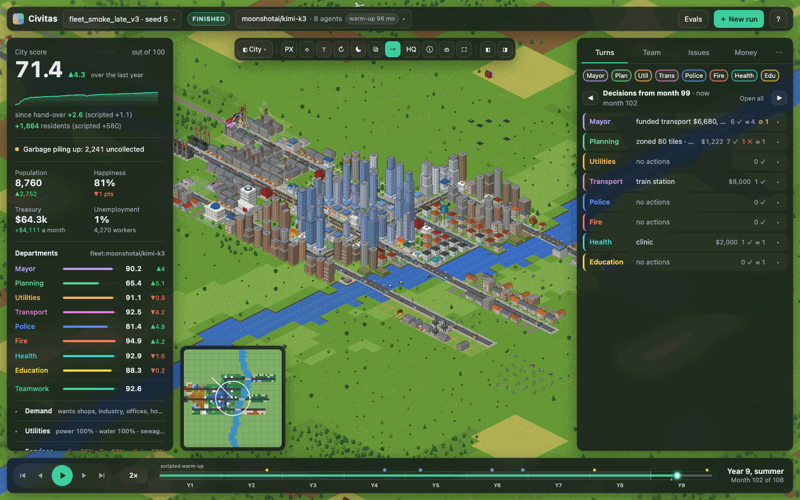
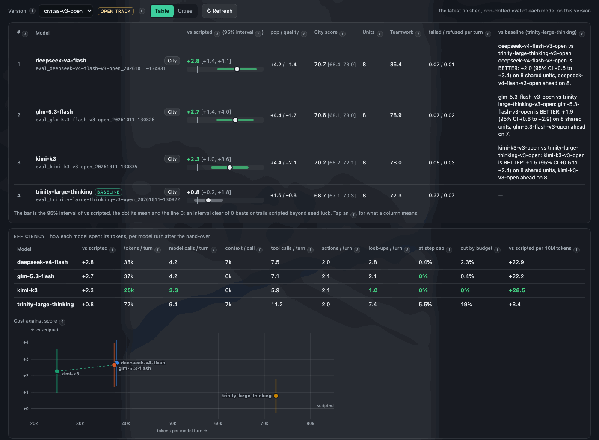

# Civitas Bench

Civitas Bench is a SimCity-style city simulation in which eight city departments (mayor, planning, utilities,
transport, police, fire, health, education) are each played by a separate LLM agent with tools. The agents share
one city, one treasury and a council message board, so they have to plan, fund and coordinate to grow the city.
It is a benchmark with frozen, fingerprinted environment versions, and an RL environment built from the same game.

```
roles:    Mayor · Planning · Utilities · Transport · Police · Fire · Health · Education
game:     120 months on a 48x48 map with a river and a highway; agents act every 3 months
agents:   fleet (tool-calling LLM) · llm (one JSON reply a turn) · scripted baselines · remote (HTTP) · RL policies
eval:     8 late-game cities x 32 model turns, 5-19M tokens and ~15 min per model with 8 workers
cost:     a scripted 10-year game takes ~5 s; the scripted reference needs no model
```



*The viewer replaying a civitas-v3 eval run (kimi-k3, seed 5, month 102): scores per department on the left, each
department's decisions for the quarter on the right.*

## Results: civitas-v3

Each model plays 8 late-game cities (seeds 0, 4, 5, 11, 12, 16, 18, 20). Scripted agents play months 0-95, the
model's fleet plays months 96-107 (32 model turns per city). **vs scripted** is the change in city score after the
hand-over minus the change the scripted agents make from the same city, averaged over the 8 cities, with its 95%
interval. Tokens are per department turn. Every model works under the same 100k-token budget per turn.

| model | guided: vs scripted (95% CI) | tokens / turn | open: vs scripted (95% CI) | tokens / turn |
|---|---:|---:|---:|---:|
| glm-5.3-flash | +2.4 (+1.1 to +3.8) | 27k | +2.7 (+1.4 to +4.0) | 37k |
| kimi-k3 | +2.4 (+1.0 to +3.8) | 19k | +2.3 (+1.0 to +3.6) | 25k |
| deepseek-v4-flash | +1.8 (+0.7 to +2.8) | 21k | +2.8 (+1.4 to +4.1) | 38k |
| trinity-large-thinking | +1.5 (+0.5 to +2.5) | 42k | +0.8 (-0.2 to +1.8) | 72k |

Paired against trinity-large-thinking on the same cities: on the open track deepseek-v4-flash (+2.0), glm-5.3-flash
(+1.9) and kimi-k3 (+1.5) are all clearly better; on the guided track glm-5.3-flash and kimi-k3 are (+0.9 each) and
deepseek-v4-flash is not distinguishable. Full tables (departments, Teamwork, failures, cost) come from
`civitas eval --leaderboard --env civitas-v3` and `--env civitas-v3-open`.

Besides the score, every eval reports each department's score against scripted, the population and quality parts
of the city score, a Teamwork score (were requests between departments answered and followed through, did the
mayor's money go where it was needed), failed actions and guard refusals per turn, and token use.



**What we learned**

- **v1 measured instruction-following.** 88-92% of department actions were an exact call or site from the
  briefing, and the mayor funded the briefing's to-fund line to the dollar ~92% of the time. Four models scored
  within 0.8 points; the seed explained 68% of the variance, the model 7%.
- **v2 added the open track,** where briefings give the same facts but never name the action to take. It
  separates models that the guided track can't.
- **v3 added an equal token budget per turn.** Token use differed up to 3x between models for the same ~2 actions
  a turn. The budget cut total tokens by 22% across the eight evals, with scores within about 0.8 points of v2.
- **Efficiency matters.** trinity-large-thinking makes ~9 model calls and ~7 look-ups a turn on the open track
  (kimi-k3: 3 and 1), hits the budget in 19% of its turns, and is the only model whose interval there includes 0.

## Quickstart

```bash
uv venv --python 3.12 && source .venv/bin/activate && uv pip install -e ".[dev]"   # Python >= 3.10
civitas run -c configs/baseline.toml --seed 0     # one 10-year game with the scripted agents (~5 s, no model)
civitas serve                                     # the viewer and run launcher at http://127.0.0.1:8765
civitas models                                    # the model registry (configs/models.toml) and which API keys are set
civitas eval --model kimi-k3 --dry-run            # the plan, its tokens and time, and the environment check
civitas eval --model kimi-k3                      # civitas-v3 guided; -s configs/eval_v3_open.toml for the open track
```

API keys go in `./.env` (e.g. `ARCEE_API_KEY=...`). Any OpenAI-compatible endpoint works: add an entry to
`configs/models.toml`, or use the viewer's Evals page (Models, Evals, Leaderboard) to add a model, run an eval and
read the leaderboard. More in [docs/SETUP.md](docs/SETUP.md) and [docs/EVALS.md](docs/EVALS.md).

## How it works

**The city.** A grid map with a river and a highway. Zones grow by themselves when there is demand and the city
provides roads, power, water, sewage, services, jobs and land value. Residents are tracked by age and education;
traffic, trade, crime, fire, health, pollution, seasons, disasters and milestones are all simulated. Money is
real: taxes and fees in, upkeep and loans out, bankruptcy after 12 months below zero. See
[docs/SIMULATION.md](docs/SIMULATION.md).

**The departments.** The mayor writes the city plan and moves the money; the other seven each own a system
(planning zones and roads, utilities builds plants, pumps and outlets, and so on) and can only spend what the mayor
gives them. Every role sees the whole city in summary and its own system in detail, so they have to talk on the
council board. Agents never touch the world directly: every action is validated against budgets, permissions and
unlocks.

**Turns and tools.** Agents act every 3 months. A turn is a tool loop: the agent gets a short briefing, then calls
look-up tools (`map_overview`, `find_sites`, `inspect`, ...), one tool per game action, and `send_message` /
`update_memory` / `end_turn`. Guards refuse a few clearly harmful calls (cutting roads off the highway, borrowing
with money in the bank) unless the agent repeats them with `confirm`. The plan, each department's memory and a
history log carry over between turns. See [docs/FLEETS.md](docs/FLEETS.md).

**Agent kinds.** The benchmark's agent is the tool-calling `fleet`. The same game also takes a single-call `llm`
agent (one JSON reply a turn), the rule-based `scripted` baselines (which read only the observation and serve as the
reference), a `remote` agent in any language over HTTP, and RL policies through a PettingZoo-style
`reset()` / `step()` with tensor observations. Any role can be any kind, so a model can play one department among
scripted colleagues.

**Scoring.** The city score (0-100) is half population and half quality (happiness, finances, utilities, services,
environment, jobs, safety, health, education); each department also has its own score. Evals compare against the
scripted baseline from the same hand-over rather than using raw scores, because cities differ a lot by seed: the
same model's score moves far more between seeds than between replays of one seed (std 2.5 vs 0.4 points).

**Guided and open tracks.** The guided briefing names the next build, its exact tool call and the money to ask
for. The open briefing gives the same facts (prices, sites, coverage estimates, demand, the reserve rule) but never
a chosen action, so the model has to decide.

**Token budget.** From civitas-v3 every department turn has 100k tokens, counted the same way for every model
(prompt characters / 4 plus the completion tokens the provider reports). Each tool result says how much is left;
when the next reply would not fit, the turn ends.

**Frozen versions.** An environment version (`civitas-v1`, `-v2`, `-v2-open`, `-v3`, `-v3-open`) is a behavioural
fingerprint of the game, briefings, tools and config, recorded in `configs/envs/`. An eval on code that no longer
matches is refused (or recorded as drifted and never ranked), so leaderboard rows stay comparable.

**Region mode.** Two to six linked cities can run as a region: they share a river, trade goods, exchange commuters
and tourists, and their mayors make power and water deals (see
[docs/SIMULATION.md](docs/SIMULATION.md#region-mode-cities-that-trade-and-specialise)).

## RL environment

`civitas/rl/` turns the game into short, deterministic tasks: one department's turn from a saved city, played
through the real fleet tools. The reward is verifiable: the city (and role) score 6 months later minus that of the
scripted agent's own turn from the same state, less small penalties for failed or invalid calls. A task bank
snapshots cities from training and held-out seeds; the reward was validated with hand-made policies
(oracle > scripted > noop > random on both splits). Training uses TRL's `GRPOTrainer` with an environment factory
over the same tools (Qwen3-4B + LoRA on Modal H100s); the pipeline is ready to launch. See [docs/RL.md](docs/RL.md).

## Docs

| file | what it covers |
|---|---|
| [docs/SETUP.md](docs/SETUP.md) | install, model providers, running games and benchmarks, game switches, output files |
| [docs/VIEWER.md](docs/VIEWER.md) | the browser control center: replay, agent decisions and tool calls, Team, Problems and Compare views |
| [docs/SIMULATION.md](docs/SIMULATION.md) | architecture, the simulated systems, building tiers, roles and actions, scores, region mode |
| [docs/FLEETS.md](docs/FLEETS.md) | agent fleets: briefings, guards, money, tools, limits, playbooks, warm-ups, scripted fleet, reports |
| [docs/EVALS.md](docs/EVALS.md) | model evals: suites, registry, environment versions v1-v3, statistics, the leaderboard |
| [docs/RL.md](docs/RL.md) | RL tasks, reward and validation, the TRL / Modal training pipeline |
| [docs/HISTORY.md](docs/HISTORY.md) | dated smoke runs and long runs from the fleet's development |
| [docs/DEVELOPING.md](docs/DEVELOPING.md) | code layout, adding a role or building, ideas |
| [docs/MECHANICS.md](docs/MECHANICS.md) | which SimCity / Cities: Skylines mechanics are implemented, and where |

## Project layout

```
civitas/
  sim/       the simulation: map, networks, people, services, traffic, economy, events, catalog of balance numbers
  core/      CivitasEnv (the hub), regions, observations, action validation, roles, council board
  agents/    single-call LLM agent, scripted baselines, remote (HTTP) agents
  fleet/     tool-calling agents: tool loop, tools and guards, briefings, memory, reports
  bench/     runner, scoring, evals, environment versions, statistics, collaboration score
  rl/        task bank, episodes, reward, TRL environment, training and Modal app
  viewer/    browser viewer (vanilla JS, pixel-art and three.js renderers)
  server.py  `civitas serve`: viewer, replay API, run launcher
  cli.py     `civitas run | bench | eval | serve | prompt | rl | ...`
configs/     game, fleet and eval-suite configs; models.toml (registry); envs/ (frozen versions)
docs/        reference documentation (see above)
examples/    remote agent, RL loop, SFT export
tests/       pytest suite (`pytest -q -m "not slow"` for the quick loop)
```
