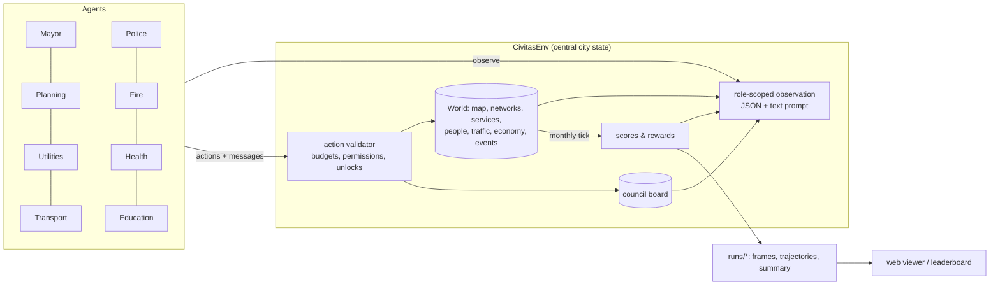

# Civitas Bench

A SimCity-style city simulation built for **multi-agent AI benchmarking**.
Each city department is played by a separate agent (an Arcee LLM, a scripted
baseline, a remote program, or an RL policy). All of them read from one central
city state, act only through validated actions, talk on a shared council board,
and are scored on the city as a whole *and* on their own department.

The map starts as a flat plain with a river flowing north to south. The highway
on the west edge connects the city to the rest of the region.

```
roles:    Mayor · Planning & Housing · Utilities (power, water, sewage) · Transport
          Police · Fire & Emergency · Health & Sanitation · Education
episode:  120 months (10 years), each agent acts once a month
cost:     scripted run ≈ 4–5 s · every role on an LLM ≈ 960 model calls
modes:    one city, or a region of 2-6 linked cities that trade and specialise
```

---

## 1. Setup (macOS)

You need Python 3.10 or newer. The Python that ships with macOS is usually 3.9, so
the simplest path is [uv](https://docs.astral.sh/uv/):

```bash
cd ~/Desktop/civitas-bench
uv venv --python 3.12
source .venv/bin/activate
uv pip install -e ".[dev]"
pytest -q                       # ~150 tests, ~25 s (pytest -q -m "not slow" skips the 5-episode benchmark test)
```

(With plain pip: `python3.12 -m venv .venv && source .venv/bin/activate && pip install -e ".[dev]"`.)

## 2. Open the control center

```bash
civitas serve            # then open http://127.0.0.1:8765
```

Everything happens in the browser from here. You can:

- **Watch** the city in the OpenTTD-style pixel view (the default) or in 3D (toggle with `X`
  or the `PX`/`3D` button). The pixel view is a 2:1 isometric pixel-art map: drag to
  scroll, zoom in steps with the wheel, rotate in quarter turns with `Q`/`E`. Buildings go
  up behind scaffolding, cars, buses, trains, boats and planes move around, cars queue at
  traffic lights on junctions, planes land, taxi to the terminal and take off (in region runs
  they fly to the other cities' airports), container ships berth under the harbour crane, and night lights the windows. Around the city a distant view
  fades into haze: fields, the river and highways running on, villages where roads leave the
  map and, in region runs, the neighbouring cities with the rivers flowing between them and
  their highway and rail links routed from connector to connector (`T` zooms out over all of it). Both views
  show the river (a little murkier where it is polluted), bridges,
  houses, row houses and villas that become apartments and towers, offices, shop-houses,
  factories, farms, sawmills, mines and oil fields, power plants (nuclear too), pumps, sewage works,
  police and fire stations, clinics, 2×2 hospitals and universities, schools, landfills,
  crematoria, higher-tier buildings drawn bigger or with annexes,
  bus and metro lines, casinos, airports, levees, landmarks, floods, historic plaques,
  snow in winter and orange trees in autumn. Smoke drifts with the wind.
- **Replay or follow live.** Use the timeline to play, step or scrub. Marks on the
  timeline show council messages (purple), failed actions (amber), money trouble (red),
  disasters and offers (blue) and milestones (gold). A run in progress is followed
  automatically.
- **See why things happen.** The Agents tab shows each month's decisions with ✓/✗
  results. Click an action to fly the camera to where it happened. For LLM agents you
  can expand the model's full reasoning, its raw reply and the exact prompt it saw. The
  Events tab starts with what residents complain about this month.
- **Inspect** any tile by clicking it: stats, services, wealth or industry type, its
  building level over time, and which agent zoned or built it.
- **Switch map layers** (press `V`, or `1`–`9`): pollution, land value, happiness, noise,
  power, water, sewage, river pollution, traffic, bus coverage, police/fire/clinic/school
  cover, crime, fire risk, health, garbage, soil pollution, historic buildings, business
  profit, affordability, natural resources, flood risk and districts.
- **Launch runs** with **＋ New run**: pick a config, seed, length and each role's agent
  (scripted, LLM with any model, fleet, noop or random); each role starts at the config's own
  agent and only the roles you change are overridden. Stop runs from the Runs tab, which also
  holds the leaderboard.
- **Browse the Charts tab**: population, scores, money, happiness and approval, demand,
  jobs, pollution, commute and traffic, trade, service coverage, crime and health,
  education.
- **Region runs** get a city switch in the top bar and a **Region** tab: a map of the
  cities with their links and the goods, commuters and tourists flowing between them,
  plus each city's score and specialisations.

Press `?` in the app for all keyboard shortcuts. `civitas run ... --serve` also opens the
interface while a run from the terminal is playing. The old 2D viewer is still available
at `/classic.html`.

## 3. Plug in Arcee models (trinity-large-thinking)

Put your key in a `.env` file in the project folder. It's gitignored and `civitas` loads
it automatically. `export ARCEE_API_KEY=...` works too.

```bash
echo 'ARCEE_API_KEY=rcai-...' > .env
civitas check-llm                            # one test call to trinity-large-thinking
civitas run -c configs/smoke.toml --serve    # 2 years, 3 LLM roles acting every 3 months (~24 calls)
civitas run -c configs/arcee.toml --serve    # 10 years, mayor/planning/utilities on the LLM, the rest scripted
civitas run -c configs/arcee_full.toml       # 10 years, all 8 roles on the LLM (~960 calls)
civitas run -c configs/fleet_smoke.toml      # 1 year, all 8 roles as a tool-calling fleet (see Agent fleets)
```

The Arcee API is OpenAI-compatible (`https://api.arcee.ai/api/v1`). Notes on the
thinking model:

- **Token budget.** The Arcee configs give each call `max_tokens = 12000` so there's room
  for the reasoning *and* the JSON answer. If a reply is cut off, the agent retries once,
  hands the model the end of its own reasoning and asks for the JSON only; as a last resort
  it recovers the action objects from the end of the reasoning. Prompts are about 3–4.5k
  tokens per role (a system prompt with the rules and action docs, then the observation).
- **Where the answer comes from.** The agent reads plain JSON from the reply rather than
  using tool calling. If the final answer has no JSON, the agent checks the reasoning text.
- **What gets logged.** The reasoning is saved in `trajectories.jsonl` along with the
  answer, which is useful for studying or training on how the model plans.
- **Speed.** Calls are slow, so a full game with several LLM roles can take hours. Start
  with `smoke.toml`, or set `game.act_every` to 2–3.

Any role can be switched from the CLI, and any value overridden:

```bash
civitas run -c configs/arcee.toml --agent mayor=scripted --agent police=llm:arcee/trinity-mini --set game.act_every=3
```

Other OpenAI-compatible endpoints (OpenRouter, vLLM, Ollama and so on) work the same way.
Add a `[providers.name]` block with `base_url` and `api_key_env`, then use `llm:name/model`.

## 4. Benchmark

```bash
# the same line-up across 5 seeds (maps and disaster schedules differ by seed)
civitas bench -c configs/arcee.toml --seeds 0-4 --workers 3

# role-isolated eval: only Planning is an LLM, the other roles are fixed baselines,
# so any score difference comes from the Planning agent
civitas bench -c configs/eval_planning.toml --seeds 0-4
civitas bench -c configs/eval_planning.toml --seeds 0-4 --agent planning=llm:arcee/trinity-mini   # compare models

civitas leaderboard            # every finished run, grouped by agent line-up
```

Baseline reference (all scripted, seeds 0–4): **city 77.5 ± 1.5**, mayor 88.1, planning
68.4, utilities 89.4, transport 75.9, police 74.9, fire 85.7, health 86.6, education 83.2,
population ≈ 14.5k, no bankruptcies, ~4–5 s per game (seeds 5–9: city 75.9 ± 0.8). `noop` and
`random` line-ups score 0. Building tiers changed these numbers. Just before tiers were
added, the same baseline scored city 78.1 ± 1.8 with population ≈ 14.7k.
The scripted agents leave obvious room: they never use districts, mixed use, historic
listings or soil clean-up, rarely use policies or funding levels, build services by simple
coverage rules, hoard money late in the game and never make neighbour deals.

Useful switches in `[game]` (or `--set game.X=...`):

| setting | effect |
|---|---|
| `events = "auto"` / `"none"` | seeded floods, heatwave, recession and a factory offer (same on every line-up for a seed) |
| `milestones = true` | buildings unlock at 1k / 5k / 10k residents |
| `simultaneous = true` | every role sees the same start-of-month state (harder: no reacting to earlier roles) |
| `roles = [...]` | which roles play, in turn order |
| `seasons = true` | winter heating and snow, summer cooling and fires, seasonal tourism |
| `region = true`, `cities = [...]` | 2–6 cities, each with its own team (see below) |
| `team_weight` | reward = w·Δcity + (1−w)·Δrole − penalty·invalid actions |
| `balance` | override any constant, e.g. `"CATALOG.coal.cost" = 3000`, `"SERVICES.clinic.radius" = 9` or `"TIERS.pump.2.water" = 800` |

---

## How it works



**The central state.** `CivitasEnv` is the hub. It owns the `World` (the single source
of truth), the council board, each role's memory (the results of its last turn and its
notes to self) and the scores. Agents never touch the world directly. Each month every
role observes and acts in turn order (later roles see what earlier roles just did), then
`end_month()` simulates the month and recomputes the scores. Each role's reward is the
change in score.

Every observation is available as structured JSON (for RL policies and remote agents)
and as a rendered text prompt (for LLMs). Everyone sees the same city summary, the top
complaints, the finances, events, forecasts and council messages; each role also gets a
detailed section on its own system (its buildings with load vs capacity, problem hotspots
with coordinates, suggested sites) and, except the mayor, the ASCII map. Other systems
only appear as summaries, so agents have to talk to each other.

**Five ways to connect an agent.** All use the same actions:

| kind | what it is |
|---|---|
| `llm` | Any OpenAI-compatible model (Arcee by default). It gets a system prompt with the rules and action docs, plus the observation text, and replies with JSON. |
| `fleet` | A tool-calling model: a short briefing, then look-up and action tools in a loop, with a city plan and memory between turns. See [Agent fleets](#agent-fleets). |
| `scripted` | Rule-based baselines. They read only the observation, so they are fair references and a source of demonstration data. |
| `remote` | Any external process, in any language, over HTTP: `GET /api/live/turn?role=planning`, then `POST /api/live/act`. See `examples/remote_agent.py` and `configs/remote.toml`. |
| RL | `env.reset()` / `env.step({role: Decision})` (PettingZoo-style), with `env.tensor_observation()` returning a 14×H×W grid and a feature vector. See `examples/rl_loop.py`. |

### The simulation

- **Zones and levels.** Residential (R), commercial (C), industrial (I) and office (O)
  zones develop by themselves when there is demand. Each level needs more of the city:
  L1 road access + power, L2 water, L3 sewage + garbage pickup + land value 40%, L4 a
  school in reach (homes) or skilled workers (jobs) + land value 58%, L5 land value 75% +
  low crime + a park nearby. Low-density zones stop at L2; high density goes to L5 (up to
  240 residents or 140 office jobs per tile). Industry stops at L3 unless it is high-tech.
- **People.** Residents are tracked as an age × education vector (children, teens, adults,
  seniors × none, elementary, high school, university). Migrants fill new housing, people
  age and die, and students only graduate when they have a school seat. Jobs need education:
  offices and high-tech want graduates, over-educated workers take lower jobs.
- **Wealth and households.** Homes are low, middle or high income depending on land value
  when they are built. Wages minus rent is what households spend in shops; rich households
  pay more tax, care more about pollution, crime and noise, and leave first when unhappy.
- **Industry types.** Industry zoned on natural resources becomes farms (fertile soil),
  sawmills (forest), mines (ore) or oil fields; resources run out. Educated cities attract
  high-tech industry.
- **Demand** depends on jobs vs. workers, taxes, happiness, commute times, household
  spending and export demand. Big cities need a train station or harbour, and enough parks,
  or residential and commercial demand is capped.
- **Utilities.** Every connected road network is its own grid for power, water and sewage.
  Facilities serve the network they touch, nearest buildings first. Pumps and sewage
  facilities sit on the riverbank, and clustered pumps, outlets, towers and turbines lose
  output (see [Building tiers](#building-tiers)). Plants lose output after five years unless overhauled;
  wind output follows a wind map. Shortfalls are covered by costly imports from the region
  (the mayor can stop them) and surplus power is sold.
- **The river** flows north to south. Sewage outlets and riverside industry pollute it
  downstream: pumps below an outlet deliver dirty water. Treatment plants remove 80% (advanced
  treatment 95%).
- **City services** (police, fire, clinics and hospitals, schools, garbage trucks,
  shelters) cover buildings they can reach along the road network within their radius, up
  to their capacity, scaled by the department's funding level. Crime grows with
  unemployment, density, low education and low land value; uncovered fires spread;
  uncollected garbage piles up; pollution, dirty water and garbage make people sick (sick
  workers stay home); deaths need cemetery space or a crematorium; landfills fill up
  (recycling centres don't).
- **Traffic.** Workers commute from home to the busiest job areas along shortest road
  paths (a gravity model); trucks carry goods to the highway, train stations and the
  harbour. Load over capacity means congestion: longer commutes, noise, exhaust, and slower
  police, fire and ambulances. Avenues and highways carry more; bus lines take trips off
  the road.
- **Trade and businesses.** Industry makes goods and raw materials; shops need goods.
  Surpluses are exported and shortfalls imported, limited by freight capacity. Every shop,
  factory and office has a profit margin (customers, taxes, shortages, traffic, crime);
  six months of losses and it closes.
- **Happiness** is a weighted sum of 14 needs (power, water, sewage, garbage, safety,
  health, education, commute, leisure, noise, pollution, tax, affordability, jobs). The
  needs that cost the most happiness become the **complaints feed**. **Approval** follows
  happiness and taxes; 12 months below 30% and the mayor loses the recall election.
- **Mixed use** (M zones) puts shops below flats; **historic listings** freeze a
  building's level and add land value and tourists; **soil pollution** builds up under dirty
  industry, landfills and coal plants, fades very slowly, and hurts health, land value and
  farms (the health department can clean it); **wind** changes every month around a
  westerly and pushes air pollution downwind; **seasons** raise power demand in winter
  (and slow the roads with snow), water and fire risk in summer, and move tourism.
- **Metro**: stations serve 5 tiles around them; lines between stations carry trips
  three times faster than driving, immune to jams. Hospitals, universities, stadiums
  and casinos cover 2×2 tiles, airports 3×3 (x, y is the top-left tile).
- **Casinos and airports**: a casino gives low-skill jobs and gamblers who pay a gambling
  tax, but raises crime around it; an airport adds freight, tourists and air links.
- **Events** come from the seed: a river flood (forecast 3 months ahead; levees protect,
  shelters save lives), a heatwave, a recession and a factory offer the mayor must accept
  or decline (jobs and a bonus vs. heavy pollution).
- **Milestones** at 1k / 5k / 10k / 20k residents pay a reward and unlock buildings (high
  density, offices, avenues, high schools... then hospitals, universities, train stations,
  hydro dams, stadiums, the harbour... then monuments). Landmarks raise land value and
  bring tourists.
- **Money.** Taxes (per sector, with district modifiers), fares, trade fees, tourism and
  power sales come in; upkeep of roads, plants and service buildings (times funding
  levels), policies, imports and loan interest go out. Departments can only spend what the
  mayor gives them. Twelve months in a row with a negative treasury means bankruptcy.

All balance numbers live in `civitas/sim/catalog.py`. You can override them per config
with `[game.balance]`.

### Building tiers

Most service and utility buildings belong to a ladder, like the ones in Cities: Skylines
(`catalog.TIER_LINES`). Higher tiers unlock at the Town (1k), City (5k) and Metropolis (10k)
milestones. They are bigger buildings with much more output per dollar of upkeep, so a
growing city replaces a cluster of small buildings with a few large ones. Each cell below
shows the milestone, the main output, the build cost and the upkeep per month.

| line | tier 1 | tier 2 | tier 3 |
|---|---|---|---|
| pump (riverbank) | water pump: 250 water, $1,500, $25 | pumping station (1k): 650, $4,000, $45 | water works (10k, 2×2): 2,000, $12,000, $100, filters dirty river water |
| tower | water tower: 120 water, $2,200, $30 | inland water plant (5k): 600, $7,000, $70 | |
| outlet (riverbank) | outlet: 250 sewage, raw, $1,200, $15 | treatment plant (1k): 700, removes 80%, $5,000, $50 | advanced treatment (10k, 2×2): 2,000, removes 95%, $14,000, $110 |
| coal | coal plant: 250 power, pollution 25, $4,000, $80 | advanced coal (5k): 500, pollution 12, $9,000, $120 | |
| gas | gas plant: 200 power, pollution 10, $6,500, $60 | combined cycle (5k): 450, pollution 6, $12,000, $90 | |
| wind | wind turbine: 40 power, $2,500, $12 | advanced turbine (1k): 100, $5,000, $20 | |
| solar | solar farm: 70 power, $5,000, $15 | solar plant (10k, 2×2): 400, $16,000, $50 | |
| landfill | landfill: collects 450/mo, fills at 30,000, $2,000, $30 | recycling centre (1k): 900, never fills, $6,000, $50 | waste complex (10k, 2×2): 3,000, never fills, +60 power, $20,000, $150 |
| cemetery | cemetery: 30/mo, 2,500 plots, $1,500, $12 | crematorium (1k): 120/mo, no plots, $5,000, $35 | |
| clinic | clinic: capacity 2,500, radius 10, $2,000, $40 | hospital (5k, 2×2): 9,000, r14, $8,000, $120 | medical centre (10k, 2×2): 22,000, r20, $20,000, $220 |
| police station | station: 4,000, r14, 25 cells, $2,500, $55 | police HQ (5k): 14,000, r22, 100 cells, $9,000, $130 | |
| jail (1k) | jail: 250 inmates, $4,000, $45 | prison (10k, 2×2): 1,200, $14,000, $120 | |
| fire station | station: capacity 260, 5 call-outs, r14, $2,500, $55 | fire HQ (5k): 900, 15 call-outs, r20, $9,000, $130 | |
| elementary | school: 450 seats, $2,500, $45 | large elementary (1k): 1,200, $6,000, $80 | |
| high school (1k) | school: 700 seats, r22, $5,000, $75 | large high school (5k): 2,000, r26, $11,000, $130 | |

The **nuclear plant** (10k, map character `u`) is a new single-tier building. It is a 2×2
plant on the riverbank that makes 2,000 clean power for $40,000 and $400/mo, and it draws
100 water for cooling from its road network. The crematorium has its own character, `z`.
Every other tier keeps its line's character, and frames carry the tier in the per-tile
`levels` string. Hydro dams, incinerators, universities, libraries and shelters have a
single tier.

- **Build a tier directly.** Every facility build action (power, water, sewage and service
  buildings) takes `"tier": n` (counted within the line, 1 = base), or a tier name as `kind`:
  `{"type":"build_water","kind":"pumping_station","x":29,"y":24}`,
  `{"type":"build_police_station","kind":"police_hq","x":14,"y":25}`,
  `{"type":"build_cemetery","tier":2,...}`. Nuclear is `build_power_plant` with
  `kind: "nuclear"`. `kind: "treatment"` and `build_hospital` still work; they build tier 2
  of their lines.
- **Upgrade in place.** `{"type":"upgrade_facility","x":..,"y":..,"module":"tier"}` moves a
  building up one tier. It costs the price difference × 1.2 and keeps the building's age
  and modules. A 2×2 tier grows into free tiles around the building (the top-left tile may
  move), and the action fails with a clear message if none are free. Outlets become
  treatment plants and clinics become hospitals. An expansion adds 50% of the current
  tier's output.
- **Crowding.** Production buildings of the same group lose 15% output for each neighbour
  within the group's radius, down to a floor of 40%. A neighbour of any tier counts. The
  groups are pumps (4 tiles), outlets (4), water towers (5) and wind turbines (2, on top of
  the wind map). Coal, gas, solar and nuclear plants don't crowd. One water works beats
  eight pumps on one stretch of river.
- **Downtown.** Level 4–5 buildings get only 60% of the police, fire and health cover that
  tier-1 buildings give. A tier-2+ building in range gives them full cover.
- **What agents see.** The utilities section shows the crowding for each group, the
  observation offers the best upgrades with their real gains, service sections report
  downtown tiles without tier-2 cover, and suggested sites include riverbank spots with
  room for a 2×2 building. The windy, pump and sewage site lists put uncrowded spots first and mark
  crowded ones (`near 1 turbine`). `World._metrics()` records `tiers` (count per line and tier)
  and `downtown_uncovered`.
- **Overrides.** Use `"TIERS.<line>.<tier>.<field>"`, e.g.
  `"TIERS.pump.2.water" = 800` in `[game.balance]`, a nested `[game.balance.TIERS.pump.2]`
  table, or `--set game.balance.TIERS.pump.2.water=800`. Tier 1 is the same dict as the
  `CATALOG` / `SERVICES` entry, so `"CATALOG.pump.water"` still works. Tiers 2+ are
  copies, so a tier-1 override doesn't reach them. The crowding and downtown rules use
  `CROWD_STEP`, `CROWD_FLOOR`, `T1_DOWNTOWN` and `DOWNTOWN_LEVEL`.

### Roles and actions

| role | actions |
|---|---|
| mayor | `set_tax` (R/C/I %), `allocate_budget`, `set_funding` (department 50–150%), `enact_policy` / `repeal_policy` (city-wide or per district), `set_district_tax`, `accept_offer` / `decline_offer`, `set_service_imports`, `take_loan`, `repay_loan` |
| planning | `build_road`, `zone` (R/C/I/O/M, low or high density), `dezone`, `build_park`, `build_landmark` (plaza/stadium/monument), `build_casino`, `paint_district`, `specialize_district`, `preserve_historic` / `delist_historic`, `bulldoze`, `demolish` |
| utilities | `build_power_plant` (coal / gas / solar / wind / hydro / nuclear), `build_water` (pump / tower), `build_sewage` (outlet / treatment), `upgrade_facility` (tier / filter / expansion / overhaul), `demolish` |
| transport | `upgrade_road` (avenue / highway), `create_bus_line`, `remove_bus_line`, `set_fare`, `build_metro_station`, `create_metro_line`, `remove_metro_line`, `build_train_station`, `build_harbour`, `build_airport`, `build_connector` (region mode), `upgrade_facility`, `demolish` |
| police | `build_police_station`, `build_jail`, `upgrade_facility`, `demolish` |
| fire | `build_fire_station`, `build_levee`, `build_shelter`, `upgrade_facility`, `demolish` |
| health | `build_clinic`, `build_hospital`, `build_landfill`, `build_incinerator`, `build_cemetery` (tier 2: crematorium), `clean_soil`, `upgrade_facility`, `demolish` |
| education | `build_school` (elementary / high / university), `build_library`, `upgrade_facility`, `demolish` |

Policies: recycling, neighborhood watch, smoke detectors, education boost, industry
filters, high-rise ban, free transit. Every role can post `messages` to the council board
(to `all` or a role) and keep `notes` for its next turn. Invalid actions are rejected with
a helpful message and counted in the invalid-action rate. Every facility build action (power,
water, sewage and service buildings) also takes a `tier` (see [Building tiers](#building-tiers)).

### Scores (0–100)

| score | built from |
|---|---|
| **city** | ½ population (√ of pop / 30k) + ½ quality: happiness, finances, power/water/sewage coverage, environment, employment, safety, health, education. Quality counts only once the city has people; bankruptcy halves the total, a lost recall election cuts it by a quarter. |
| **mayor** | revenue, solvency, net worth, happiness, approval, and how much of the money given to departments actually got spent |
| **planning** | growth, share of zoned land that developed, demand balance, land value, road efficiency, employment |
| **utilities** | power, water and sewage coverage, spare capacity in the 10–60% range, cost efficiency, clean-energy share (solar, wind, nuclear), pollution near homes, water quality, river quality |
| **transport** | commute time, share of congested road, bus share of trips, cost per resident |
| **police** | crime at homes, coverage, jail space, cost per resident |
| **fire** | buildings lost to fire, coverage, cost per resident |
| **health** | health of residents, garbage at homes, clinic coverage, landfill room, deathcare, cost |
| **education** | enrolment, skilled jobs filled, share of adults with high school+, cost |

Every score is a function of the monthly history, so the same code produces the final
benchmark number, the live "your score" shown to agents, and dense RL rewards.

### Region mode: cities that trade and specialise

`configs/region.toml` (two cities) and `configs/region_trio.toml` (three) run a region:
`[game] region = true` and `cities = [...]` from north, south, east, west, southeast,
southwest. Every city has its own full team; roles are named `north.planning`,
`south.mayor` and so on. Agents configured for a base role (`[agents.planning]`) play it
in every city, `[agents."south.planning"]` sets one city.

- **The river** runs through the north-south column: upstream sewage and runoff arrive
  in the next city's water.
- **Links.** Transport departments build `build_connector` (highway or rail) on the map
  edge facing a neighbouring city, with a feeder road inland; the link opens when both
  cities have built their side. Any two cities with a harbour are linked by boat, any two
  with an airport by air. Each link type has a goods and a people capacity.
- **Commerce.** Every month, over those links, surplus goods and raw materials go to
  cities that are short (the seller collects part of the value; the buyer avoids costly
  imports and shortages), unemployed workers commute to open jobs, and residents visit
  their partners' casinos, landmarks and historic districts.
- **Specialisation** follows from each city's land and people and is reported to every
  agent: mining & farming (natural resources, pollutes the soil), high tech (needs
  graduates and raw materials), gambling (casinos: little education needed, crime, tourist
  money), tourism, trade (freight), education. Complementary cities gain the most from links.
- **Diplomacy.** All teams share one council board (address `"south"`, `"north.mayor"` or
  `"all"`) and mayors can agree power/water deals (`offer_deal`, `accept_deal`, `cancel_deal`).

Each city is scored on its own; the region score is their average.

### Agent fleets

`kind = "fleet"` plays a role with a tool-calling agent (`civitas/fleet/`) instead of the
one-shot JSON `llm` agent. A fleet is built to measure how well a team of agents manages
tasks and money, and to let people coach it.

- **One manager, seven departments.** The mayor manages. It writes the city plan (goals, a
  budget target and a one-line priority per department, notes) and moves the money. The
  seven departments carry the plan out, and each one sees only its own slice. Turn order
  doesn't change, so the mayor acts first each month.
- **A turn is a tool loop.** The agent starts from a short briefing and then calls tools.
  The mayor's briefing covers the city, the finances, each department's funds, target
  (`funds $0 < target $2,500` when it still needs funding) and latest report, a line with
  the total funding gap (ending in `allocate_budget`, or in "hold" when the treasury is at
  or under the reserve), and the plan. A department's briefing covers its plan slice, its
  budget, its key metrics, a "since your last turn" digest (failed actions, events, and the
  newest council messages addressed to it or to `all`, quoted with sender and month), a
  Ready sites block (one line per `find_sites` purpose: the count and best site, or why
  there is none, e.g. locked, no connected road reaches the river, the riverbank beside
  the roads is taken, or no roadside lot is away from homes for a landfill, cemetery or
  jail; a site on one of the last two free riverbank lots is marked to keep for a pump or
  sewage outlet) and its memory. Both have a short Map block (size, highway entry,
  river columns by row band, the extent of the connected roads, any road tiles not
  connected to the highway, and the built-up area) and
  end with the next milestone. Actions run immediately and return
  `ok`, a message, the cost and the money left, so a failed action can be fixed in the
  same turn. Bad arguments, unknown tools and refused actions come back as
  `{"ok": false, "error": ...}` for the model to correct.
- **Guards.** A `bulldoze` that would cut highway-connected road tiles off the highway
  (the road network relabelled without the removed tiles, as `World.refresh()` does) is
  refused before it runs (`refused: "disconnect"`: not executed, not charged as an invalid
  action, still a tool call), naming how many tiles and where; the agent can build a new link
  first or repeat with `confirm: true`. A `zone` that takes the last free riverbank lot
  beside the connected roads while the city has neither a pump nor a sewage outlet /
  treatment plant succeeds, with a warning to dezone one for utilities.

| tools | |
|---|---|
| look-ups (no side effects) | `city_overview` (headline numbers and a 3-month trend), `map_overview` (the whole map as ASCII with rulers and a legend, downsampled on maps too big for one tool result, plus the facts of the briefing's Map block), `inspect(x, y, radius)` (tiles within 4: zones and levels, buildings and tiers, roads, river, power / water / pollution), `find_sites(purpose, near_x, near_y)` (ranked sites for the role, e.g. `zone_R`, `road_extension`, `pump`, `clinic`, `bus_stops`, `levee`; the mayor's read-only version takes `<department>.<purpose>`, e.g. `utilities.sewage`, to check which sites a department has), `my_facilities` (the role's buildings with load, capacity, tier and the upgrades on offer; for the mayor, funding levels, policies and imports), `unlocks`, `get_plan`, `get_messages`, `history(kind, months)` |
| turn control | `send_message(to, text)`, `update_memory(commitments, open_tasks, lessons)`, `update_plan(goals, budgets, priorities, notes)` (mayor only; the result lists the departments whose funds are below their budget target, with the gap and the treasury, and warns when the gaps exceed the treasury above the reserve, or says "hold" when there is nothing above it; the reserve rule in `fleet/tools.py:reserve`, $3,000 or 3 months of expenses, 6 in a deficit, mirrors the fleet configs' mayor playbook), `end_turn(report)` |
| actions | one tool per action of the role (see [Roles and actions](#roles-and-actions)). The JSON schemas come from `actions.action_docs()`, and the actions run through `apply_action`, so validation, costs and milestone locks are the same as for every other agent |

**Three memory layers.** Nothing else carries over between turns.

1. **City plan**, owned by the mayor. In `update_plan`, goals (up to 5) and notes replace the old ones, while budgets and priorities merge per department. Every version is kept.
2. **Department memory**, owned by each agent: `commitments`, `open_tasks` and `lessons`, up to 8 items of 200 characters each. It's shown in full in the agent's briefing.
3. **History log**, written by the game: every action with its result and cost, end-of-turn reports, city events and a monthly metrics snapshot. Agents query it with `history(kind = action | failure | event | report | metrics | all, months up to 12)`. A department sees its own entries and the city's; the mayor sees everything.

The memory lives on the env (`env.fleet`) for the length of the run. The final plan and
lessons go into the fleet report, and every edit is in the tool traces.

**Limits per turn** are set in `[fleet]` or per role:

- `max_steps` tool calls (default 20)
- `max_tokens` per model call (16,000)
- `turn_tokens` completion tokens per turn (80,000)
- the game's `max_actions_per_turn` successful actions

A model that answers without a tool call gets one nudge, and a second one ends the turn.
Tool calls a model leaves as text (`<tool_call>` blocks in its reasoning, which
trinity-large-thinking sometimes does) still run, and the trajectory counts them in
`recovered_calls`.
On a limit or an API error the turn ends, and completed actions stay. Every turn records
why it ended: `end_turn`, `max_steps`, `turn_tokens`, `no_tool_calls` or `api_error`.
Every tool result carries `steps_left` (except `end_turn`'s and the "not run" ones for calls
after `end_turn` or past the limit), plus a `wrap_up` note once 3 or fewer calls are left. Within a turn, an identical repeat of a look-up (same tool, same
arguments after type coercion) returns the earlier result marked `repeat`, and an identical
repeat of an action that failed is refused without running (`refused: "repeat"`, not charged
as an invalid action), until the agent's next successful action. A successful `update_plan`
also refreshes look-ups, and a failed action refreshes `history` (which lists it). Both kinds
of repeat still count as tool calls. A guard refusal (above) is not remembered as a failure:
an identical repeat is checked, and refused, again.

**Coaching with playbooks.** The system prompt starts with a fixed part: how to play, the
role's mission and the game rules. Then comes the coach's playbook: the fleet playbook
(`[fleet].playbook`, shared by every role) and the role's own (`[agents.<role>].playbook`).
Coaches can steer strategy this way but can't change the rules or the tools.
The "hold" advice follows a reserve rule that lives in code (`fleet/tools.py:reserve`): a coach
who changes the mayor playbook's reserve rule must change it there too.
`civitas prompt -c configs/fleet_trinity.toml --role planning` prints a fleet agent's
system prompt, its first briefing and its tool names.

**Modes.** `mode = "autonomous"` fixes the instructions at month 0 and the fleet plays to the
end on its own; this is the standard eval track. `"supervised"` means the coach may revise
the playbooks between sessions. For now both modes run the same way. The mode is recorded
in the run (the signature ends in `[autonomous]` or `[supervised]`) and shown in briefings,
but there's no pause / resume yet. All fleet agents in a run share one mode.

**Config.**

```toml
[game]
act_every = 3                  # the city runs monthly; the fleet plans by the quarter

[fleet]                        # every fleet agent; any key can be overridden per role
mode = "autonomous"
provider = "arcee"
model = "trinity-large-thinking"
max_steps = 20
max_tokens = 16000
turn_tokens = 80000
temperature = 0.4
extra_body = {}                # extra request fields (a role's extra_body replaces this one)
playbook = """
- Keep a treasury reserve; utilities first, then services as the city grows ...
"""

[agents.mayor]
kind = "fleet"
playbook = """
- First turn: write the plan, then fund it ...
"""

[agents.health]
kind = "fleet"
model = "trinity-mini"         # a cheaper model for one department
max_steps = 12
```

Fleet and non-fleet roles mix freely, for example a fleet mayor over scripted departments.
`configs/fleet_trinity.toml` is the full fleet: all eight roles on trinity-large-thinking for
120 months, acting every 3 months (320 turns), with a default fleet playbook and one
playbook per department. `configs/fleet_smoke.toml` is the same fleet for 12 months.
`meta.json` records `fleet_version` and every fleet agent's system prompt once
(`fleet_prompts`); `summary.json` records `fleet_version` too. `fleet_version` is a hash of
`[fleet]` and the fleet agents' settings, so runs with the same coaching can be compared: the
leaderboard groups fleet runs by signature and `fleet_version` (shown in its own column). The
signature reads `role=fleet:<model> ... [mode]`.

**Reports.** Every run with fleet agents writes `fleet_report.json` and `fleet_report.md`
next to its summary. They contain:

- the scoreboard
- the final plan and the months it changed
- per-role stats: turns, tool calls, actions, failures, tool errors, repeated look-ups and refused repeats, spending, tokens, turns ended on a limit, length stops and turns cut short by an API or briefing error
- the top failures, last reports and the lessons in memory
- coaching hints

A hint fires on any of these:

- 3 or more similar failures
- a department holding more than 2× its plan budget for 3+ months
- a department with no successful action for 2+ turns spanning 6+ months
- a negative treasury
- a role ending more than 20% of its turns on a limit

`summary.json` gets a `fleet` entry with the report name and the number of hints. In
`trajectories.jsonl`, each fleet turn carries its full `tool_trace` (tool, arguments and a
slim result) along with the messages, reasoning, token usage and finish reasons.

**First smoke runs** (2026-09-25, `fleet_smoke.toml`, seed 0) took 9–11 minutes for 32
turns. Three runs (v2–v4) used revised playbooks on intermediate code, as the fixes from
each run landed. Turns averaged 12–16 tool calls and 48–66k prompt tokens, and 21–30% of
actions failed, mostly departments building without funds or on taken tiles. The fleet
reached 1.0k–1.7k residents and a city score of 40.6–43.5. A final run (v5) on the
committed code reached 2,244 residents and 43.1: 13.8 tool calls and 53k prompt / 4.7k
completion tokens per turn, 24% of actions failed, 7 of 32 turns ended on the step limit.
The scripted baseline on the same settings (`act_every = 3`) reaches 468 residents and
43.8 on seed 0 and 384 and 36.2 on seed 1; acting monthly, 916 and 45.4 (seed 1: 872 and
43.4).

**v6** (2026-09-26, after the briefing blocks, `map_overview`, repeats, the mayor's
`find_sites` and the playbooks above; two seeds run in parallel, 14.5–16 minutes each):
seed 0 reached 1,848 residents and a city score of 45.1, seed 1 2,756 and 46.6. Sewage was
built on month 0 in both (v5 never built it), the mayor funded the plan in its first turn,
and planning freed a riverbank lot when asked. Turns averaged 14.6–14.7 tool calls and
68–71k prompt / 5–6k completion tokens (up from 53k / 4.7k: agents call `map_overview`
most turns, the mayor calls `find_sites` about 5 times a turn and `inspect` use rose);
19–27% of actions failed and 6–7 of 32 turns ended on the step limit, about as in v5.
Twelve months is too short to compare with the 120-month benchmark, and single runs vary
a lot (the two v6 seeds differ by 900 residents). Wording changes landed after the v6 runs
and are untested live: `map_overview` "only when you need tile-level layout (at most once per
turn)", the mayor's `find_sites` limited to checking "no site" claims (at most 2 per turn),
"hold" allowing money to be taken back, and the health `cemetery` purpose.

**Not built yet:**

- a scripted fleet that plays through the tools (the scripted baselines still read the observation)
- fleets in region mode (a fleet agent refuses a region game)
- supervised scheduling (pause, edit the playbook, resume)
- a viewer panel for tool traces (the Agents tab shows a fleet turn's briefing, the model's reasoning and its end-of-turn report, or its last reply when it never called `end_turn`; the full trace is in `trajectories.jsonl`)

### Output files (`runs/<run_id>/`)

- `meta.json`: config, agents, map size, natural resources
- `frames.jsonl`: one frame per month (tiles, levels, variants, road classes, overlay layers, metrics, scores, turns, council). The viewer replays these.
- `trajectories.jsonl`: one record per agent turn: the full prompt and raw response (LLM agents) or the observation text (scripted agents), actions, results, reward and scores
- `summary.json`: final and average scores, per-agent stats (invalid rate, spending, messages, LLM tokens, latency)
- `fleet_report.json` / `fleet_report.md` (runs with fleet agents): scoreboard, plan, per-role tool use and failures, coaching hints (see [Agent fleets](#agent-fleets))

`python examples/export_sft.py runs/ --role planning --min-reward 0.001` turns the good
turns into a chat-format dataset for fine-tuning or as the start of a GRPO / preference loop.
It skips fleet turns (multi-step tool-calling traces, which don't fit its one-shot format) and prints how many.

---

## Project layout

```
civitas/
  sim/        catalog.py (all balance numbers) · world.py (map, networks, tick, metrics) · grid.py (numpy helpers)
              population.py (cohorts, schooling, jobs) · services.py (coverage, crime, fire, garbage, health)
              civics.py (needs, complaints, approval, funding, policies, districts) · traffic.py (commutes, buses)
              economy.py (demand, levels, wealth, industry, households, trade, profits) · events.py
              progress.py (milestones, landmarks; heritage, soil, wind, seasons)
  core/       env.py (the hub) · region.py (2-6 linked cities) · observation.py · actions.py · council.py · roles.py · decision.py
  agents/     llm.py · llm_client.py · prompts.py · scripted.py · remote.py · base.py (noop, random)
  bench/      scoring.py · runner.py (episodes, logging, benchmark, leaderboard)
  fleet/      agent.py (ToolAgent tool loop) · tools.py · briefing.py · memory.py (plan, memory, history) · config.py · report.py · fmt.py
  viewer/     index.html · app.js · scene.js (three.js renderer) · life.js (3D vehicles)
              · pixel.js (OpenTTD-style 2D renderer) · recipes.js (its buildings, ground, vehicles)
              · sprites.js (pixel-art painter) · lifesim.js (vehicle movement shared by both views)
              · region.js (region map) · app.css · vendor/ (three.js, bundled; works offline)
  cli.py      civitas run | bench | serve | leaderboard | prompt | check-llm
configs/      baseline · arcee · arcee_full · smoke · eval_planning · remote · region · region_trio · fleet_trinity · fleet_smoke
docs/         MECHANICS.md (the design roadmap and what is implemented)
examples/     remote_agent.py · rl_loop.py · export_sft.py
tests/
```

`civitas prompt -c configs/arcee.toml --role police` prints exactly what an LLM agent sees
on month 0. It's the fastest way to iterate on prompts.

## Adding a role

1. `core/roles.py`: add the role (title, mission, allowed actions, budget line) and put it in `TURN_ORDER`.
2. `sim/world.py`: add the department to `DEPARTMENTS` (and `catalog.FUNDED_DEPARTMENTS` if it has a funding level).
3. `sim/`: add the mechanic, usually in a mixin (see `services.py`); record what the score needs in `World._metrics()`.
4. `core/actions.py`: add handlers to `HANDLERS`, docs in `action_docs()`, and what it may demolish in `OWNED_STRUCTS`.
5. `core/observation.py`: add a role section (`ROLE_SECTIONS`) and its text rendering.
6. `bench/scoring.py`: add a KPI function to `ROLE_SCORERS`.
7. `agents/scripted.py`: add a baseline to `SCRIPTED`, and let the scripted mayor fund it.
8. Viewer: give new buildings a character in `catalog.CHAR`, a model in `scene.js` (`_buildSpecial`), a sprite recipe in `recipes.js` (`special`), and entries in `NAMES` / `MINI` in `app.js`; new map layers go in `World.frame_layers()` and `OVERLAYS` in `scene.js`.
9. Fleet: add the role's `find_sites` purposes to `fleet/tools.py:SITE_PURPOSES` (`{}` if it places no buildings; gate locked ones in `SITE_UNLOCKS`), its briefing metrics to `fleet/briefing.py:KEY_METRICS`, and the role to `UNLOCK_ROLES` for the milestone unlocks it uses. (`fleet/memory.py:DEPARTMENTS` follows `TURN_ORDER`.) Give it an `[agents.<role>]` block with a playbook in both fleet configs.

## Ideas for next steps

- Per-agent partial maps (only the role's own layer in detail) to shrink prompts further.
- An MCP server wrapping the live API (the fleet tools are a ready-made tool set).
- Council negotiation as structured objects (budget requests the mayor approves or denies).
- Region-level projects that need several cities to fund them (a shared university, a regional airport).
- Training: run GRPO on `trajectories.jsonl`, using per-turn rewards as advantages.
