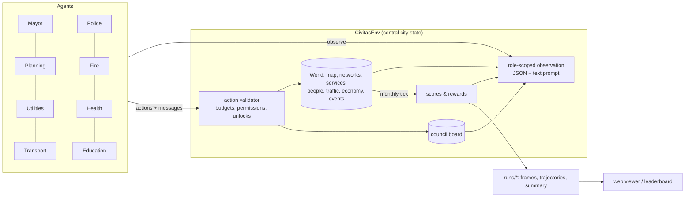

# How the simulation works

The city simulation behind the benchmark: the central state agents act on, the simulated systems, building
tiers, each role's actions, the scores and region mode. Which city-builder mechanics exist is
tracked in [MECHANICS.md](MECHANICS.md).

Contents:

- [Architecture](#architecture)
- [The simulation](#the-simulation)
- [Building tiers](#building-tiers)
- [Roles and actions](#roles-and-actions)
- [Scores (0–100)](#scores-0100)
- [Region mode: cities that trade and specialise](#region-mode-cities-that-trade-and-specialise)

## Architecture

**The central state.** `CivitasEnv` is the hub. It owns the `World` (the single source
of truth), the council board, each role's memory (the results of its last turn and its
notes to self) and the scores. Agents never touch the world directly. Each month every
role observes and acts in turn order (later roles see what earlier roles just did), then
`end_month()` simulates the month and recomputes the scores. Each role's reward is the
change in score.

Every observation is available as structured JSON (for RL policies and remote agents)
and as a rendered text prompt (for LLMs). Everyone sees the same city summary, the top
complaints, the finances, events, forecasts and council messages; each role also gets a
detailed section on its own system (its buildings with load vs capacity, problem hotspots
with coordinates, suggested sites) and, except the mayor, the ASCII map. Other systems
only appear as summaries, so agents have to talk to each other.

**Five ways to connect an agent.** All use the same actions:

| kind | what it is |
|---|---|
| `llm` | Any OpenAI-compatible model (Arcee by default). It gets a system prompt with the rules and action docs, plus the observation text, and replies with JSON. |
| `fleet` | A tool-calling model: a short briefing, then look-up and action tools in a loop, with a city plan and memory between turns. See [Agent fleets](FLEETS.md). |
| `scripted` | Rule-based baselines. They read only the observation, so they are fair references and a source of demonstration data. |
| `remote` | Any external process, in any language, over HTTP: `GET /api/live/turn?role=planning`, then `POST /api/live/act`. See `examples/remote_agent.py` and `configs/remote.toml`. |
| RL | `env.reset()` / `env.step({role: Decision})` (PettingZoo-style), with `env.tensor_observation()` returning a 14×H×W grid and a feature vector. See `examples/rl_loop.py`. |

## The simulation

- **Zones and levels.** Residential (R), commercial (C), industrial (I) and office (O)
  zones develop by themselves when there is demand. Each level needs more of the city:
  L1 road access + power, L2 water, L3 sewage + garbage pickup + land value 40%, L4 a
  school in reach (homes) or skilled workers (jobs) + land value 58%, L5 land value 75% +
  low crime + a park nearby. Low-density zones stop at L2; high density goes to L5 (up to
  240 residents or 140 office jobs per tile). Industry stops at L3 unless it is high-tech.
- **People.** Residents are tracked as an age × education vector (children, teens, adults,
  seniors × none, elementary, high school, university). Migrants fill new housing, people
  age and die, and students only graduate when they have a school seat. Jobs need education:
  offices and high-tech want graduates, over-educated workers take lower jobs.
- **Wealth and households.** Homes are low, middle or high income depending on land value
  when they are built. Wages minus rent is what households spend in shops; rich households
  pay more tax, care more about pollution, crime and noise, and leave first when unhappy.
- **Industry types.** Industry zoned on natural resources becomes farms (fertile soil),
  sawmills (forest), mines (ore) or oil fields; resources run out. Educated cities attract
  high-tech industry.
- **Demand** depends on jobs vs. workers, taxes, happiness, commute times, household
  spending and export demand. Big cities need a train station or harbour, and enough parks,
  or residential and commercial demand is capped.
- **Utilities.** Every connected road network is its own grid for power, water and sewage.
  Facilities serve the network they touch, nearest buildings first. Pumps and sewage
  facilities sit on the riverbank, and clustered pumps, outlets, towers and turbines lose
  output (see [Building tiers](#building-tiers)). Plants lose output after five years unless overhauled;
  wind output follows a wind map. Shortfalls are covered by costly imports from the region
  (the mayor can stop them) and surplus power is sold.
- **The river** flows north to south. Sewage outlets and riverside industry pollute it
  downstream: pumps below an outlet deliver dirty water. Treatment plants remove 80% (advanced
  treatment 95%).
- **City services** (police, fire, clinics and hospitals, schools, garbage trucks,
  shelters) cover buildings they can reach along the road network within their radius, up
  to their capacity, scaled by the department's funding level. Crime grows with
  unemployment, density, low education and low land value; uncovered fires spread;
  uncollected garbage piles up; pollution, dirty water and garbage make people sick (sick
  workers stay home); deaths need cemetery space or a crematorium; landfills fill up
  (recycling centres don't).
- **Traffic.** Workers commute from home to the busiest job areas along shortest road
  paths (a gravity model); trucks carry goods to the highway, train stations and the
  harbour. Load over capacity means congestion: longer commutes, noise, exhaust, and slower
  police, fire and ambulances. Avenues and highways carry more; bus lines take trips off
  the road.
- **Trade and businesses.** Industry makes goods and raw materials; shops need goods.
  Surpluses are exported and shortfalls imported, limited by freight capacity. Every shop,
  factory and office has a profit margin (customers, taxes, shortages, traffic, crime);
  six months of losses and it closes.
- **Happiness** is a weighted sum of 14 needs (power, water, sewage, garbage, safety,
  health, education, commute, leisure, noise, pollution, tax, affordability, jobs). The
  needs that cost the most happiness become the **complaints feed**. **Approval** follows
  happiness and taxes; 12 months below 30% and the mayor loses the recall election.
- **Mixed use** (M zones) puts shops below flats; **historic listings** freeze a
  building's level and add land value and tourists; **soil pollution** builds up under dirty
  industry, landfills and coal plants, fades very slowly, and hurts health, land value and
  farms (the health department can clean it); **wind** changes every month around a
  westerly and pushes air pollution downwind; **seasons** raise power demand in winter
  (and slow the roads with snow), water and fire risk in summer, and move tourism.
- **Metro**: stations serve 5 tiles around them; lines between stations carry trips
  three times faster than driving, immune to jams. Hospitals, universities, stadiums
  and casinos cover 2×2 tiles, airports 3×3 (x, y is the top-left tile).
- **Casinos and airports**: a casino gives low-skill jobs and gamblers who pay a gambling
  tax, but raises crime around it; an airport adds freight, tourists and air links.
- **Events** come from the seed: a river flood (forecast 3 months ahead; levees protect,
  shelters save lives), a heatwave, a recession and a factory offer the mayor must accept
  or decline (jobs and a bonus vs. heavy pollution).
- **Milestones** at 1k / 5k / 10k / 20k residents pay a reward and unlock buildings (high
  density, offices, avenues, high schools... then hospitals, universities, train stations,
  hydro dams, stadiums, the harbour... then monuments). Landmarks raise land value and
  bring tourists.
- **Money.** Taxes (per sector, with district modifiers), fares, trade fees, tourism and
  power sales come in; upkeep of roads, plants and service buildings (times funding
  levels), policies, imports and loan interest go out. Departments can only spend what the
  mayor gives them. Twelve months in a row with a negative treasury means bankruptcy.

All balance numbers live in `civitas/sim/catalog.py`. You can override them per config
with `[game.balance]`.

## Building tiers

Most service and utility buildings belong to a ladder
(`catalog.TIER_LINES`). Higher tiers unlock at the Town (1k), City (5k) and Metropolis (10k)
milestones. They are bigger buildings with much more output per dollar of upkeep, so a
growing city replaces a cluster of small buildings with a few large ones. Each cell below
shows the milestone, the main output, the build cost and the upkeep per month.

| line | tier 1 | tier 2 | tier 3 |
|---|---|---|---|
| pump (riverbank) | water pump: 250 water, $1,500, $25 | pumping station (1k): 650, $4,000, $45 | water works (10k, 2×2): 2,000, $12,000, $100, filters dirty river water |
| tower | water tower: 120 water, $2,200, $30 | inland water plant (5k): 600, $7,000, $70 | |
| outlet (riverbank) | outlet: 250 sewage, raw, $1,200, $15 | treatment plant (1k): 700, removes 80%, $5,000, $50 | advanced treatment (10k, 2×2): 2,000, removes 95%, $14,000, $110 |
| coal | coal plant: 250 power, pollution 25, $4,000, $80 | advanced coal (5k): 500, pollution 12, $9,000, $120 | |
| gas | gas plant: 200 power, pollution 10, $6,500, $60 | combined cycle (5k): 450, pollution 6, $12,000, $90 | |
| wind | wind turbine: 40 power, $2,500, $12 | advanced turbine (1k): 100, $5,000, $20 | |
| solar | solar farm: 70 power, $5,000, $15 | solar plant (10k, 2×2): 400, $16,000, $50 | |
| landfill | landfill: collects 450/mo, fills at 30,000, $2,000, $30 | recycling centre (1k): 900, never fills, $6,000, $50 | waste complex (10k, 2×2): 3,000, never fills, +60 power, $20,000, $150 |
| cemetery | cemetery: 30/mo, 2,500 plots, $1,500, $12 | crematorium (1k): 120/mo, no plots, $5,000, $35 | |
| clinic | clinic: capacity 2,500, radius 10, $2,000, $40 | hospital (5k, 2×2): 9,000, r14, $8,000, $120 | medical centre (10k, 2×2): 22,000, r20, $20,000, $220 |
| police station | station: 4,000, r14, 25 cells, $2,500, $55 | police HQ (5k): 14,000, r22, 100 cells, $9,000, $130 | |
| jail (1k) | jail: 250 inmates, $4,000, $45 | prison (10k, 2×2): 1,200, $14,000, $120 | |
| fire station | station: capacity 260, 5 call-outs, r14, $2,500, $55 | fire HQ (5k): 900, 15 call-outs, r20, $9,000, $130 | |
| elementary | school: 450 seats, $2,500, $45 | large elementary (1k): 1,200, $6,000, $80 | |
| high school (1k) | school: 700 seats, r22, $5,000, $75 | large high school (5k): 2,000, r26, $11,000, $130 | |

The **nuclear plant** (10k, map character `u`) is a new single-tier building. It is a 2×2
plant on the riverbank that makes 2,000 clean power for $40,000 and $400/mo, and it draws
100 water for cooling from its road network. The crematorium has its own character, `z`.
Every other tier keeps its line's character, and frames carry the tier in the per-tile
`levels` string. Hydro dams, incinerators, universities, libraries and shelters have a
single tier.

- **Build a tier directly.** Every facility build action (power, water, sewage and service
  buildings) takes `"tier": n` (counted within the line, 1 = base), or a tier name as `kind`:
  `{"type":"build_water","kind":"pumping_station","x":29,"y":24}`,
  `{"type":"build_police_station","kind":"police_hq","x":14,"y":25}`,
  `{"type":"build_cemetery","tier":2,...}`. Nuclear is `build_power_plant` with
  `kind: "nuclear"`. `kind: "treatment"` and `build_hospital` still work; they build tier 2
  of their lines.
- **Upgrade in place.** `{"type":"upgrade_facility","x":..,"y":..,"module":"tier"}` moves a
  building up one tier. It costs the price difference × 1.2 and keeps the building's age
  and modules. A 2×2 tier grows into free tiles around the building (the top-left tile may
  move), and the action fails with a clear message if none are free. Outlets become
  treatment plants and clinics become hospitals. An expansion adds 50% of the current
  tier's output.
- **Crowding.** Production buildings of the same group lose 15% output for each neighbour
  within the group's radius, down to a floor of 40%. A neighbour of any tier counts. The
  groups are pumps (4 tiles), outlets (4), water towers (5) and wind turbines (2, on top of
  the wind map). Coal, gas, solar and nuclear plants don't crowd. One water works beats
  eight pumps on one stretch of river.
- **Downtown.** Level 4–5 buildings get only 60% of the police, fire and health cover that
  tier-1 buildings give. A tier-2+ building in range gives them full cover.
- **What agents see.** The utilities section shows the crowding for each group, the
  observation offers the best upgrades with their real gains, service sections report
  downtown tiles without tier-2 cover, and suggested sites include riverbank spots with
  room for a 2×2 building. The windy, pump and sewage site lists put uncrowded spots first and mark
  crowded ones (`near 1 turbine`). `World._metrics()` records `tiers` (count per line and tier)
  and `downtown_uncovered`.
- **Overrides.** Use `"TIERS.<line>.<tier>.<field>"`, e.g.
  `"TIERS.pump.2.water" = 800` in `[game.balance]`, a nested `[game.balance.TIERS.pump.2]`
  table, or `--set game.balance.TIERS.pump.2.water=800`. Tier 1 is the same dict as the
  `CATALOG` / `SERVICES` entry, so `"CATALOG.pump.water"` still works. Tiers 2+ are
  copies, so a tier-1 override doesn't reach them. The crowding and downtown rules use
  `CROWD_STEP`, `CROWD_FLOOR`, `T1_DOWNTOWN` and `DOWNTOWN_LEVEL`.

## Roles and actions

| role | actions |
|---|---|
| mayor | `set_tax` (R/C/I %), `allocate_budget`, `set_funding` (department 50–150%), `enact_policy` / `repeal_policy` (city-wide or per district), `set_district_tax`, `accept_offer` / `decline_offer`, `set_service_imports`, `take_loan`, `repay_loan` |
| planning | `build_road`, `zone` (R/C/I/O/M, low or high density), `dezone`, `build_park`, `build_landmark` (plaza/stadium/monument), `build_casino`, `paint_district`, `specialize_district`, `preserve_historic` / `delist_historic`, `bulldoze`, `demolish` |
| utilities | `build_power_plant` (coal / gas / solar / wind / hydro / nuclear), `build_water` (pump / tower), `build_sewage` (outlet / treatment), `upgrade_facility` (tier / filter / expansion / overhaul), `demolish` |
| transport | `upgrade_road` (avenue / highway), `create_bus_line`, `remove_bus_line`, `set_fare`, `build_metro_station`, `create_metro_line`, `remove_metro_line`, `build_train_station`, `build_harbour`, `build_airport`, `build_connector` (region mode), `upgrade_facility`, `demolish` |
| police | `build_police_station`, `build_jail`, `upgrade_facility`, `demolish` |
| fire | `build_fire_station`, `build_levee`, `build_shelter`, `upgrade_facility`, `demolish` |
| health | `build_clinic`, `build_hospital`, `build_landfill`, `build_incinerator`, `build_cemetery` (tier 2: crematorium), `clean_soil`, `upgrade_facility`, `demolish` |
| education | `build_school` (elementary / high / university), `build_library`, `upgrade_facility`, `demolish` |

Policies: recycling, neighborhood watch, smoke detectors, education boost, industry
filters, high-rise ban, free transit. Every role can post `messages` to the council board
(to `all` or a role) and keep `notes` for its next turn. Invalid actions are rejected with
a helpful message and counted in the invalid-action rate. Every facility build action (power,
water, sewage and service buildings) also takes a `tier` (see [Building tiers](#building-tiers)).

## Scores (0–100)

| score | built from |
|---|---|
| **city** | ½ population (√ of pop / 30k) + ½ quality: happiness, finances, power/water/sewage coverage, environment, employment, safety, health, education. Quality counts only once the city has people; bankruptcy halves the total, a lost recall election cuts it by a quarter. |
| **mayor** | revenue, solvency, net worth, happiness, approval, and how much of the money given to departments actually got spent (spending over the last 12 months against the department funds held idle, averaged over those months) |
| **planning** | growth, share of zoned land that developed, demand balance, land value, road efficiency, employment |
| **utilities** | power, water and sewage coverage, spare capacity in the 10–60% range, cost efficiency, clean-energy share (solar, wind, nuclear), pollution near homes, water quality, river quality |
| **transport** | commute time, share of congested road, bus share of trips, cost per resident |
| **police** | crime at homes, coverage, jail space, cost per resident |
| **fire** | buildings lost to fire, coverage, cost per resident |
| **health** | health of residents, garbage at homes, clinic coverage, landfill room, deathcare, cost |
| **education** | enrolment, skilled jobs filled, share of adults with high school+, cost |

Every score is a function of the monthly history, so the same code produces the final
benchmark number, the live "your score" shown to agents, and dense RL rewards.

## Region mode: cities that trade and specialise

`configs/region.toml` (two cities) and `configs/region_trio.toml` (three) run a region:
`[game] region = true` and `cities = [...]` from north, south, east, west, southeast,
southwest. Every city has its own full team; roles are named `north.planning`,
`south.mayor` and so on. Agents configured for a base role (`[agents.planning]`) play it
in every city, `[agents."south.planning"]` sets one city.

- **The river** runs through the north-south column: upstream sewage and runoff arrive
  in the next city's water.
- **Links.** Transport departments build `build_connector` (highway or rail) on the map
  edge facing a neighbouring city, with a feeder road inland; the link opens when both
  cities have built their side. Any two cities with a harbour are linked by boat, any two
  with an airport by air. Each link type has a goods and a people capacity.
- **Commerce.** Every month, over those links, surplus goods and raw materials go to
  cities that are short (the seller collects part of the value; the buyer avoids costly
  imports and shortages), unemployed workers commute to open jobs, and residents visit
  their partners' casinos, landmarks and historic districts.
- **Specialisation** follows from each city's land and people and is reported to every
  agent: mining & farming (natural resources, pollutes the soil), high tech (needs
  graduates and raw materials), gambling (casinos: little education needed, crime, tourist
  money), tourism, trade (freight), education. Complementary cities gain the most from links.
- **Diplomacy.** All teams share one council board (address `"south"`, `"north.mayor"` or
  `"all"`) and mayors can agree power/water deals (`offer_deal`, `accept_deal`, `cancel_deal`).
- **Power and water deals.** A deal moves a fixed amount of capacity from the seller's
  supply to the buyer's every month, for a price per unit, until its term ends or either
  mayor cancels it; no link is needed. A city short of power or water imports at most 25%
  of its demand at $1.50 / $0.80 a unit a month (+1% per 1,000 residents), and while it
  imports no empty lot connects, so it stops growing. Spare power earns $0.25 a unit
  (sold to the outside region) and spare water nothing. A deal priced between the two
  pays both sides. Once the buyer has room again it only moves money from one city to the
  other. Each mayor's observation (`RegionEnv.deal_opportunities`) names a deal
  opportunity when one city is at 90% or more of its own supply (imports left out) while
  another has spare beyond 90%. It gives the amount that brings the buyer back to 90%
  (at most the seller's spare, `offer_deal`'s 2,000 units and what the buyer can afford),
  a price halfway between the seller's floor and the buyer's
  import price, a term of two mayor turns and the exact `offer_deal` call. Need and spare
  count the deals the supply doesn't show yet (accepted this month, the city's own open
  offers, offers to it worth taking), so two sellers aren't both sent to cover one need.
  An offer to the city says whether it is worth taking (`RegionEnv.deal_check`): cheaper
  than its imports, not already covered by its other deals, the seller still has some
  capacity to sell, and affordable (the deal's cost beyond the imports it replaces, over its term,
  within the treasury above the fleet's reserve plus last month's surplus). An active deal
  says when it ends and whether to cancel it. An offer not accepted within two mayor turns
  (`2 x act_every` months) expires (status `expired`), and `accept_deal` refuses an offer
  whose seller has no capacity left (its own supply no longer above its demand) or whose
  need the buyer's deals accepted this month already cover. The scripted mayors follow these lines: they accept fair offers
  (the second of two for one need only if need is left), cancel the others and offer each
  opportunity.

Each city is scored on its own; the region score is their average.

| scripted, 120 months | city | population | deals run / offered |
|---|---:|---:|---:|
| `region.toml` seeds 0–2, before deals | 75.96 ± 1.56 | 27,175 | 0 / 0 |
| `region.toml` seeds 0–2, with deals | 77.19 ± 1.28 | 29,159 | 20 / 24 |
| `region.toml` seeds 0–7, before deals | 76.26 ± 1.15 | 27,507 | 0 / 0 |
| `region.toml` seeds 0–7, with deals | 76.76 ± 1.05 | 28,434 | 18 / 22 |
| `region_trio.toml` seeds 0–2, before deals | 76.13 ± 0.78 | 40,755 | 0 / 0 |
| `region_trio.toml` seeds 0–2, with deals | 77.10 ± 1.00 | 42,004 | 51 / 67 |
| civitas-v2 (the scripted mayor reclaims idle money): `region.toml` seeds 0–2 | 76.86 ± 1.83 | 28,479 | |
| civitas-v2: `region_trio.toml` seeds 0–2 | 75.75 ± 0.46 | 39,444 | |
| civitas-v2, take-backs with hysteresis: `region.toml` seeds 0–2 | 76.96 ± 0.99 | 28,604 | |
| civitas-v2, take-backs with hysteresis: `region_trio.toml` seeds 0–2 | 76.22 ± 1.15 | 40,095 | |
| `region.toml` seeds 0–2, deal checks | 77.35 ± 1.14 | 29,429 | 21 / 24 |
| `region.toml` seeds 0–7, deal checks | 76.84 ± 1.10 | 28,660 | 18 / 22 |
| `region_trio.toml` seeds 0–2, deal checks | 76.40 ± 0.15 | 41,525 | 41 / 48 |
| `region_trio.toml` seeds 0–7, with deals / deal checks | 77.02 ± 0.71 / 76.71 ± 0.64 | 42,346 / 42,383 | – / 36 / 42 |

The deals are small money: $650–2,200 paid per two-city game, with most deals running
1–2 months before the buyer's own plant gives it room. The gain is within seed noise
(7 of 8 seeds up, seed 7 down 2.3). The deal checks (pending deals counted, offers
expiring, affordability, a seller with nothing left refused) leave the two-city numbers up
slightly; three cities make fewer deals (counting pending offers stops two sellers both
covering one need, which had given buyers extra capacity), the same population on seeds
0–7 and a score 0.3 lower, within noise. Refusing a seller with less capacity than the
amount (not only none) cost 0.8 on `region.toml` seeds 0–2, so a partly short seller still
sells and ends the deal itself once its demand reaches its own supply. Single-city play is unchanged. Fleet agents play region
roles too (see [Regions](FLEETS.md#regions)).
